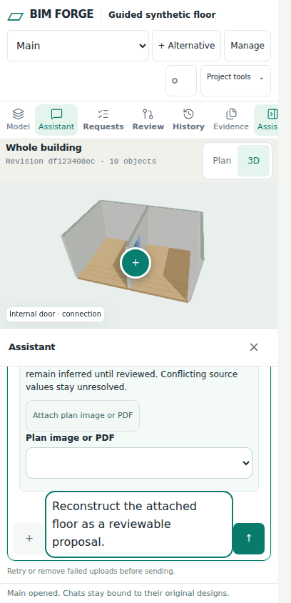

# Canvas Studio workspace

Issue: https://github.com/Frederik91/bim-forge/issues/241

## Plan and ownership

- [x] Ground: trace workspace, viewer, request conversation, composer and review authority.
- [x] Sketch: compare complete React shell ownership with incremental React mounts.
- [x] Agree: implement the maintainer-selected Canvas Studio direction; all left rail tools open side panels. Model explorer is full height, resizable and independently scrollable.
- [x] Implement: React chrome/tray, assistant-ui transcript, Tailwind/shadcn controls and build integration.
- [ ] Verify: isolated coding VM validation/build, existing behavior tests and real desktop/narrow browser evidence.
- [ ] Hand back: visible run summary, validator output and draft PR; human controls readiness and merge.

## Existing flow and selected boundary

`room-app.ts` binds the existing control IDs synchronously, polls persisted request conversations and controls project/request/accepted-model state. `ModelViewer` lazily owns one Babylon engine/canvas; its root is moved to the active model host. `RequestComposer` owns the durable-request form, uploads, mentions and captured model context. `request-chat-status.ts` owns proposal identity matching, decision gates and scroll helpers.

The complete-shell candidate would move every existing model/form/context host into React at once. It creates a large migration obligation because legacy controllers synchronously bind those hosts, and replacing them could lose camera, GPU, draft or selection state. The selected candidate gives React exclusive ownership of the new chrome, proposal tray and chat transcript, leaving existing model, source/composer and domain controllers authoritative. Both independent architecture readers selected this boundary. No cross-family model judge was available; the parent reviewed the existing call sites and selected the converged design.

The shell worker owns `workspace-shell.ts`, `workspace-react.tsx`, `canvas-studio.css` and workspace browser tests in its isolated worktree. The chat worker owns `request-chat.ts`, `request-chat-react.tsx` and chat browser tests in its isolated worktree. Parent owns HTML/bootstrap, package/build/TypeScript configuration, shadcn primitives and integration. Workers do not share a checkout.

## Contracts

Chrome mounts synchronously before required DOM lookup. Rail buttons use the real existing command IDs, with no duplicate proxy commands. `WorkspaceShell` remains the sole owner of panel open/close, width, focus return and ARIA state. Left tool pages reuse their existing DOM nodes in the left tools host; request/review and assistant remain contextual surfaces. No left rail tool opens a popup. Long model navigation retains its own scroll and the model remains visible while panels are used.

`RequestChat` retains `show`, `close`, `setDisabled`, `setOffline`, `setProposalReview` and the `conversation` getter. Its React transcript uses assistant-ui ExternalStoreRuntime over existing immutable snapshots. Existing composer and backend transport remain in place. Edit/regenerate/branching capabilities are not enabled without backend semantics.

The exact `RequestChatProposalReview` accepted by `updateChatProposalCard` feeds both tray and chat. Commands recheck current message/request/proposal-revision identity before calling the existing decision path. Neither surface creates proposal readiness, validation success or acceptance facts. Evidence uncertainty and source pins remain inspectable.

## Acceptance and model delta

This change modifies presentation, not model schemas, geometry operations or accepted-model storage. The model delta is zero until an explicit existing backend acceptance command succeeds. Verify source downloads/uploads, request switching, stale/offline/disabled decisions, details/focus/scroll restoration, model selection and 2D/3D behavior. Browser checks must exercise the compiled shipped CSS and JS, not uncompiled Tailwind input. No production data or deployment change is authorized here.

## Run ledger

| Attempt | Evidence | Result |
| --- | --- | --- |
| Preparation | Current main `8a7bb02`; isolated VM reachable; 70 GiB root free; Node 24.22.1; dependency install | Ready; no app checks yet |
| 1 | Strict TypeScript, policy validation and production build | Passed; production browser bundle built |
| 1 | Real chat/workspace/shipped-app browser suites | Failed: grid placement overlaps model controls; explorer opening does not reserve width; phone history below required height; external runtime updates history after facade anchoring. Logs retained on coding VM. |
| 2 | Strict validation/build and real browser suites | Validation/build and all 6 chat + 7 workspace checks passed. Shipped-app tests exposed a fixture calling scope-only parameter editing without a scope, and the existing acceptance helper matched both the new tray and chat buttons. The fixture now uses the supported single-room rectangle operation; existing chat acceptance is explicitly scoped, with tray acceptance covered independently. |
| 3 | Strict validation/build and 17 real browser checks | Validation/build passed. 16 browser checks passed, including real attachment, single-canvas lifetime, zero accepted-model changes before review and explicit tray acceptance changing only `door-entry`. Existing guided-floor phone PDF attachment check timed out waiting for the file-ready status at `floor-plan-guide-browser.test.ts:156`. Stopped further implementation/reruns under AGENTS.md three-attempt rule. |

## Remaining work before readiness

- Complete phone PDF attachment qualification. The VM has no `/usr/bin/pdfinfo`, `/usr/bin/pdftoppm` or `/usr/bin/pdftotext`, which the existing source preparer requires. Preserve the complete guided-floor reconstruction, source retention, restart and alternative-target assertions; do not label a missing-prerequisite run as a passing PDF flow.
- Parent conversation-offline state must gate both tray publication and tray actions. Currently a later controls refresh can republish a tray hidden by a conversation refresh failure while chat correctly remains offline.
- Tray Revise must reopen the request/assistant context before focusing the composer after Sources & checks has opened review.
- Full `npm test` remains unrun for this implementation. No IFC runtime, live provider, production image, deployment or real-device touch qualification is claimed.
- Draft PR only; no merge or deployment. The side panel and chat changes are not ready for approval until these issues are resolved and the required checks pass.

## Review evidence

Runtime source tested: `5d267e6`. Later handback edits contain documentation and synthetic screenshots only.

```text
npm run validate
Strict TypeScript valid. 331 source file(s) checked.
tsc --noEmit: passed
Policy valid. 0 changed file(s) checked.
npm run build:demo: passed
Browser checks: 17 total, 16 pass, 1 fail, 0 skipped
```

The new shipped-app check proves source upload, one surviving canvas, baseline preservation before review, and explicit tray acceptance with exactly one modified entity (`door-entry`) and no additions/removals. All six chat checks and seven workspace checks passed. The existing guided-floor check reached desktop reconstruction, source persistence, explicit Main acceptance, an alternative and restart recovery before failing at phone PDF file readiness. This does not establish PDF, IFC runtime, provider or production-image qualification.




## Sources

- React incremental adoption: https://react.dev/learn/add-react-to-an-existing-project
- assistant-ui external store: https://www.assistant-ui.com/docs/runtimes/custom/external-store
- assistant-ui custom tool cards: https://www.assistant-ui.com/docs/tools/tool-ui
- shadcn button registry: https://ui.shadcn.com/r/styles/new-york-v4/button.json
- Tailwind build integration: https://tailwindcss.com/docs/installation/using-postcss

Installed package types and server runs determine the supported integration; documentation review alone does not qualify the implementation.
