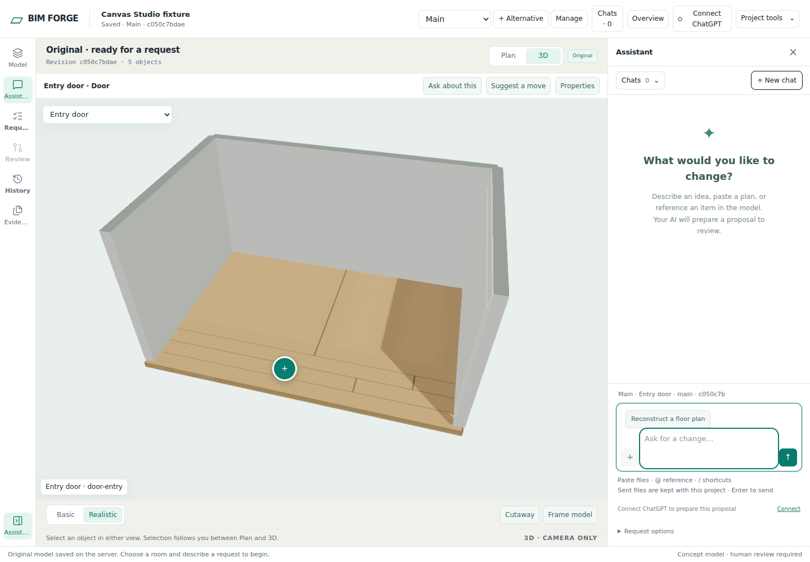
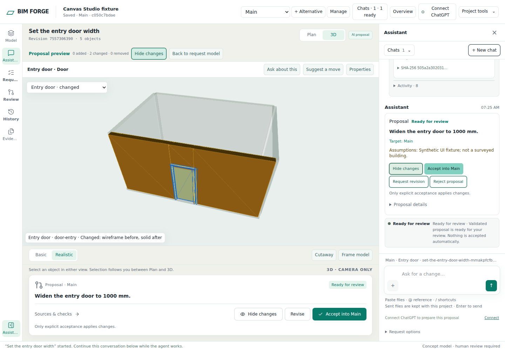
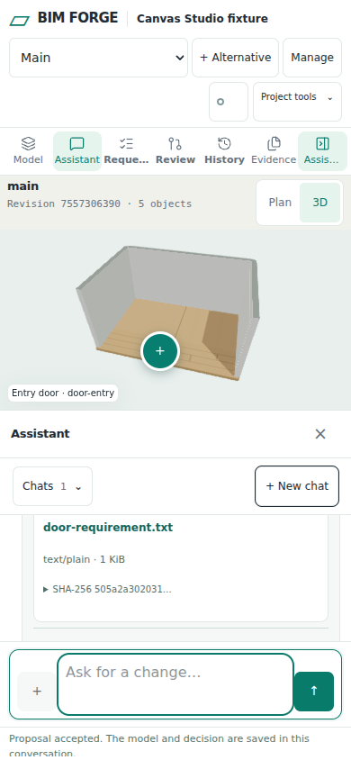
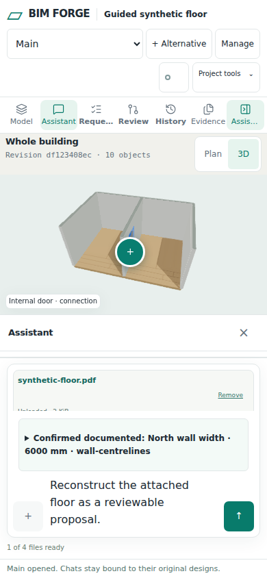

# Canvas Studio workspace

Issue: https://github.com/Frederik91/bim-forge/issues/241

## Plan and ownership

- [x] Ground: trace workspace, viewer, request conversation, composer and review authority.
- [x] Sketch: compare complete React shell ownership with incremental React mounts.
- [x] Agree: implement the maintainer-selected Canvas Studio direction; all left rail tools open side panels. Model explorer is full height, resizable and independently scrollable.
- [x] Implement: React chrome/tray, assistant-ui transcript, Tailwind/shadcn controls and build integration.
- [x] Verify: isolated coding VM validation/build, full root suite and real desktop/narrow browser evidence.
- [x] Hand back: visible run summary, validator output and draft PR; human controls readiness and merge.

## Existing flow and selected boundary

`room-app.ts` binds the existing control IDs synchronously, polls persisted request conversations and controls project/request/accepted-model state. `ModelViewer` lazily owns one Babylon engine/canvas; its root is moved to the active model host. `RequestComposer` owns the durable-request form, uploads, mentions and captured model context. `request-chat-status.ts` owns proposal identity matching, decision gates and scroll helpers.

The complete-shell candidate would move every existing model/form/context host into React at once. It creates a large migration obligation because legacy controllers synchronously bind those hosts, and replacing them could lose camera, GPU, draft or selection state. The selected candidate gives React exclusive ownership of the new chrome, proposal tray and chat transcript, leaving existing model, source/composer and domain controllers authoritative. Both independent architecture readers selected this boundary. No cross-family model judge was available; the parent reviewed the existing call sites and selected the converged design.

The shell worker owns `workspace-shell.ts`, `workspace-react.tsx`, `canvas-studio.css` and workspace browser tests in its isolated worktree. The chat worker owns `request-chat.ts`, `request-chat-react.tsx` and chat browser tests in its isolated worktree. Parent owns HTML/bootstrap, package/build/TypeScript configuration, shadcn primitives and integration. Workers do not share a checkout.

## Contracts

Chrome mounts synchronously before required DOM lookup. Rail buttons use the real existing command IDs, with no duplicate proxy commands. `WorkspaceShell` remains the sole owner of panel open/close, width, focus return and ARIA state. Left tool pages reuse their existing DOM nodes in the left tools host; request/review and assistant remain contextual surfaces. No left rail tool opens a popup. Long model navigation retains its own scroll and the model remains visible while panels are used.

`RequestChat` retains `show`, `close`, `setDisabled`, `setOffline`, `setProposalReview` and the `conversation` getter. Its React transcript uses assistant-ui ExternalStoreRuntime over existing immutable snapshots. Existing composer and backend transport remain in place. Edit/regenerate/branching capabilities are not enabled without backend semantics.

The exact `RequestChatProposalReview` accepted by `updateChatProposalCard` feeds both tray and chat. Commands recheck current message/request/proposal-revision identity before calling the existing decision path. Neither surface creates proposal readiness, validation success or acceptance facts. Evidence uncertainty and source pins remain inspectable.

## Acceptance and model delta

This change modifies presentation, not model schemas, geometry operations or accepted-model storage. The model delta is zero until an explicit existing backend acceptance command succeeds. Verify source downloads/uploads, request switching, stale/offline/disabled decisions, details/focus/scroll restoration, model selection and 2D/3D behavior. Browser checks must exercise the compiled shipped CSS and JS, not uncompiled Tailwind input. No production data or deployment change is authorized here.

## Run ledger

| Attempt | Evidence | Result |
| --- | --- | --- |
| Preparation | Current main `8a7bb02`; isolated VM reachable; 70 GiB root free; Node 24.22.1; dependency install | Ready; no app checks yet |
| 1 | Strict TypeScript, policy validation and production build | Passed; production browser bundle built |
| 1 | Real chat/workspace/shipped-app browser suites | Failed: grid placement overlaps model controls; explorer opening does not reserve width; phone history below required height; external runtime updates history after facade anchoring. Logs retained on coding VM. |
| 2 | Strict validation/build and real browser suites | Validation/build and all 6 chat + 7 workspace checks passed. Shipped-app tests exposed a fixture calling scope-only parameter editing without a scope, and the existing acceptance helper matched both the new tray and chat buttons. The fixture now uses the supported single-room rectangle operation; existing chat acceptance is explicitly scoped, with tray acceptance covered independently. |
| 3 | Strict validation/build and 17 real browser checks | Validation/build passed. 16 browser checks passed, including real attachment, single-canvas lifetime, zero accepted-model changes before review and explicit tray acceptance changing only `door-entry`. Existing guided-floor phone PDF attachment check timed out waiting for the file-ready status at `floor-plan-guide-browser.test.ts:156`. Stopped further implementation/reruns under AGENTS.md three-attempt rule. |
| Maintainer continuation | Explicit instruction on 2026-10-31 | Maintainer overrode the attempt limit for this task, authorized missing tools and fixes, and required the full suite; draft PR only, no merge or deployment. AGENTS.md itself remains unchanged. |
| Resume red | Two shipped-UI regressions before fixes | Reproduced offline tray republication after a controls refresh and a hidden composer after Revise from Sources & checks. Both assertions failed on the original implementation. |
| Resume build | Regression control type narrowing | Typecheck rejected calling click on a possible SVG element. Narrowed the retained control to HTMLButtonElement. A prematurely started browser run was aborted and excluded; its log was retained separately. |
| Resume browser | Parent state/dispatch fixes, Poppler 24.02.0 installed | Both regressions passed. Trace then isolated a fixture restart waiting on old HTTP connections; explicit fixture connection closure retained all restart/data assertions without increasing the timeout. The phone PDF workflow subsequently passed. |
| Resume consolidated | Complete browser checks | 19/19 passed, including source upload, offline and stale actions, focused refinement, long-tree/side-panel behavior, desktop/phone layouts, PDF confirmation and restart recovery. |
| Resume visual review | Phone toolbar bounds and touch targets | Added viewport/44px-target assertions; the original toolbar failed. Responsive grid layout passed all workspace checks without clipping the last control. |
| Final browser run | Implementation `cd652f2`, compiled shipped assets | Strict validation/build and all 19 browser checks passed, with no skips. Browser timeout termination and protected-file owner rejection also passed independently. |
| Full suite environment | Initial complete root run | Two immutable-tree tests failed under the VM's inherited umask 0002 because fixture files were group-writable. All other executed tests passed. A command-local umask 0022 made all four targeted deployment measurement checks pass; no validator or assertion changed. |
| Full suite final | Implementation `cd652f2`, command-local umask 022 | `npm test` exited 0. All six stages passed; main stage 842 pass/2 conditional skips and assets 21/21. Both skipped cases also passed independently under their required environments. |

## Maintainer follow-up

- Installed the existing PDF preparer's prerequisites (`pdfinfo`, `pdftoppm`, `pdftotext`, Poppler 24.02.0) on the isolated coding VM.
- Parent-owned conversation connectivity now gates tray rendering and all tray callbacks across unrelated controls refreshes. A matching successful conversation refresh restores the controls; late failures from another project cannot change this conversation's state.
- Chat and tray share one decision dispatcher. Revise reopens the request/assistant context and focuses the enabled composer without entering the asynchronous busy wrapper or losing unsent text. Accept/Reject still use the existing authoritative backend path.
- The browser fixture explicitly closes old HTTP connections during restart instead of waiting indefinitely for a browser connection pool. Existing source, baseline, alternative and restart assertions remain intact.
- Phone tools now use a wrapping grid with full touch targets. No rail control extends beyond the 320/390px viewport checks.
- Full `npm test` passed with command-local `umask 022`; the default umask and machine configuration are not changed globally. The browser timeout and protected-file owner cases skipped by the default run passed separately.
- No live provider, production-image, deployment or real-device touch qualification is claimed. Draft PR only; no merge or deployment.

## Review evidence

Historical initial runtime source: `5d267e6`. Follow-up implementation source: `cd652f232a4dc03934dceb4d4573b55500b9646b`. The final handback adds documentation and captured screenshots only. Reproducible commands, environment and results are in [qualification.txt](canvas-studio-241/qualification.txt).

```text
npm run validate
Strict TypeScript valid. 331 source file(s) checked.
tsc --noEmit: passed
Policy valid. 0 changed file(s) checked.
npm run build:demo: passed
Follow-up browser checks: 19 total, 19 pass, 0 fail, 0 skipped
npm test: exit 0; all six stages passed
Main stage: 844 total, 842 pass, 0 fail, 2 conditional skips
Assets: 21 total, 21 pass, 0 fail, 0 skipped
Conditional browser timeout and file-owner checks: 1 pass each, 0 skipped
```

The shipped-app check proves source upload, one surviving canvas, baseline preservation before review, and explicit tray acceptance with exactly one modified entity (`door-entry`) and no additions/removals. The guided-floor check now verifies PNG/PDF preparation, source-bound confirmation, unsent reload, explicit acceptance, As-is baseline, alternative-only partition delta, SQLite restart and revoking readiness when the confirmed source is removed. These are deterministic fixture outcomes, not live provider or production-image qualification.









The earlier failed phone screenshot remains retained as `canvas-studio-241/last-ui-state.png` alongside the historical run ledger.

## Sources

- React incremental adoption: https://react.dev/learn/add-react-to-an-existing-project
- assistant-ui external store: https://www.assistant-ui.com/docs/runtimes/custom/external-store
- assistant-ui custom tool cards: https://www.assistant-ui.com/docs/tools/tool-ui
- shadcn button registry: https://ui.shadcn.com/r/styles/new-york-v4/button.json
- Tailwind build integration: https://tailwindcss.com/docs/installation/using-postcss

Installed package types and server runs determine the supported integration; documentation review alone does not qualify the implementation.
