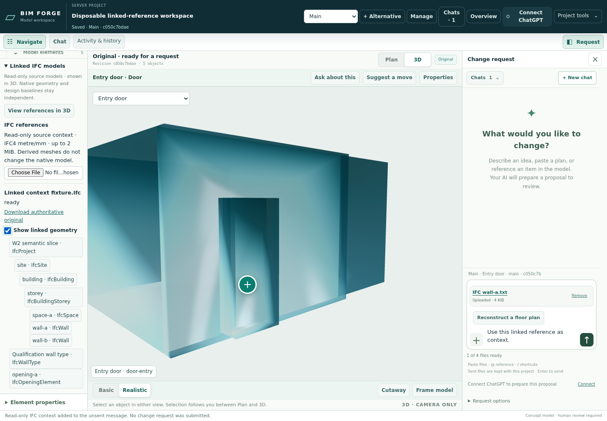
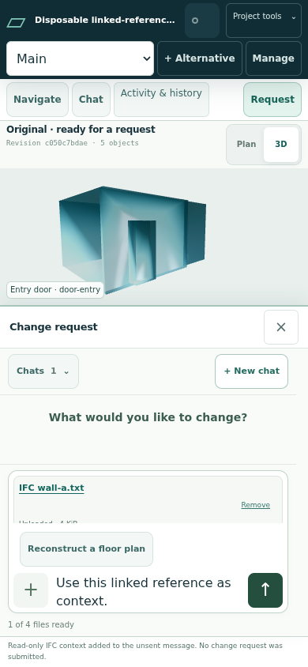

# Evidence and IFC workspace integration

Integration [#223](https://github.com/Frederik91/bim-forge/issues/223), parent #197.
Base: merged PR #215, `882a50b7599ff926fb0648c2e070c51a2cffccfd`.

## Sources and ownership

| Component | Reviewed source | Responsibility |
| --- | --- | --- |
| Floor-plan workflow, PR #222 | `8812815` | Chat action, source-bound measurement confirmation, recovery and baseline/alternative workflow |
| Dimension helper, PR #220 | `11c8e65` | Bounded complete-partition preview, conservative minimum clear spans and evaluated dependencies |
| Read-only IFC, PR #221 | `ecd18db` | Source retention, isolated conversion, artifact validation, hierarchy, properties and disposable render layer |
| ScriptBox integration | `ee2f694` | Typed guest method, atomic staging, frozen read/write scope and generated documentation |
| Parent | This branch | Single-viewer/panel/server mounts, test registration, combined qualification and paired preview publication |

Every component has an isolated worktree. The parent integrates original histories rather than copying partial final documentation commits.
The independent viewer benchmark (#192 / PR #214) is outside this change.

## User workflow and authority

Use **Reconstruct a floor plan** in the chat composer. Attach an image/PDF and confirm a known feature,
dimension provenance and whether it measures wall centrelines or a clear span. The confirmation is a user
assertion bound to the original source, not certification of the drawing or every inferred dimension.
The AI prepares a reviewable proposal. Acceptance stays explicit. **+ Alternative** retains an As-is
baseline and opens a separate writable target.

`model.previewRoomDimensionChange` drives a complete shared partition from a centreline span and
checks optional conservative clear spans. Unresolved measurements do not mutate the draft. Source
reference text grants no evidence freshness or write authority. Every stored change still passes the
existing snapshot and frozen-scope validators; no general parametric solver is introduced.

**Navigate → Linked IFC models** retains an original IFC and reports asynchronous preparation.
Hierarchy, original properties, source diagnostics and visibility stay beside the existing model.
Linked meshes use the same Babylon scene and canvas. Their selection is separate from native selection
and scope. **Reference in request** attaches a named source-context note with the pinned identity and
original object properties to the unsent composer, keeping machine identifiers out of the message field. It does not submit,
approve, import native objects or grant editing rights. IFC geometry is shown in 3D, with explicit
reference framing. Hover and selection use distinct outlines.

IFC conversion runs without network access in a separate hard-limited process/container. Only its
dedicated spool is writable; accepted models, application-private state, credentials and Docker sockets
are absent from converter mounts. Ready artifacts are validated and retained in application-private
storage. A configured spool is not a claim that the converter is healthy.

## Supported bounds

Floor reconstruction remains one rectangular storey tiled by supported rectangular rooms. Native
portable limits remain 100-item arrays, 32 revisions and 256 KiB. Centreline and clear spans cannot be
silently substituted.

The IFC path retains the reviewed small-fixture bounds: IFC4 metre/mm, 2 MiB original, 2,000 entities,
64 products, 50,000 vertices, 100,000 triangles and 8 MiB completed artifacts. Display/job identity must
equal the source occurrence identity at the display boundary. Full namespace/revision/hash/GlobalId
and occurrence transforms remain pinned. Source ownership and unsupported/lost information are
visible. This does not qualify arbitrary vendor exports, large hospitals, native IFC editing or survey
coordinate accuracy.

## Qualification and publication

Build/test only in bounded isolated server containers. Source/dependencies are read-only, tests use
network-none, and artifacts/cache/temp files live on `/ssd1`. Deterministic provider fixtures prove
application behavior separately from any live-provider interpretation check.

Parent evidence root: `/ssd1/bim-forge-qualification/issue223/`.
The first parent check at `8896658` passed root validation (286 TypeScript files), explicit 29-path
policy, browser build and 32 focused helper/guide/wall tests. This preliminary result does not qualify
the later server mounts, dimension bridge or combined browser workflow.

Combined acceptance must cover source upload/confirmation/recovery, proposal/explicit acceptance,
baseline/alternative isolation, real linked canvas picking and visibility, unsent-only references,
converter isolation/recovery and unchanged native accepted data. Inspect actual desktop/phone
screenshots. Register pure/ScriptBox tests in the root suite; the IFC browser command requires an
explicit disposable external converter spool and fixture, so it is invoked by the server harness.

Before publication retain exact source, commands, container inspections, logs, hashes and model delta.
Deploy paired static/runtime artifacts with rollback and accepted/source/auth preservation checks.
Do not merge new geometry/storage/security work without human approval.

### Attempt record

- Preparation: an isolated docs-only cherry-pick was aborted before product edits; full component
  histories were then integrated. No validator/test attempt ran during that correction.
- Parent check 1, `8896658`: validation, explicit policy, build and 32 focused checks passed.
- Parent check 2, `1b110b1`: strict lint passed; typecheck caught missing awaits in the new browser test's asynchronous repository restoration. No browser test ran; corrected the fixture.
- Parent check 3, `14422ff`: root validation, explicit policy, build and 49 focused checks passed. Browser setup stopped before tests because its generator requires a new output directory; removed the helper's premature directory creation.
- Parent check 4, same source: both shipped floor-plan/IFC workflows and all five chat cases passed. The existing workspace suite could not find its cached default browser; fixed only the harness's browser-cache environment.
- Parent check 5, same source: all 15 actual-browser checks passed, including desktop/phone layout, baseline/alternative isolation, linked canvas picking/visibility and no submission on reference.
- Screenshot inspection prompted compact IFC controls, a corrected reference-frame enable state and named source-context attachments instead of raw JSON in the message field. Final-source qualification follows.
- Parent check 6, `9140400`: root validation, explicit policy, build, 49 focused checks and all 15 browser checks passed with the refined UI. The full root suite passed 810 checks with two existing optional skips and one packaging failure: the Docker context allowlist omitted the new linked store/routes. Added the two explicit entries; no validator changed. Assets tests had not yet run because the root command stopped at that failure.
- Parent check 7, `e99740f`: root validation, explicit 41-path policy, build and 51 focused checks passed. Full `npm test` passed: 5 qualification-contract checks, 811 of 813 main checks (two existing optional skips) and all 21 asset checks. The source-only image preflight initially referenced the pre-squash approved commit, absent from the bounded bundle; corrected the preflight to the merged base and checked unchanged production dependency metadata against the actual approved base image.
- Parent check 8, same executable source: source-only image built with no pull/install and no new dependencies. Actual image plus a separate spool-only converter passed all three HTTP/security/conversion/recovery/preservation tests as UID 65032:33, under production app limits. Runtime/dependency file manifests were checked before enabling conversion.
- Publication and live-provider interpretation: pending at this receipt; recorded separately on issue #223 and the integration PR.

### Final source and retained evidence

Qualified executable source: `e99740fc952527f900bd891298248c9315417f18`.
Image: `bim-forge-preview-app:e99740fc952527f900bd891298248c9315417f18`,
ID `sha256:e56d752c1d5206a1a66ed4ff550410f250949a83e64ee9bc0ae4690e8bb13e93`.
Later receipt-only commits do not change executable files.

The image is a source-only layer over the exact already-qualified approved preview image
`sha256:c3497c848dceca6fbf01c08f64649a444e69cfe65570ffca63b2f4b36508bcc3`.
The lockfile and production dependency metadata match. This avoids reinstalling unchanged dependencies
on a nearly full root filesystem; it is a retained preview build path, not a replacement for the clean
repository Dockerfile. That Dockerfile and its context allowlist now include both new server modules.

The 15 browser checks ran on `9140400`; all UI/domain/server/guest/worker files are identical to the
final executable source. Only the Docker-context allowlist and receipt changed afterward. Browser source,
trace, screenshots and inspectable delta are retained under
`build-9140400048c17591899ad96254e0fa25cc9cabaf/browser-a06/`.
Final root/full/image/canary evidence is under `build-e99740fc952527f900bd891298248c9315417f18/`.
Containers had read-only roots/source/dependencies, no network, bounded CPU/memory/PIDs, and SSD-backed
private state, spool and artifacts. The actual image app has no Python mounts; the converter has no app
state, credentials, native database or Docker socket.

| Retained artifact | SHA-256 |
| --- | --- |
| Final `artifacts/full.log` | `bf78e019863c0f285159a239bbc1b37780982cfa13d56e8f050358bf35768519` |
| Actual-image `artifacts/image-canary.log` | `a1ec95376dd836068b66edd8707f712e82539a037458017f502f9b8fd4f8e7fa` |

These [synthetic model deltas](fixtures/evidence-ifc-223/floor-alternative-delta.json) show Main and
the fixed As-is baseline retaining their revision while only Alternative 1 accepts the shared-wall move.
They contain invented test data, not the owner's house.

The owner permits ten attempts per interactive item, without weakening validators or changing factory
policy. IFC worker #218 used all ten and handed back its final passing source; this parent work does
not authorize that worker to rerun an unchanged exhausted item.
