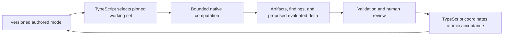

# Native computation under permanent resource constraints

Status: proposal for [issue #153](https://github.com/Frederik91/bim-forge/issues/153), 25 October 2026. This is a computation-ownership recommendation, not an adopted architecture, a qualified capacity result, or permission to rewrite the backend. The [implementation plan and verification record](native-computation-plan.md) describe this documentation change.

## Recommendation and why act now

Permanent CPU and memory limits justify designing heavy computation for bounded native execution from inception. They do not make a whole-backend Rust rewrite inevitable. Use existing native geometry kernels for engineering geometry. Prefer Rust for new application-owned spatial and numerical kernels where compact arrays, explicit allocation ownership, and bounded execution fit the job. Keep TypeScript for UI, agent interaction, review policy, transaction orchestration, and asynchronous I/O.

Act now on ownership, working-set limits, and the data contract below, before a detailed geometry feature acquires a second implementation. Introduce an executable boundary with the first concrete computation that needs it. Do not add empty adapters, an unused Rust service, or a general backend replacement in anticipation of scale. Existing TypeScript functions stay until a scoped requirement or measured gate justifies moving them.

This recommendation is an engineering inference from the inspected source and the workload requirements. Rust's ownership rules provide compile-time memory-management guarantees, but do not establish a smaller working set or faster BIM workload. Native libraries and unsafe interfaces also require their own correctness discipline. [Rust ownership](https://doc.rust-lang.org/book/ch04-01-what-is-ownership.html), [Rust undefined behavior](https://doc.rust-lang.org/reference/behavior-considered-undefined.html).

## Current source and proposed architecture are different

The deployed-preview worktree was inspected read-only and was clean at `8a1f3a955ecea90bceef574ff8b9eab4249669ce`. The storage experiment was inspected through Git at `962d6023119baf070bd6c2a8c599e2cf0ea3186e`. Independent geometry experiments have separate source pins below. These snapshots establish source behavior, not a new live deployment verification.

| Inspected owner | Current behavior | Implication for this proposal |
| --- | --- | --- |
| Preview [`src/room-model.ts`](https://github.com/Frederik91/bim-forge/blob/8a1f3a955ecea90bceef574ff8b9eab4249669ce/src/room-model.ts), `validateSnapshot`, `revision`, `RoomRepository` | TypeScript validates metre-based snapshots, caps each entity and relationship array at 100, canonicalizes state, clones drafts, hashes revisions, and computes semantic deltas. | This is a bounded prototype, not the detailed hospital graph or a production parametric kernel. Removing its bounds is not a scaling strategy. |
| Preview [`src/viewer-geometry.ts`](https://github.com/Frederik91/bim-forge/blob/8a1f3a955ecea90bceef574ff8b9eab4249669ce/src/viewer-geometry.ts) and [`src/asset-family.ts`](https://github.com/Frederik91/bim-forge/blob/8a1f3a955ecea90bceef574ff8b9eab4249669ce/src/asset-family.ts) | TypeScript derives rectangular slab pieces, roof-clipped wall sections, and normalized proxy asset geometry. | Retain this concept-view behavior. It does not establish robust B-rep, clash, or solver capability. |
| Preview [`src/model-script.ts`](https://github.com/Frederik91/bim-forge/blob/8a1f3a955ecea90bceef574ff8b9eab4249669ce/src/model-script.ts) and [`demo/change-requests.ts`](https://github.com/Frederik91/bim-forge/blob/8a1f3a955ecea90bceef574ff8b9eab4249669ce/demo/change-requests.ts) | ScriptBox stages a private draft and validates before returning a proposal. It declares 64 MiB script memory and a 256 MiB compiler heap. SQLite backs the server request queue and serialized project state. | Script limits are not a total process/native-memory guarantee. Keep request identity, cancellation authority, review, and acceptance outside geometry kernels. |
| Storage experiment [`lines.ts`](https://github.com/Frederik91/bim-forge/blob/962d6023119baf070bd6c2a8c599e2cf0ea3186e/experiments/storage/lines.ts), [`load.ts`](https://github.com/Frederik91/bim-forge/blob/962d6023119baf070bd6c2a8c599e2cf0ea3186e/experiments/storage/load.ts), [`prepared.ts`](https://github.com/Frederik91/bim-forge/blob/962d6023119baf070bd6c2a8c599e2cf0ea3186e/experiments/storage/prepared.ts), [`store.ts`](https://github.com/Frederik91/bim-forge/blob/962d6023119baf070bd6c2a8c599e2cf0ea3186e/experiments/storage/store.ts) | Pull-based NDJSON admission bounds rows at 4 MiB. Prepared records retain canonical serialization and a SHA-256 version hash. Loading flushes at 250 records or 4 MiB of canonical bodies. Staging uses SQL `jsonb_to_recordset` and inserts; publication creates changes and visibility, validates references, and advances a head transactionally. | Body-byte accounting does not include all wire strings, objects, and driver allocations. This is experimental PostgreSQL persistence, not the preview's deployed storage. Moving the producer to Rust leaves these SQL operations and durability costs. |
| EX-07 [`evaluator.ts`](https://github.com/Frederik91/bim-forge/blob/3fe6e4c5837595455fefe43608bca10c5c30bde6/experiments/regeneration/evaluator.ts) and [`topology.py`](https://github.com/Frederik91/bim-forge/blob/3fe6e4c5837595455fefe43608bca10c5c30bde6/experiments/regeneration/topology.py) | TypeScript orders a small dependency graph and evaluates fixture positions/distances. Python calls OCP/OCCT `BRepAlgoAPI_Splitter`, checks shapes, writes BREP artifacts, and tests unique or pending semantic anchors. | Native geometry already participates in experiments. The [bounded review](../experiments/decisions/semantic-kernel-review-20261025.md) leaves general regeneration, reference stability, and kernel upgrades unqualified. |
| IFC [`run.py`](https://github.com/Frederik91/bim-forge/blob/c30979d640a22ef8b4dc83f7307e111cd5d6546a/experiments/ifc/run.py) and [`requirements.txt`](https://github.com/Frederik91/bim-forge/blob/c30979d640a22ef8b4dc83f7307e111cd5d6546a/experiments/ifc/requirements.txt) | Python calls IfcOpenShell 0.9.0.post1 `geom.create_shape` and measures returned vertices/faces. | This uses an existing native IFC geometry engine. The [exchange review](../experiments/decisions/exchange-storage-review-20261025.md) retains partial coverage and fidelity gaps; it is not product adoption. |

The [architecture direction](../architecture.md), [storage direction](../storage.md), and [VM-C1 candidate](versioned-model-candidate.md) describe future boundaries. They do not establish implemented PostgreSQL product persistence, a general native model engine, or a selected Rust architecture. There is no separate technology-stack document in this branch; architecture and storage are the relevant technology references.

## The full failure concerns ingestion and PostgreSQL first

The [second full review](../experiments/decisions/full-hospital-round2-review-20261025.md) records runtime `c0ad96765e8fee8088188894dc484f3a81704dda`, a two-hour timeout, and 23,791,755 staged records out of 27,020,089. There were zero published revisions and no complete source/body/property readback. Client and producer shared 1 CPU and 1 GiB; PostgreSQL had 1.5 CPUs and 3 GiB. Those limits remain the relevant qualification envelope, not a promise of more hardware.

Read-only inspection of the retained terminal evidence found 179 frequent-checkpoint warnings in `postgres-run.log`; the reported intervals were 13 to 29 seconds. `client-cpu-stat.txt` reports `usage_usec 3109584288`, about 51.8 CPU minutes across roughly 120 wall minutes. These files are retained beneath `/ssd1/bim-forge-qualification/qvm-20261025/artifacts/hospital-full-20261025b-terminal-evidence`, bound by the [terminal record](../experiments/results/EX-13/hospital-full-20261025b/result.json). The difference between CPU and wall time is not an exact database-wait measurement: throttling, scheduling, producer behavior, and I/O also matter.

The separate reduced [parent-process profile](../experiments/decisions/round2-20261025/profile-aggregated.json) reports about 63% idle samples. It identifies canonicalization and hashing work too, but is neither a full-run profile nor coverage of the producer and database. Do not convert its sample fractions into a predicted Rust speedup.

Inference: the immediate failure is in the ingestion/database path, with material WAL/checkpoint pressure, rather than evidence of a geometry-computation or language limit. PostgreSQL documents checkpoint I/O and extra WAL from frequent checkpoints under full-page writes. The logs do not isolate one causal fraction or prove a tuning remedy. A Rust client cannot remove the same SQL, index, WAL, and durability work merely by changing language. [PostgreSQL 15 WAL configuration](https://www.postgresql.org/docs/15/wal-configuration.html).

The coordinator owns ongoing tuning, the exclusive database lease, registry, and benchmark results. This proposal neither reruns nor replaces those experiments.

## Computation ownership for new features

These assignments are proposed architecture choices, not measured performance findings.

| Work | Proposed owner from inception | What remains in TypeScript |
| --- | --- | --- |
| Engineering B-rep operations, intersections, booleans, meshing, and geometric validity | An established native kernel such as OCCT, accessed through a bounded worker. Preserve IfcOpenShell for declared IFC geometry/exchange work. | Request preparation, artifact selection, policy, and explanation of results. Do not write a Rust replacement for mature kernel algorithms. |
| Large spatial indexes, batched bounds/transforms, clash broad phase, and numerical quantities | A bounded native compute module. Rust is the preferred candidate for application-owned array/index work; kernel-backed narrow-phase checks remain with the geometry engine. | Spatial scope selection, revision pins, result pagination, and review. Bounding-box overlap alone is not a certified clash. |
| Constraint solving and evaluated regeneration of engineering geometry | Native numerical/geometry execution, with explicit affected inputs and outputs. | Semantic dependency rules, authority, invalidation requests, and orchestration can remain TypeScript. Move large dependency traversals only if their own CPU/memory profile justifies it. |
| Concept display shapes and small metadata/schema checks | Existing TypeScript, with declared input bounds. Viewer GPU work remains presentation. | All current behavior until a concrete engineering requirement or migration gate applies. A display mesh cannot become accepted engineering truth. |
| Bulk parsing, canonicalization, and hashing | Retain bounded streaming/prepared records initially. Extract a native batch transform only if profiles and full-path costs justify it. | Backpressure, I/O, SQL transactions, error handling, and publication. Reuse existing native library work rather than assume each Node call is JavaScript computation. |
| Agents, permissions, proposal/review state, audit, and acceptance | TypeScript services and the authoritative transactional store. | Keep these owners. Native execution returns evidence and proposed deltas; it cannot accept its own changes. |

IfcOpenShell documents a C++/Python bulk geometry iterator with caching/reuse and configurable threads, plus several geometry kernels. Its current settings document OpenCascade as the default and CGAL alternatives. Those documented options are not evidence that these experiments tested every kernel. [IfcOpenShell iterator](https://docs.ifcopenshell.org/ifcopenshell-python/geometry_processing.html#geometry-iterator), [geometry settings](https://docs.ifcopenshell.org/ifcopenshell/geometry_settings.html#geometry-library).

OCCT documents Boolean operations, operation history, and tolerance-dependent behavior. That supports reusing a mature engine; it does not solve application-level persistent face identity. The OCP experiment pins `cadquery-ocp==8.0.1.1.0` in its [requirements](https://github.com/Frederik91/bim-forge/blob/3fe6e4c5837595455fefe43608bca10c5c30bde6/experiments/regeneration/requirements.txt). Rust around that engine would still execute OCCT. [OCCT Boolean operations](https://dev.opencascade.org/doc/overview/html/specification__boolean_operations.html).

## One authoritative model and an explicit compute boundary

The future model service owns authored entity/relationship versions, revision ancestry, and accepted state. Native workers receive immutable revision-scoped working sets and produce disposable projections or candidate artifacts. An index or kernel object cache is derived, keyed by input and engine versions, bounded, and safe to evict. It must not become a second mutable authoritative graph with its own acceptance rules.

The following contract is proposed for the first real compute operation. It is documentation, not an implemented transport/schema.

| Boundary concern | Required behavior |
| --- | --- |
| Identity and input binding | Job/command ID, project ID, base revision, exact entity-version IDs, ordered input hashes, and operation/settings identify an execution. Batch-local integer indices map back to stable IDs through a pinned table. Preserve source namespaces and linked occurrences. Never use pointer values, mesh indices, or face traversal order as durable identity. |
| Dense data and artifacts | Use contiguous typed arrays for positions, transforms, bounds, indices, and adjacency offsets when appropriate. Specify scalar width, byte order, layout, offsets, counts, and index bounds. Pass large BREP/mesh payloads as immutable artifact references with hash, size, format, and access scope. Small control messages and diagnostics can be JSON. No per-vertex RPC and no serialization of the whole project graph per call. |
| Versions and history | Bind schema, protocol, canonicalization, mapping, validator, kernel/build, and algorithm versions plus relevant settings and image/toolchain identity. Reject unsupported versions. Cache keys include those versions. Preserve reviewed engineering artifacts when rerunning an old kernel is unavailable. A kernel upgrade requires comparison and renewed evidence, not silent replacement of history. |
| Units, coordinates, and tolerances | Declare length/angle units, coordinate frame, origin/transform, precision, and separate operation/validation tolerances. Convert once at a named boundary. Preview metres, millimetre authoring inputs, and EX-07's `1e-7` millimetre classifier tolerance are different contracts. Do not promote one fixture epsilon to a project-wide tolerance. Distinguish engineering tolerances from display tessellation settings. |
| Determinism and references | Pin input order, seeds if any, threading, settings, and output ordering. Require stable diagnostic/ID ordering and exact canonical hashes where byte determinism is part of the contract. Compare floating geometry using declared engineering invariants and tolerances; do not promise cross-platform or cross-kernel bit equality. Ambiguous semantic anchors return pending with candidates, never an arbitrary first face. |
| Cancellation and failure | Propagate revocation/deadline to each chunk and poll inside long operations where supported. Fence late results by job and base revision. If a kernel cannot stop cooperatively within its grace period, terminate its isolated worker. Distinguish completed, pending, cancelled, timed out, memory exhausted, and invalid result. Failed/partial output cannot publish accepted state. |
| Time and memory | Admission declares input/output/working-set limits, wall deadline, CPU quota, scratch/artifact allocation, worker count, and cancellation grace. Include TypeScript, native heap, buffers, kernel state, and in-flight copies in the total. Reject an operation whose minimum indivisible working set exceeds the cap; chunking cannot fix every kernel operation. |
| Chunking and completeness | Bound both bytes and item counts, apply backpressure, cap in-flight chunks, and release each chunk after acknowledgement. Spatial partitions include required overlap/halo and deterministic pair ownership, so cross-partition clashes are neither lost nor duplicated. Dependency chunks retain required closure. Validate final count/hash/completeness before exposing a result as complete. |

Begin with an isolated process for untrusted imports and potentially uninterruptible native geometry. This is a proposed containment choice with startup and IPC costs, not a claim that processes are faster. A later Node-API binding or browser WebAssembly build needs a measured use case. Node-API provides an ABI-stable interface, but external kernel libraries have their own compatibility obligations. [Node-API ABI implications](https://nodejs.org/api/n-api.html#implications-of-abi-stability).

## Copies and memory are part of the algorithm

Compare complete data flow: storage read, decode/validate, pack, transfer, compute, return, validate, persist artifacts, and prepare the review delta. Count live JS objects, UTF-8/JSON strings, packed arrays, IPC buffers, native workspace, and returned artifacts. A smaller Rust inner loop can still lose on packing or duplicate residency. Replacing arrays with a full native graph plus the full JS graph defeats the memory objective.

Node workers can transfer an owned `ArrayBuffer`, detaching sender views, or clone data. Pooled Buffers have different transfer behavior and may clone their backing pool. Worker `resourceLimits` constrain the JS engine, not external buffers or the whole process. Therefore neither a transfer list nor a JS heap limit establishes zero-copy execution or a total memory cap. [Node worker transfer and limits](https://nodejs.org/docs/latest-v24.x/api/worker_threads.html).

Use artifact streaming or mapped files only after specifying lifetime, ownership, validation, and access controls. They can avoid particular copies but do not eliminate resident pages or kernel allocations. Record bytes copied and peak simultaneous residency at the actual boundary; do not label a design zero-copy before measuring it.

## Explicit migration decision gates

These are proposed gates for a future scoped issue. They are not adopted product SLOs or measured Rust benefits.

1. Bind a representative workload, correctness oracle, source/kernel versions, and deployment envelope before implementation. Use the current 1 CPU/1 GiB client-compute allowance as the initial combined budget, not 1 GiB for Node plus another 1 GiB for Rust. Any PostgreSQL comparison retains its separate declared 1.5 CPU/3 GiB envelope and the coordinator's lease.
2. Profile every participating process and separate active CPU, throttling, database/I/O wait, serialization, GC, and native work. For an existing path, open an extraction comparison when the proposed computation consumes at least 30% of end-to-end active CPU, or when its measured working set prevents staying inside the target memory cap after bounding input and eliminating redundant materialization. New engineering geometry goes to an existing native kernel for capability/correctness reasons without requiring a JavaScript reimplementation first.
3. Set the user-visible completion target before comparison. Where applicable, retain the qualification envelope's existing detail/page/delta/accept targets and the two-hour complete-admission target. A proposed spatial operation needs its own accepted workload and target; metadata-read targets do not define a geometry budget. [Execution envelope](../experiments/decisions/execution-envelope-20261025.md).
4. Migrate only if correctness, cancellation, and completeness pass and a repeated end-to-end comparison meets the target within memory limits. As an initial decision rule, require at least 20% lower median end-to-end time, or at least 25% lower combined peak memory that resolves a memory-budget failure without missing the time target. Record raw runs, variability, and tail behavior; a median improvement cannot excuse a tail-target regression. These margins are proposed to justify boundary and maintenance costs, not predicted advantages.
5. If SQL, checkpoint/WAL, or I/O waits dominate, address that path through the coordinator's evidence first. If the native candidate misses the gates, retain the bounded implementation and record the result. Do not expand a failed small comparison into a backend rewrite.

## Small future executable Rust comparison

Create a separate issue for one batched spatial operation: transform local AABBs into a revision-scoped world-space working set and return conservative overlap pairs with stable entity IDs. This isolates application-owned numerical work without replacing OCCT, authoring semantics, or persistence. It is a new comparison, not a claim that a production clash engine already exists.

Prepare a tiny hand-checked fixture and a fixed seeded 10,000-object fixture with sparse and dense-overlap variants, linked-instance transforms, metre/millimetre equivalence, and cross-chunk boundary cases. A simple independent brute-force oracle on the tiny fixture checks containment and pair completeness. Bound output bytes/pair count, and return an explicit budget failure for excessive overlap rather than silently truncate. The larger fixture checks deterministic hashes and invariants; input distributions must be published before interpreting relevance to BIM workloads.

Implement one TypeScript executable and one Rust executable with the same batch layout and operation semantics. For this comparison, use little-endian Float64 bounds and transforms, Uint32 batch indices, and a hashed stable-ID manifest. Normalize length inputs to metres, declare the overlap tolerance, include touching pairs, and sort/deduplicate output pairs by stable ID. Build pinned release binaries in a separately authorized offline tools image containing the Rust toolchain and cached dependencies. Do not assume the current qualification image contains Rust. A small TypeScript harness exercises both the inner operation and the actual process round trip, including startup, packing, copies, output checks, and cleanup. No addon framework or general adapter is needed.

For the first smoke comparison, predeclare a 60-second per-case wall limit including startup/transfer, 1 GiB combined memory, one in-flight input/output pair of chunks at most 4 MiB each, and a one-second cancellation grace followed by worker termination. One irreducible operation that cannot fit must fail admission. These are proposed experiment limits; this PR's validation uses the user's stricter 0.25 CPU/1 GiB network-disabled container, and any comparison must receive its own authorized resource slot.

Run one warm-up and at least five alternating measured pairs per variant at the same CPU cap; report cold-start separately. Collect total wall/CPU time, throttle time, process RSS and cgroup peak, JS heap/external buffers, input/output/copy bytes, artifacts, errors, and cancellation latency. Inject cancellation, malformed versions, and oversize output; verify that accepted state remains unchanged. A microbenchmark win permits only a scoped extraction proposal. Representative storage-to-review execution within the target envelope is required before migration; full hospital admission, IFC fidelity, or general engineering-clash qualification cannot follow from this fixture alone.

No comparison, database job, runtime change, registry update, or results publication is part of issue #153. The practical decision now is to reserve native ownership for new heavy computation and make the first real operation measurable, while the coordinator resolves the current ingestion limit.
