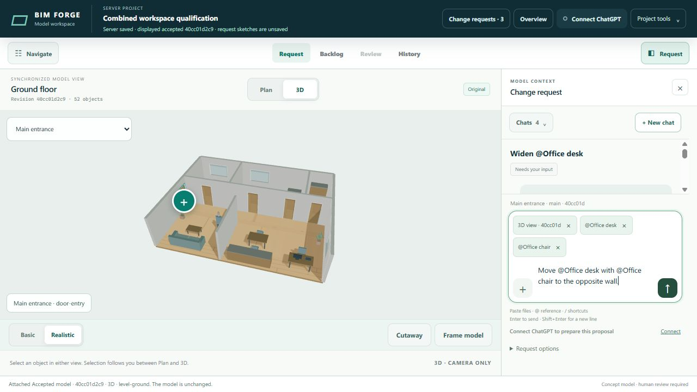
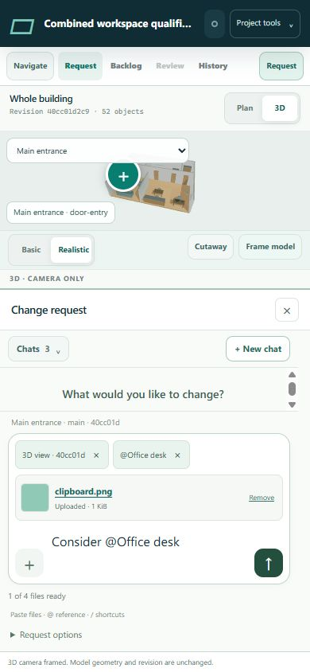

# Request chat composer

Issue #189 follows the deployed workspace in #188. The default request surface is a conversation and a single message composer. Context is explicit, visible and removable; attaching an item does not authorize a model edit.

## Plan

- `demo/index.html`, `demo/request-chat.css`: one composer with a left-hand + action, attachment chips, Send and compact model binding. Put coordinates, numeric sketch controls, source inspection, naming, scope and reconstruction behind Request options.
- `demo/request-composer.ts`: accessible + actions, @ model-item search and / action discovery, keyboard selection, composition-safe sending and visible snapshot-bound context. Commands are local UI actions; none submit, approve or mutate geometry.
- `demo/request-source-ui.ts`: file selection and clipboard files share atomic validation, upload state, size/count limits, retry/removal and draft retention. Mixed text/file paste preserves text. No background clipboard permission or global paste interception.
- `demo/room-app.ts`, `demo/request-chat.ts`: use the same composer for new requests and replies. Existing conversation, frozen scope, source, model, replay and review validators remain authoritative.
- Concurrent chats: a searchable project chat switcher and New chat action. Keep independent unsent message/file/reference/scope/model/replay state per chat. Derive stable chat-list titles from the first stored message without loading complete projects or transcripts.
- Evidence: isolated server validation/build, focused source/composer and existing conversation integration tests, then desktop/phone UI with a disposable server project. Inspect +, @, /, paste, keyboard, errors, removable evidence and continued conversations. No live model edits.

## Boundaries

No schema, model, storage or credential changes. The backlog summary adds a read-only title projection from the first stored message. @ references bind stable IDs to the displayed revision through the existing visual-evidence contract. The model agent still interprets the instruction and prepares a separately validated proposal. Explicit user acceptance remains required.

The + menu and / palette expose file selection, model-item search, current selection/view/marker attachment, scope and request options. They never submit or approve work. A native textarea preserves ordinary and mixed text/file paste; the app does not request global clipboard access. Enter selects a suggestion or sends a message; Shift+Enter inserts a line and IME composition is not submitted. @ supports several stable item references in one message.

Drafts are retained in the current tab, not persisted across browser reloads. A reload/close warning covers inactive drafts as well as the current draft. Submitted messages, evidence and titles survive server and browser restarts. Uploads already in flight can finish for an inactive draft; its remaining queued files resume when reopened. Selection does not create a new chat. Scope/reconstruction authority remains fixed for an existing request.

## Qualification

All builds and tests ran in isolated server containers using Node 24.22.1 and tools image `sha256:4b96c3cba2f461d2bb9b6a285e5514fcf58968c9614eddd3441bcdb2def38dff`. Test containers used 0.5 CPU, 1 GiB and no network. The separate browser fixture used 0.25 CPU/1 GiB, server loopback and an authenticated SSH tunnel, synthetic house data and a deterministic agent. ScriptBox, model validators, upload/persistence and conversation APIs were real; live ChatGPT was not invoked.

- Source `7adf0d2`: root validation (147 TypeScript files), build, 11-path policy and full standard suite: **583 cases, 581 passed, zero failed, two existing root-environment factory skips**. Raw logs and container inspection: `/ssd1/bim-forge-qualification/composer-189/final2/artifacts/`.
- Source `97ee231`: corrected phone attachment layout, root validation/build and six focused composer/release checks passed. Phone 390 × 844 kept both file/context chips and the input/Send controls on screen with document width 390. Desktop 1280 × 720 remained bounded. Raw artifacts: `composer-189/ui-final/` under the same server root.
- Final application `54f0ac4` additionally makes + → Reference work after text without trailing whitespace. Its final delivery validation/build, 13-path policy and six focused tests passed under `composer-189/delivery/`. A fresh browser verified + → Reference after text without trailing whitespace.
- Browser workflows: + → file picker uploaded a Markdown plan; mixed image/text paste preserved both parts; image-only paste preserved typed text; unsupported files produced an error without losing text or model references; pending upload blocked Send; source and reference chips were removable.
- Three independent submitted chats, continued replies, plus separate unsent drafts were exercised. Switching away/back retained uploaded documents/images, exact model bindings and independent text. Draft state also retains request/reply retry identities; existing replay/CAS tests passed. Stable first-message titles and retained evidence survived server/browser restart. A read-only database check found three request tickets, ten messages and four stored source blobs, with integrity check `ok`. Search, keyboard @ selection, multi-item references, slash actions, Escape and Shift+Enter were exercised.
- Scope draft verification: enable scope, add current selection, preview, switch to another chat and return. The message, enabled state, frozen target `door-entry` and preview readiness were retained. No proposal was accepted; the synthetic accepted revision remained `40cc01d2c9`.

The first validation attempt caught an unparsed activity timestamp used for sorting; the parser now validates it. Browser testing found phone attachment styles could push the input outside its sheet; compact file rows and a larger open chat sheet fixed it. No validator was weakened, no browser security permission was changed, and the live preview was not modified by these tests. The maintainer's earlier file-count waiver remains applicable; factory policy is unchanged.

## Captures

