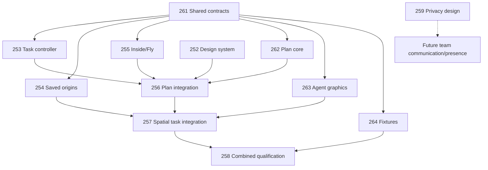

# Inside-first spatial workspace implementation plan

Epic: [#251](https://github.com/Frederik91/bim-forge/issues/251). Draft planning review: [#260](https://github.com/Frederik91/bim-forge/pull/260).

## Decision and scope

The maintainer accepted the Inside-first study direction on 2026-10-31 and requested an implementation plan. The reference is [draft PR #249](https://github.com/Frederik91/bim-forge/pull/249), commit `9f5802d3f3d428fd91d367fba71477a787b26ad1`. Production source was inspected at `bc7fbd392f036a6fda055599854f29670a27f279`; that is still main at planning time. The study is not merged or deployed, and accepting its direction is not merge authorization.

This plan originally proposed implementation work. The maintainer subsequently authorized orchestrated implementation with subagents through a verified local deployment on 2026-10-31. The single-engineer milestone is confirmed. Each issue retains its isolated worktree, acceptance evidence, validation and draft change review. Geometry, coordination, persistence and permission changes retain human merge review; no main-branch merge or production-data mutation is authorized by the local deployment goal. Current execution evidence is recorded in [epic #251](https://github.com/Frederik91/bim-forge/issues/251).

The accepted experience keeps the model present, supports Inside, Plan, Section and Overview, and uses WASD and explicit mouse-look with Escape release. Fly uses Shift to ascend and Ctrl to descend. Conversations retain a fixed starting location, represented by a hovering 3D task agent, separately from their associated model objects or region. Selecting that agent opens the conversation and highlights its targets. Plan follows the approved drawing language using actual model geometry. A secondary task list provides retrieval.

## Proposed first real milestone

Deliver one engineer's complete task journey in the existing trusted single-operator environment: open an actual project, enter a valid view, start a spatial conversation, send it through the existing worker queue, navigate elsewhere, reopen the same task after reload, inspect the actual proposal, and explicitly accept through the current server decision path.

Use multiple independent conversations at the same door and a region-only task as acceptance cases. Show actual queued, running, waiting, failed, cancelled and proposal states. A visible task agent represents a durable conversation; it does not mean a worker process runs continuously. Retain the server's configured execution limits.

The maintainer confirmed single-engineer spatial workflow first on 2026-10-31. Team identity, personal/discipline/company authorization, shared presence and human communication follow separate gates; privacy design may proceed in parallel. Do not expose audience selectors as if they enforce privacy before the server supports them. Upstream deployed authentication has not been qualified by this planning exercise.

Team collaboration is outside the first implementation milestone. Adding it requires a separately reviewed scope change and the identity/authorization gates before shared release. Execution and local deployment were separately authorized as described above; the scope confirmation did not authorize a main merge or production-data changes.

Time-linked speech, pointing and drawing remains explicitly deferred in [#250](https://github.com/Frederik91/bim-forge/issues/250). It is not required to ship this milestone.

## Current foundation

### Overview and key concepts

Current production is a model viewer with durable task conversations and explicit proposal review. The accepted model changes only through the existing server decision path. The multiplayer experience extends this foundation; it is not already implemented.

A conversation ticket is the durable task identity. It survives follow-up messages, retries and proposal revisions. Several tickets can concern the same location. A request identifies one changing turn; a worker attempt identifies one bounded execution. The proposed task-agent avatar represents the ticket, not a new daemon or a building-model entity.

Existing visual context binds messages to an accepted or proposed revision, view, level, selected objects and annotations. It does not contain an immutable conversation origin or saved eye position. A displayed draft or ready proposal remains distinct from an accepted revision.

### How it works

The application controller loads server projects and maintains selection, conversation, draft and review state. React presents the chrome and transcript; it does not independently own model changes or acceptance. One reusable Babylon viewer supplies 3D rendering. Its canvas moves between request and review hosts while retaining its engine and camera. Native meshes, comparison geometry and linked IFC reference meshes retain their separate source identities.

Plan follows a different path. The controller renders SVG from the native model and hides the 3D viewer. This already includes wall thickness, door swings, room labels, stairs, roofs and furniture proxies. It is not a general section renderer for arbitrary IFC geometry.

The server saves task history and queues work. Currently two attempts may run globally, with one per ticket. Cancellation retains execution ownership until cleanup drains, while newer turns are protected from late results. The browser polls updates.

Review controls match the exact message, request and proposal revision. The server independently rechecks scope, evidence, compatibility and publication state. Atomic publication prevents an asynchronous decision from replacing a changed accepted head.

### Existing owners and constraints

| Owner | Current responsibility and integration constraint |
| --- | --- |
| `demo/model-viewer.ts` | One engine/canvas, picking, markup and lifecycle. Motion detection and markup currently depend on an orbit camera. |
| `demo/model-scene.ts` | Native projection, comparison geometry, orbit camera, framing, selection and visibility. FXAA and cutaway also assume that camera. |
| `demo/room-app.ts` | Application orchestration, request transport, native SVG Plan and view routing. Existing framing can reset the view on focus/level changes. |
| `demo/workspace-shell.ts`, `workspace-react.tsx` | Shell routing/focus and React presentation. Preserve mounted model and chat/composer state. |
| `demo/linked-model-render.ts` | Read-only linked source meshes and engineering-to-viewer transforms. They are not native wall/storey entities. |
| `src/request-conversation.ts` | Transcript and per-message visual evidence. Stable task identity is project plus ticket, not selected object. |
| `demo/change-requests.ts` | Submission, continuation, bounded queue, cancellation, attempts and decisions. Do not create another queue or acceptance authority. |
| `demo/request-chat.ts`, `request-chat-status.ts` | Transcript presentation and exact proposal matching. Request transport still lives in room-app. |
| `demo/versioned-project-store.ts` | Authoritative accepted heads, publication compare-and-swap and decision evidence. |
| `demo/server.ts` | Host/origin guards and service-wide AI connection. There is no BIM participant or project-membership boundary yet. |

There is no production `request-conversation-queue.ts` implementation; the similarly named file is a test. There is no `authoritativeAccept` API to introduce alongside the current decision endpoint.

ChatGPT sign-in supplies the service's AI connection, not BIM participant identity. Hiding an agent in the interface would leave ticket lists, titles, URLs, attachments and history exposed. Any future team release must enforce authorization before returning data or publishing activity.

## Invariants for the implementation

- One viewer engine and one owner for each model, task, navigation and acceptance invariant. Task graphics are presentation overlays, not IFC/native construction entities.
- Origin and targets are separate. Origin is recorded once at task creation in a named project coordinate frame. Targets come from explicit, source-pinned task context, never incidental later focus.
- Persist engineering coordinates and units, with revision/source references. Convert to Babylon coordinates only at the rendering boundary. Linked transforms cannot silently become native identities.
- Reuse ticket identity. Multiple tasks at one place remain separate, and a region-only task must not invent nearby object targets.
- Existing tasks without trustworthy placement remain explicitly unplaced and discoverable in the task list. Do not reconstruct an origin from latest selection or silently move it after a model revision.
- Missing/deleted/replaced targets or stale source pins remain inspectable; require an explicit recovery or refreshed proposal. Never silently retarget an agent.
- View changes preserve the current task, draft, selection and applicable saved pose. Focus, pointer cancellation and view changes share one input-stop path.
- Real worker status drives agent activity. Cancellation, restart, superseded replies and exact proposal matching retain existing server semantics.
- Human acceptance remains explicit for geometry and coordination. An avatar, selection, gesture or voice instruction cannot change the accepted model.

## Architecture comparison

Two independent sketches were read in full and compared. A keeps current React/DOM mounts, extracts a deep spatial task controller, and extends the existing viewer. B gives a new React root ownership of frontend orchestration, with existing domain/backend ports and a parity-tested cutover deleting the old orchestration. B is a viable eventual structure, not a permanently parallel application.

| Criterion, qualitative score out of 4 | A: bounded controller integration | B: React root cutover |
| --- | --- | --- |
| One owner per invariant | 4 | 4 |
| Truthful spatial/source/privacy semantics | 4 | 3 |
| Bounded first slice and review risk | 4 | 2 |
| Interface depth and future shape | 3 | 4 |
| Coherent migration and deletion | 4 | 3 |
| Total, design judgment rather than a benchmark | 19 | 16 |

Choose A. Preserve the single engine, existing backend, current editors and recovery paths while moving request orchestration into one owner. A is rejected if it leaves old transport, draft or acceptance writers behind. B would require a larger capability-parity cutover covering imports, linked references, evidence, history, design alternatives and composers before the first spatial release.

Take two ideas from B: opening a visible agent must not silently move the camera, and one immutable workspace projection should drive React presentation. Use a separate explicit Return to task action for navigation. Do not adopt B's illustrative millimetre coordinate comment: existing spatial markup uses project X-east, Y-north, Z-elevation in metres. Do not adopt a targets union that excludes objects and regions together; current evidence can contain both.

The workflow's cross-model seats are unavailable here. Two same-model independent candidates were compared by the parent; no cross-family judge ran. Candidate sketches are local planning artifacts under the isolated materials/studio worktrees, not implemented APIs.

## Proposed contracts and ownership

Names introduced here are proposed. Reuse existing domain definitions and TypeBox parsers; these sketches do not assert implemented endpoints or compiled types.

| Contract | Owner and rule |
| --- | --- |
| Task identity | Existing project ID plus ticket ID. Request and attempt IDs remain changing execution identities. No per-object worker or avatar identity becomes a second task store. |
| Placement | Versioned, validated metadata owned by `ChangeRequests`, committed atomically with first submission. Discriminate placed from unplaced. A placed origin includes project frame, source/snapshot pin, point in canonical units and creation view context. |
| Targets | Reuse snapshot-bound selections, linked references, pins and regions. Objects and regions may coexist; object selection may be empty. Targets never overwrite origin. |
| Draft task | Capture origin when the local composer begins. It is an unsent draft, not running work. Reuse request identity on uncertain acknowledgement; reconcile to a confirmed ticket without duplicates. |
| View session | Discriminated Inside/Overview/Plan/Section state plus saved Inside pose. Camera pose is per operator/tab, separate from a task origin and any future shared presence. |
| Task projection | Readonly frontend data derived from server conversation/execution state. Drives figures, Plan references, task list, transcript and review affordances. |
| Inspection | Reuse exact ticket/message/request/proposal revision and source bindings. A local inspected receipt cannot create authority; the existing server decision route and publication CAS remain final. |

Proposed caller intent is deliberately small:

```text
startTask(capturedPlace, explicitContext) -> unsent draft
sendTask(draft) -> existing authoritative submission/continuation
openTask(ticket) -> show conversation and highlight targets, keep current camera
returnToTask(ticket) -> explicit navigation to saved place
inspectProposal(ticket, message) -> inspect exact bound proposal
decide(inspectedProposal, action) -> existing guarded decision path
observeWorkspace(render) -> one readonly presentation projection
```

The controller hides wire parsing, polling, source retention, idempotency, sequence conflicts and stale-response rejection. Components express intent instead of coordinating those stages. It must preserve unsent content on errors and stop old project/task responses from changing current presentation.

Proposed module boundaries:

- `demo/spatial-tasks.ts`: deep task controller, extracting submission/read/append/decision/polling and per-task drafts from `room-app.ts`. Migrate chat, backlog, tray and old request callers, then delete the moved code in the same change.
- `demo/view-navigation.ts`, with existing `ModelViewer` and `ModelScene`: active camera and input lifecycle. Update motion detection, picking, markup and FXAA together. Keep a single engine/canvas and explicit framing policy.
- `demo/model-plan.ts`: extract the existing native drawing and inverse hit mapping. Apply the approved drafting language without copying synthetic coordinates or inventing linked/native geometry.
- `demo/spatial-task-layer.ts`: disposable agent geometry, picking, origin projection and same-place chooser. Graphics are derived UI objects, not building entities or worker processes.
- Existing `RequestChat`, React chrome, UI primitives and `WorkspaceShell`: presentation and mount/focus ownership. One chat/composer instance follows the active task; avoid simultaneous legacy and new conversation authorities.
- Existing conversation schema, `ChangeRequests`, project/source stores and server: validated placement and authoritative request/review persistence. Choose and document the exact schema/version migration in its implementation issue before writing storage.

Adopt the approved baseline into a token-bearing `DESIGN.md` and machine-readable design tokens, then share those values between React/CSS, Plan and task-agent materials. A design-system gallery must use real states and model fixtures. Do not promote the experiment's monolithic application or simulated behavior into production.

## Delivery sequence

Implementation is underway under the maintainer's explicit orchestration goal. On 2026-10-31 the maintainer requested an epic with parallel subtasks. The numbered outcomes below are deliverables, not a serial implementation schedule. The parallel schedule and exclusive ownership rules supersede the original step dependencies. Each issue gets a separate worktree and coherent draft PR. Named combined branches provide reviewed dependency baselines without merging main.

| Step | Outcome | Dependencies | Review class |
| --- | --- | --- | --- |
| [1 · #252](https://github.com/Frederik91/bim-forge/issues/252) | Approved visual system and shared primitives | Study reference retained; no automatic merge of #249 | Presentation |
| [2 · #253](https://github.com/Frederik91/bim-forge/issues/253) | One real task controller and request path | #261 contracts | Refactor with regression evidence |
| [3 · #254](https://github.com/Frederik91/bim-forge/issues/254) | Backend conversation origin and target binding | #261 contracts; frontend wiring in #257 | Schema/storage, human review |
| [4 · #255](https://github.com/Frederik91/bim-forge/issues/255) | Inside/Walk/Fly navigation and view continuity | #261 contracts; shell wiring in #256/#257 | Viewer behavior, human review |
| [5 · #256](https://github.com/Frederik91/bim-forge/issues/256) | Production native Plan integration | #252, #253, #255, #262 | Derived geometry presentation |
| [6 · #257](https://github.com/Frederik91/bim-forge/issues/257) | 3D task agents, anchored real chat and in-place review | #254, #256, #263 (other foundations transitively) | Workflow integration, human review |
| [7 · #258](https://github.com/Frederik91/bim-forge/issues/258) | Qualify the first end-to-end milestone | #257, #264 | Evidence and maintainer release decision |

### Parallel schedule and file ownership

Start [#261](https://github.com/Frederik91/bim-forge/issues/261), a small contract baseline, alongside visual foundation #252 and privacy design #259. Agree coordinate/source units and pins, origin/targets, stable task identity, readonly task projection, camera/view-session intent, graphics picking/disposal and token inputs. This is an interface handoff, not another architecture tournament. Each owning implementation still reviews its concrete schemas and behavior.

Once those contracts are reviewed, six construction streams can run side by side; #252 and #259 may continue independently. The standalone drawing and graphics tasks accept injected tokens and fixture inputs so they do not wait for every integrated dependency.

| Stream | Exclusive ownership | Handoff and exclusions |
| --- | --- | --- |
| #252 Visual foundation | DESIGN.md, shared token definitions, primitives/gallery and styling | Publish shared tokens; no request orchestration, camera or schema edits. Coordinate shared presentation files with #253. |
| #253 Task controller | spatial-tasks.ts, room-app request extraction, transport/status adapters | Preserve current server payloads; remove old writers. No backend placement, camera, drafting or global styling. Finish before later room-app integration. |
| #254 Saved placement | Conversation schema, ChangeRequests, required server contracts and persistence tests | Consume #261; hand placed/unplaced source-bound data to #257. No frontend controller/room-app/viewer edits; no dependency on #253's extraction. |
| #255 Navigation | view-navigation.ts, ModelViewer/ModelScene camera lifecycle, markup/FXAA/input consumers | Consume #261; expose intent/session state for later wiring. No room-app, task transport, Plan or agent-layer edits. One engine/canvas. |
| [#262 Plan core](https://github.com/Frederik91/bim-forge/issues/262) | Proposed model-plan.ts and drawing/projection/hit-mapping tests | Consume #261; provide real native-model rendering to #256. No room-app, viewer lifecycle or global tokens. Old live Plan stays until #256 switches callers and deletes moved code. |
| [#263 Agent graphics](https://github.com/Frederik91/bim-forge/issues/263) | Proposed spatial-task-layer.ts and graphics/picking/disposal tests | Consume #261; provide readonly figures/hit identities to #257. No viewer lifecycle, schemas, transport or room-app. Test hosts are not a second production owner. |
| [#264 Acceptance preparation](https://github.com/Frederik91/bim-forge/issues/264) | Proposed tests/fixtures/spatial-workspace and dedicated harness helpers | Consume #261; publish stable fixture identities/expected deltas for lane consumers and #258. No runtime or validator changes. One fixture owner. |
| #259 Privacy design | Participant/access/publication design contract | Independent future-facing design; no runtime permission changes. Shared release waits for enforcement and qualification. |

Three grounded supporting tasks complete the delivery contract: [#265](https://github.com/Frederik91/bim-forge/issues/265) repairs pre-existing Windows test resource cleanup without changing assertions; [#270](https://github.com/Frederik91/bim-forge/issues/270) supplies the bounded centred-door operation required by #264's actual worker; and [#279](https://github.com/Frederik91/bim-forge/issues/279) provides an isolated local launcher that separates preview model storage from the existing AI connection. #264 consumes #254's placement contract and #270's real operation. These tasks add no team, voice or synchronized-drawing scope.



Integration has three named gates. #256 wires Plan and view-session callers after #252/#253/#255/#262. #257 then wires saved placement, graphics, anchored chat/list and exact review after #254/#256/#263. #258 executes the combined qualification after #257/#264. Preparing fixtures early does not claim integrated acceptance; a graphics test host does not claim real worker behavior.

Use a named reviewed dependency baseline for each branch; do not share worktrees or copy unfinished lane state. The owning task changes shared contracts and notifies affected consumers before integration. Revalidate dependent branches after rebasing onto reviewed dependency commits. Only one task owns room-app integration at a time: #253 extraction, then #256 Plan cutover, then #257 spatial-task wiring. #255 alone changes the camera lifecycle during parallel construction; #257 makes the later task-picking adapter changes. Do not combine unrelated storage, full shell replacement and rendering changes in one PR. Human approval controls readiness, merge and release.

### Step 1: design system foundation

Files: proposed `DESIGN.md` and shared tokens; existing `demo/canvas-studio.css`, `demo/ui/*`, React chrome and chat presentation. Record the accepted typography, spacing, focus, state colors, drafting line weights, hover-agent semantics and accessible targets. Keep one token authority instead of separate hard-coded CSS, drawing and avatar palettes.

Evidence: desktop/narrow gallery and representative actual native-model views; keyboard focus, disabled/empty/loading/error/stale states; legible dimensions; foreground/background checks; task identity readable without color alone. Source validation and screenshots accompany the draft PR. This is a baseline capture and reusable foundation, not another redesign tournament.

### Step 2: task controller extraction

Files: proposed `demo/spatial-tasks.ts`; existing `room-app.ts`, `request-chat.ts`, `request-chat-status.ts`, React transcript/tray and existing request/browser tests. Keep current server routes and payload semantics. Move all affected callers to one task owner and remove the old transport/state writers.

Evidence: current submit/reopen/append/revise/cancel/retry/inspect/decide behavior, attachments, per-task drafts, stale/offline controls, project switching and focus return. Prove a late response cannot open or approve another task. This step introduces no new placement storage or model delta.

### Step 3: persisted spatial placement

Files: `src/request-conversation.ts`, `demo/change-requests.ts`, server request/read contracts and persistence tests; storage/source schemas as determined by the reviewed contract. Add validated project-frame placement, source pins and target references using the authoritative ticket transaction. Preserve first origin through messages, retries, navigation and restart. Frontend controller binding belongs to #257 so backend work can proceed alongside #253 without shared writers.

Evidence: two independent tickets at one door; objects plus regions; region-only with zero selected IDs; restart; uncertain-submit replay; nonfinite/wrong-frame/stale-source rejection; missing targets; legacy unplaced tasks and explicit recovery placement without rewriting the historical origin. Review migration and rollback before merge. Accepted construction model delta remains zero.

### Step 4: navigation and view session

Files: proposed navigation module; `model-viewer.ts`, `model-scene.ts`, markup camera consumers and focused viewer tests. Introduce an active-camera seam before adding Inside and Fly. Preserve picking, antialiasing, comparison, linked meshes and one engine while reusing the current project/level context. Expose view-session/navigation intent; #256/#257 own live shell wiring after #253 finishes extraction.

Evidence: WASD relative to facing, mouse capture/fallback and Escape, Shift-up/Ctrl-down, input isolation while typing, drag cancellation on focus loss, safe framing/return, project/level changes, saved Inside pose across Plan/Overview and source transforms. Test repeated shell/task/view switches without camera or canvas recreation. Initially qualify grounded Walk only on known native floor/level cases; unsupported entry uses an explicit alternative rather than an invented walkable surface. Collision and stair behavior need separate evidence.

### Step 5: native Plan integration

Split delivery between #262 (standalone native drawing/projection/hit-mapping module and tests) and #256 (live room-app/view-session/token integration and browser evidence). #256 switches callers and deletes superseded `drawPlan`/projection writers in the same change. Derive walls, hosted openings/swings, rooms, furniture representations, dimensions and orientation from the actual model and selected revision. Distinguish footprint proxies from exact cuts.

Evidence: a real multi-room fixture, changed door/wall comparison, dimension and scale agreement, source-bound selection/hit mapping, same task through view changes, level changes and narrow legibility. Existing linked IFC does not render in current Plan; expose that limitation and qualify a source-aware linked cut path separately. Do not silently substitute a bounding box for a wall section or import the study's fixed floor plan.

### Step 6: spatial task journey

Split delivery between #263 (standalone task graphics layer and tests) and #257 (production viewer picking/lifecycle, controller projection, `RequestChat`/React anchored presentation, task list and exact review controls). Create the draft agent at the captured origin and reconcile it to the confirmed ticket. Reopening a visible agent highlights its bound targets without moving the camera. Return to task explicitly navigates. Unplaced tasks remain list-accessible.

Evidence: actual saved task and worker result, not canned replies; agent body picking; associated item/region highlights; unchanged origin after later selection; same-place chooser and accessible list; server-reported queued/working/needs-input/failed/ready/completed/cancelled states; switching with unsent drafts; in-context proposed/existing geometry; revision request and exact explicit acceptance. Cancellation does not expose provider-cleanup progress today. Do not infer cleanup completion or show a separate draining indicator unless authoritative telemetry is added through the existing queue owner and qualified. Accepting changes only the validated proposal delta, not whatever the user currently happens to select.

Keep task-agent meshes out of construction entities, exports, geometry queries and model framing bounds. Route task picking separately from building selection and active markup gestures, without giving the avatar model-edit authority.

### Step 7: first-milestone qualification

Prepare stable shared acceptance fixtures and deterministic harness helpers early in #264 while features develop. #258 reuses those plus existing viewer, shell, conversation, queue, source-retention and accepted-head tests for the final combined journey over disposable fixtures and a copy of a real project. Run strict validation plus relevant behavior/browser suites and attach output, before/after captures and accepted-model delta. Exercise restart, concurrency limits, cancellation cleanup, late results, stale proposal rejection, linked-reference picking and recovery.

Deterministic worker qualification comes first. A separately scoped, bounded connected-provider attempt is required before claiming that the complete AI journey is qualified; its fixture, call budget and evidence must be recorded before execution. The general repair-attempt renewal is not an unbounded provider budget. The maintainer explicitly permitted as many repair attempts as needed for this epic on 2026-10-31; retain attempt evidence and every existing validator. This session override does not change factory policy or authorize production-data mutation. Local deployment follows verified evidence under the explicit goal; main merge and any production rollout remain human decisions.

The first release proof uses a disposable native project with a hosted 900 mm door. Start a task, navigate elsewhere, reopen it after restart, and inspect a real 1100 mm proposal. Before acceptance, the accepted door must remain 900 mm. After explicit acceptance, independent assertions check the proposed width, preserved opening centre, hosting relationship and complete expected delta, including any required offset change. The task origin stays fixed. Add a second task at the same door and a region-only task, plus cancellation, a late result and an incompatible concurrent proposal. Each must retain its own identity and existing acceptance guards. A deterministic run proves the integration; it does not replace the later connected-provider gate.

## Later implementation gates

| Gate | Required outcome before enabling it |
| --- | --- |
| Native Section/elevation and broader Walk | True source-derived section/cut evidence, supported representations, valid entry/floor/stair policy and coordinate fixtures. Existing cutaway is not a Section implementation. |
| Linked IFC Plan/Section | Source/revision/occurrence identity and transforms retained; explicit approximation/unsupported cases; independent real-IFC qualification. |
| Team identity and privacy | Design gate [#259](https://github.com/Frederik91/bim-forge/issues/259): BIM participant identity separate from AI credentials, project membership, attributed decisions, ownership migration, server authorization and agreed audience/publication policy. |
| Shared presence and human text | Filtered subscriptions or polling, counts and task locations; revocation/reconnect/expiry tests; explicit human recipient versus agent command. No private existence disclosure. |
| Human voice | Agreed participants, capture, recording/transcription, retention and consent behavior; mute/disconnect/accessibility and revoked-membership tests. Choose transport only after requirements are settled. |
| Voice instructions to an agent | Explicit capture and recipient, contextual transcript preview/correction, bounded source-pinned request submission and agreed retention. Human speech must not silently become an agent command. This can be planned separately from synchronized drawing. |
| Cross-agent coordination | Exchange only permitted source-bound dependencies; preserve request lineage and exact proposal approval. Spatial proximity is a hint, not authority or proof of dependency. |
| Speech plus pointing/drawing | Deferred #250. Resume only with separate maintainer direction; retain timing, replay/correction and privacy requirements. |

Privacy qualification must cover lists, counts, titles, search, direct reads/writes, attachments, evidence, history, exports, errors and event streams, using two participants, an outsider and a revoked identity. A personal conversation cannot leak through occupancy hints or coordination notices. Defaults, administrator visibility and private-to-shared publication are design decisions before that implementation, not assumptions in the UI.

## Review gates still needed

- Agree the valid entry/eye-height policy and what grounded walking means on supported geometry. Navigation affordances are not engineering clearance certificates.
- Set the supported native Plan/Section representations and explicitly gate linked IFC cut rendering until qualified.
- Design participant identity, ownership migration, default audience and private-to-shared publication before any collaboration release.
- Review agent art, dense-task grouping, narrow-screen occlusion and touch navigation as part of implementation qualification; the two-task study is not evidence for those cases.
