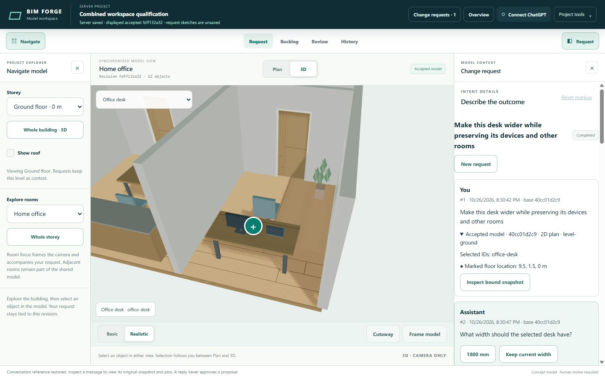
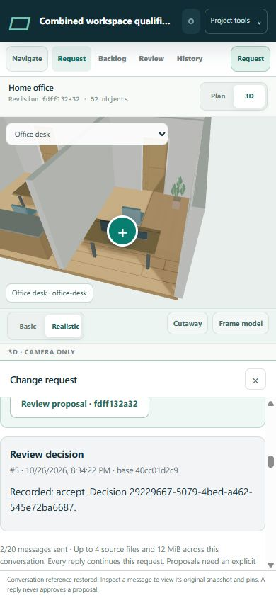

# Combined preview qualification

Issue #185 combines the versioned-model foundation (#170), model scopes (#180), persistent request conversations (#186) and model-first workspace (#187). The aggregate targets main directly. Component drafts retain their own evidence and ownership; this is the combined merge candidate.

## Qualified source and method

Final application source: `08a5868cc735389c22a2513bd0da19a1bf38305a`. Subsequent changes are qualification documents and screenshots only. All builds/tests ran in isolated server containers using immutable Git bundles, Node `v24.22.1` and image `sha256:4b96c3cba2f461d2bb9b6a285e5514fcf58968c9614eddd3441bcdb2def38dff`.

| Check | Result | Raw evidence |
| --- | --- | --- |
| Root validation and browser build | passed; 145 TypeScript files | `/ssd1/bim-forge-qualification/combined-185/ui-fix2/artifacts/{validate,build}.log` |
| Final focused integration/recovery/view-context checks | 19 passed, zero failed/skipped | same directory, `tests.log` |
| Full standard test set, serial execution | 578 cases: 576 passed, zero failed, two existing root-environment skips | same directory, `full-tests.log`, `full-container.json` |
| Built browser release | page, both CSS files and bundle verified by SHA-256/length manifest; no duplicate DOM IDs | `dist/manifest.json`; `demo/preview-build.test.ts` |
| Desktop and phone browser workflow | scoped chat, clarification, pins, model delta/orbit, explicit acceptance and retained history verified | local `combined185-ui/qa-540d315-20261026/` artifacts |
| Final browser correction recheck | both observed application defects fixed; genuine drafts still protected | [browser-recheck.json](browser-recheck.json) |

The test list is the union of the `.test.ts` paths in `scripts.test` and `scripts.test:assets`, run with `node --test --test-concurrency=1`. The exact command is retained in the inspected container arguments. Test containers use 0.5 CPU, 1 GiB, no swap and no network. The two existing skipped factory cases require a non-administrator caller and an installed symlink entry; no validator/test was weakened or disabled.

The separate browser fixture uses 0.25 CPU/1 GiB, listens on server loopback port 19585, and is reached by an authenticated SSH tunnel. It contains only a synthetic seeded house and deterministic request intentions. ScriptBox execution, scopes, model validation, SQLite persistence and human decisions are real. It does not qualify a live ChatGPT account or alter the live preview.

## Model and conversation evidence

The HTTP integration creates a saved room/type scope for `office-desk`, asks for a width through structured clarification, and receives a reply with a Markdown source plus a bound 3D pin. The initial 2D pin remains attached to the first user message. A separate scoped bed proposal is prepared at the same accepted base. After server restart the bed is accepted first; the desk remains ready and is accepted without revising its request.

| Object | Reviewed change | Preserved evidence |
| --- | --- | --- |
| `office-desk` | width 1.6 m to 1.8 m | exact stable identity and frozen query; laptop/monitor stay unchanged |
| `main-bed` | width increases by 0.2 m | its independent accepted change survives desk acceptance |
| All other entities and relationships | unchanged | deterministic delta assertion |

The browser independently verified the desk-only proposal, Plan/3D comparison, pointer orbit and explicit acceptance. Its accepted revision prefix is `fdff132a32`; all five messages, visual bindings and the decision remain after reload. The model stays visible beside request, backlog, progress, history and review contexts. Desktop 1440 x 900 and phone 390 x 844 remain bounded with independently scrolling panels; phone panels are exclusive and Escape restores toggle focus.

## Defects found and corrected

- The textual merge duplicated `#request-chat-mount`. The aggregate retains the shell-owned mount; the release test enforces unique DOM identities.
- The new conversation CSS needed to be part of the static release. `build:demo` now emits all four browser assets and their manifest together.
- Saved evidence reused the authored marker state, triggering a false discard warning. Inspection now has a separate snapshot-bound overlay. Repeated 2D/3D inspection stays read-only; genuine new text or markers still prompt, and **Keep editing** preserves the draft.
- Reopening a conversation retained the previous browsing object. The browser now validates and restores the request's stable selection, room and level. Missing references are explicit rather than silently mapped to another object. The final recheck restores `office-desk`, `room-office` and `level-ground` on desktop and after phone reload.

The first new fixture attempts also exposed metadata being passed to an older furnishings input and a missing required parameter-edit scope. The corrected fixture uses the typed parameter API with an explicit scope. A strict compilation check caught a raw level string where a branded model identity was required; the final code takes the validated entity's ID. Failed and passing logs remain under the combined server artifact root.

## Limits and remaining qualification gap

Browser file picking remains **unqualified in the combined CUA run**. One Chrome attempt was blocked by the extension's file-URL permission. CUA reported the IAB provider unavailable, and native inventory exposed no QA picker. No extension security settings changed. The server's actual upload, file binding, conversation delivery and restart retention passed in the HTTP integration; this does not substitute for a fresh combined browser file-picker check. The component conversation evidence records an earlier UI upload, but the aggregate does not count it as a corrected-build picker qualification.

Console logs contain extension-related `FILE_ERROR_NO_SPACE` entries without an independent application stack. No console-clean claim is made. Phone proof uses browser viewport/pointer/keyboard controls, not physical touch hardware.

Current portable limits remain 100 entities and 32 revisions. Conversation limits remain 20 user turns, 48 messages, 1,000 characters per message and four files totalling 12 MiB. Bounds selectors are observations, not exact solid intersections; parameter edits use supported fields and existing validators. No hospital-scale, general solver, VR or live-provider qualification is claimed.

Human review is required for these storage/model changes. Deployment needs the matching runtime and complete static release, plus the consistent state backup and rollback procedure in [the deployment guide](../../../deploy/preview/README.md). This task does not merge or deploy.

## Final captures

