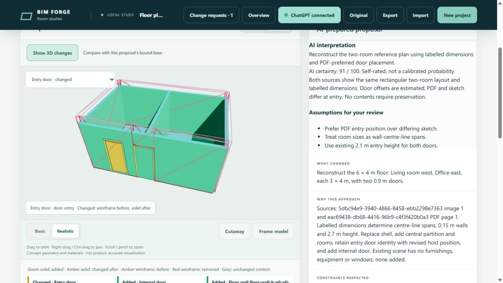
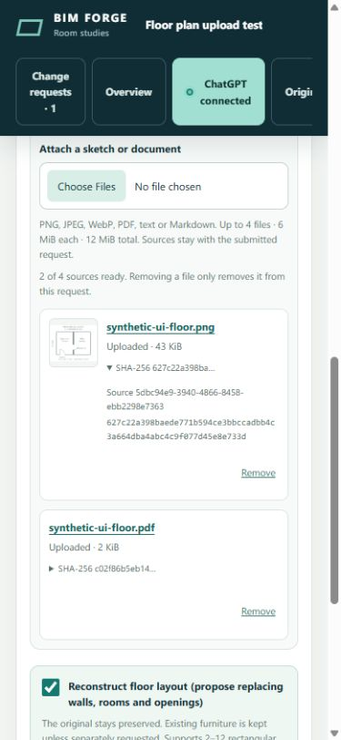
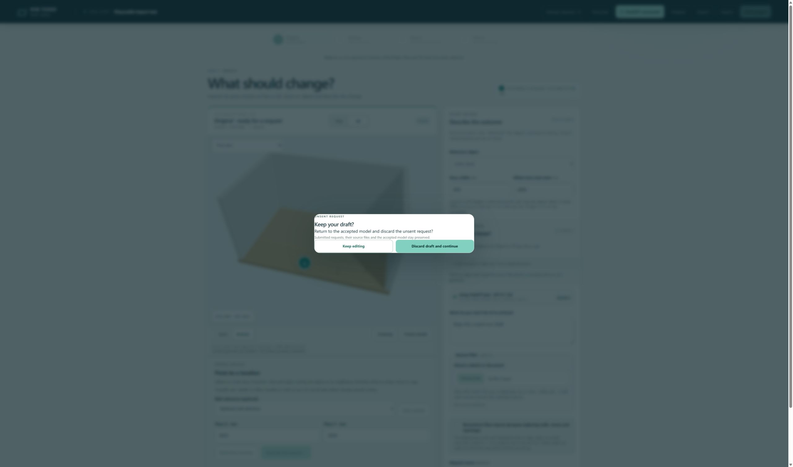

# Request source inputs: verification

All application builds and test execution ran in containers on `192.168.1.17`. Only synthetic drawings and disposable projects were used. The shared preview remains on `2cab7da1caf5c2ab86d303d57ce03befb4be654e`; this feature has not been merged or deployed there.

## Results

| Check | Result |
| --- | --- |
| Strict TypeScript, lint and repository policy | Passed |
| Full suite | 358 tests: 356 passed, 2 Windows administrator-dispatch tests skipped on Linux |
| Focused geometry/source/provider tests | 40 passed |
| Real model, PNG only | Ready proposal: two rooms, five walls, two connected doors |
| Real model, PDF only | Ready proposal with the same validated topology |
| Browser upload and combined-source request | PNG and PDF uploaded, queued asynchronously, processed by the real model and opened as a rotatable 3D delta |
| Revision source inspection | Both original references retained; removing one from the unsent draft left the submitted request intact |
| Phone source inspection | 390 by 844 override; client/content widths both 375 pixels, no horizontal overflow; override reset |
| Draft discard dialog | In Chrome, Keep editing preserved text; explicit discard cleared it and left navigation responsive |
| Production image | Built `sha256:87a7f117fc257862e402d376320a7fe1fa54854eab59a30e6f566060206a7ab5`; non-root, read-only, network-disabled image/PDF preparation and cleanup passed |
| Nginx upload/download | 1,924,282-byte PNG traversed the actual Unix-socket proxy and downloaded byte-for-byte; 384 KiB JSON limit retained; cross-origin upload rejected |

The combined-source fixture has different unlabelled entry offsets in its PNG and PDF. The model disclosed the disagreement, chose the PDF position and recorded its estimate and rationale. It also disclosed assumed door heights and unsupported swing graphics. This is evidence of a reviewable interpretation, not a claim of exact tracing.

`tests.txt` contains the full suite output. `live-results.json` contains the two independent real-model outcomes. `ui-review.json` contains the actual browser request, review, delta and activity. No account tokens or customer documents are included.

## Inspectable model delta

The browser fixture starts with an empty single-room shell. Its proposal adds a level, Living room, Office, five deduplicated walls and an internal door. It preserves the entry door identity and replaces its host relationship to reposition it. The four original walls and their old hosting link remain in the preserved base revision. The accepted model stays unchanged pending acceptance.

The deterministic queue test also revises a sourced request, restarts its store, restores source bytes and explicitly accepts the revised proposal. Existing furnishings and equipment cannot be silently removed by floor reconstruction; incompatible retained contents fail validation.

## UI evidence

## Qualification and limits

The in-app browser stalled at the old native discard confirmation after a viewport/revision transition. The new request-source guards use an asynchronous HTML dialog instead; its keep/discard behavior was verified in Chrome. Chrome's extension file-chooser automation requires file-URL permission, so actual file upload was verified through the in-app browser. No browser permission was changed.

Supported files: PNG, JPEG, WebP, PDF, UTF-8 text and Markdown. Limits: four files, 6 MiB/file, 12 MiB/request; four PDF pages/file; eight visual inputs; 16 MP input raster; 1600-pixel visual bounds; 64 KiB extracted/context text; 12 MiB prepared images; 45-second preparation. The private source store is capped at 512 MiB. Unbound uploads expire after 24 hours; bound history sources remain.

Native decoders are trusted dependencies inside the existing application container, with killable child processes and resource limits; this is not a separate hostile-file security service. Project membership checks retain the current shared-installation trust boundary. Initial floor authoring supports one rectangular envelope tiled by two to twelve rectangular rooms. Angled/curved walls and multiple levels are unsupported. AI certainty is an uncalibrated self-rating and never an approval threshold.
