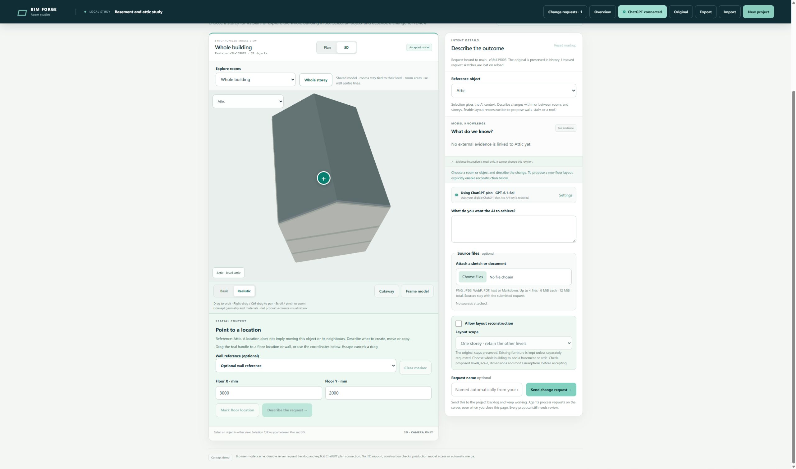
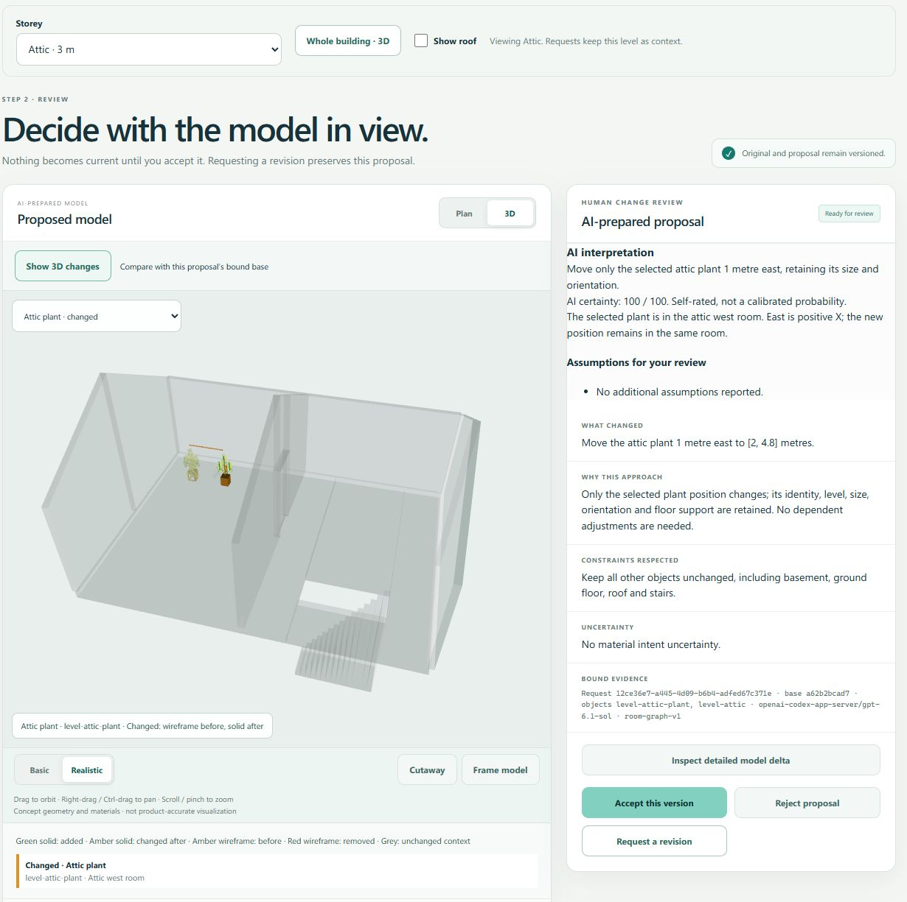

# Multi-storey acceptance evidence

Issue #111, isolated server candidate on 2026-10-25. No shared-preview deployment or merge.

## Automated checks

All builds and tests ran in server Docker containers with Node 24.22.1, Babylon.js 9.32.0 and ScriptBox 0.1.1.

- `npm run validate`: strict TypeScript lint, type checking and repository policy passed. [Output](validation.txt).
- Final `npm test` under UID 65032: 402 tests, 401 passed, zero failures, one root-only different-owner fixture skipped. The earlier root run covered that fixture; its two non-administrator checks then passed in the final run. [Complete validator and test output](test-results.txt).
- The real ScriptBox schema test and request-context regressions are included in `npm test`.
- `npm run build:demo`: passed. The browser bundle is approximately 2.4 MB before transfer compression.

The suites exercise overlapping floor plans, exact historical restore, preserved adjacent levels, cross-level support rejection, global door/stair connectivity, stair/slab voids, upper slab and roof clearance, scope enforcement, real sandbox execution, queue persistence and derived placement deltas. The existing 100-entity, 100-relationship and 32-furnishing bounds remain in force.

The first integrated full run rejected one viewer fixture that raised a lower floor into the upper slab. The fixture was corrected to valid geometry; its before-ghost picking assertion remains intact. ScriptBox registration exposed unsupported tuple and undiscriminated object-union schemas; the shared authoring schema now uses bounded arrays, while the read contract projects legacy and V2 objects without rewriting stored legacy snapshots. A real ScriptBox contract test covers these schema constraints.

Final independent review also produced regression checks for legacy floor-marker visibility, stair/door clearance, intersecting stair flights, and immutable floor-reconstruction authority after a selected furnishing transfers to another level. Opening or revising a ticket restores its level/object/room before UI filtering.

## Live model worker

Run `BIM_BUILDING_EVIDENCE=/absolute/private/path node scripts/evaluate-multi-storey.ts` explicitly with the existing server sign-in. It creates a synthetic project and a separate backlog database.

The actual ChatGPT model produced a ready proposal with 34 entities: basement, ground and attic at -3/0/+3 metres, two rooms on each, two stairs, three slabs and a gabled roof. The base revision and accepted model stayed unchanged. The validator accepted the complete snapshot, and review assumptions describe the construction, landing and headroom limits.

- [Complete building delta](building-delta.json)
- [Bound review and execution evidence](building-review.json)

## Browser workflow

Chrome drove the isolated server candidate through ordinary UI controls:

1. Create the multi-storey starter; overview shows three storeys and six rooms.
2. Select Basement; its plan and directory show only basement rooms and the upward stair.
3. Open Whole building in 3D, enable the roof, frame and orbit the model. Isolate Attic and use Cutaway to inspect its roof-clipped walls, stair and slab opening.
4. Select the attic plant and submit a request to move it one metre east. The request enters the visible backlog while model navigation remains available.
5. Open the ready request and inspect the 3D before/after delta, rationale, assumptions and certainty. Accept this synthetic proposal through the UI.
6. Inspect the saved server repository: exactly `level-attic-plant` changed, with no additions, removals or relationship changes. Basement, ground, roof and stairs are identical. [Deterministic saved-model assertion](attic-ui.json).
7. Reload and restore the accepted revision. At 390 × 844, switch levels and open the attic in 3D: scene ready, no document horizontal overflow. Restore the desktop viewport afterwards.
8. Submit a second attic request, browse Ground, then revise the ready attic ticket. The UI restores Attic, its plant and the original instruction; the revision is left unsent.

The in-app browser did not reliably activate its project-creation submit control in this session; browser verification was completed in Chrome. Chrome also logged unrelated extension storage IO errors; model save, server acceptance and subsequent restore were verified independently.

This is bounded concept geometry. Stair headroom, complex roofs, multi-flight stairs, surveyed accuracy and building-code certification are not established by these checks.
