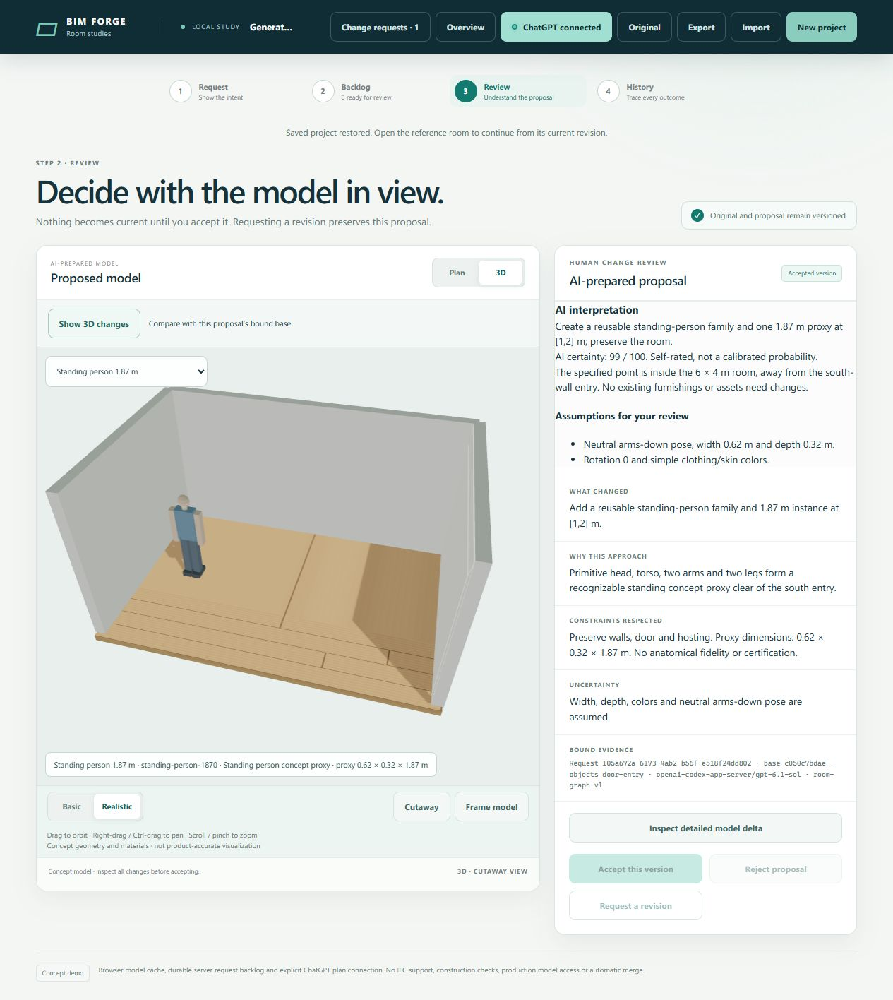

# AI-authored family acceptance evidence

Issue #113, 2026-10-25, isolated server Docker candidate based on draft PR #112. No shared-preview deployment or merge.

## Automated checks

Node 24.22.1, Babylon.js 9.32.0, ScriptBox 0.1.1. All builds and tests ran on the server.

- `npm run validate`: strict TypeScript lint, type checking and policy passed. [Output](validation.txt).
- `npm test`: 406 tests, 405 passed, zero failed, one existing root-only owner fixture skipped under the non-root container user.
- `npm run test:assets` (also invoked by `npm test`): 21 passed, zero failed/skipped.
- Combined: **427 tests, 426 passed, zero failed, one environment-dependent skip**. [Full validator/test output](test-results.txt).
- `npm run build:demo`: passed; approximately 2.5 MB browser bundle before transfer compression.

Checks cover exact analytic and rendered extrema, immutable shared definitions, both snapshot forms, millimetre-grid dimensions, invalid/dangling references and unknown fields, protected IDs, atomic script failure, queue/acceptance/restore, combined furnishing budgets, same-floor occupancy, doors, stairs, roofs, slabs, ordinary shell/furnishing edit preservation, and rotatable before/after geometry with level elevation applied once.

Integration caught a TypeScript inference failure in one test local; an explicit domain annotation fixed it. Independent review caught asset footprints being painted beneath room backgrounds in Plan; drawing them with furnishings fixes visibility and picking. No validator or existing assertion was weakened.

## Actual AI authoring

Run manually with the existing server sign-in:

```sh
BIM_ASSET_EVIDENCE=/absolute/private/directory node scripts/evaluate-assets.ts
```

The evaluator uses a synthetic legacy single-room project and its own durable backlog. The actual ChatGPT worker authored an eight-part person family and reused it for **1.87 m** and **1.65 m** instances, then authored a distinct floor-lamp family at **1.5 m**. No runtime person preset, new catalogue kind or family-specific renderer was supplied. The accepted model stayed unchanged pending review.

- [Dimensions, derived bounds and shared family IDs](live-assets.json)
- [Complete added-model delta](live-delta.json)
- [Bound review and actual ScriptBox evidence](live-review.json)

## Browser workflow

The in-app browser drove the normal UI against the isolated server candidate:

1. Create a single empty room and submit a standing-person request at exactly 1.87 m.
2. Open the ready proposal in 3D. Review its distinct head, torso, arms and legs, estimated width/depth, family fidelity and uncertainty.
3. Accept this synthetic proposal. Open the current model and select the person; the inspector shows its reusable family description and **0.62 × 0.32 × 1.87 m** dimensions.
4. Reload and restore the accepted model, then reopen the accepted request. View normal materials and the 3D delta; Basic/Realistic modes share the same native asset geometry.
5. Independently restore the saved server repository using the latest validator. Exactly one definition and one instance were added; no shell entities or hosting links changed, and the legacy snapshot format remained unchanged. Actual generated vertices span Z=0 through Z=1.87 m. [Saved-model and rendered-height assertions](browser-assertions.json), [complete UI-created delta](browser-delta.json).
6. In a second disposable three-storey house, request another 1.87 m person in the ground-floor east room. Accept it and click its footprint in Plan; the actual pointer click selects the asset and opens the correct family inspector. Only a definition and instance were added; other storeys and all relationships stayed identical. [Saved room/level assertions](room-plan-assertions.json), [plan screenshot](room-bound-plan.png).
7. At 390 × 844, the selected asset's family description/dimensions are visible in the mobile details pane; document width is 375 px with no horizontal overflow. Restore the normal viewport afterwards.

Chrome automation lost its debugger connection in this session; the UI workflow was completed in the in-app browser.



The first family module produces bounded floor-standing dimensional proxies. Scaling is by whole width/depth/height axes, with conservative occupied bounds. It does not establish anatomical, ergonomic, manufacturer-product or construction accuracy, or provide articulated/topology-changing family constraints.
