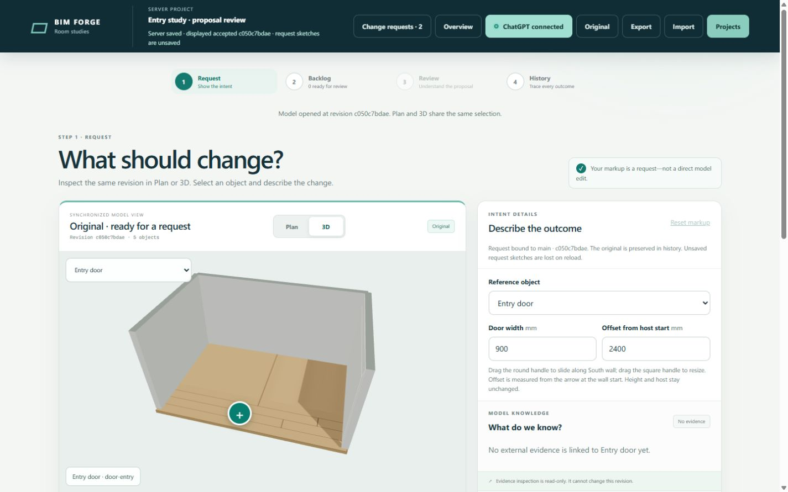
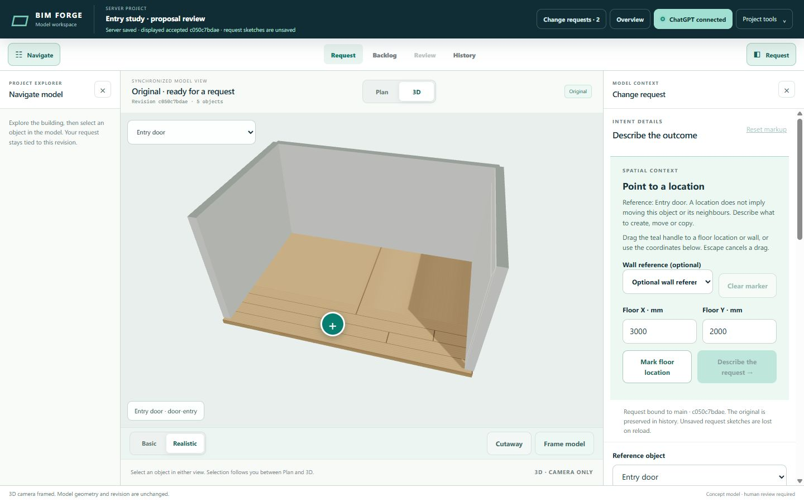
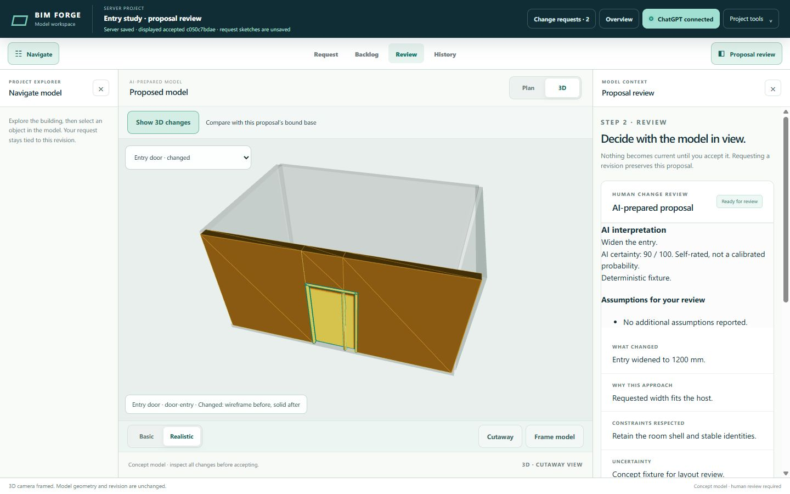
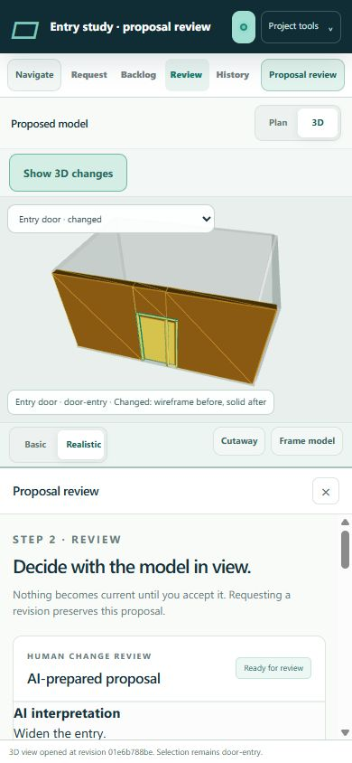

# Model-first workspace evidence (#184)

Code under test: `79e078d48a03203760022b97178d48916f6c4336`.
Base: `1643595c193f408f9840f1544c732b481390a158` from PR #180.
Subsequent evidence-only commits retain these application sources.

The model now fills a persistent central stage. Project navigation and request,
backlog, progress, scope and review tools open around it. Desktop panels collapse
independently; phone panels use a lower sheet and keep the model visible.

## Server checks

All builds and tests ran through SSH on `frederik@192.168.1.17`, in isolated
containers using `bim-qvm-tools:20261025`, image
`sha256:4b96c3cba2f461d2bb9b6a285e5514fcf58968c9614eddd3441bcdb2def38dff`.
Limits: 0.5 CPU, 1 GiB RAM, 1 GiB memory-swap (no additional swap), 128 PIDs.
Validation containers used no network. No local npm/build/test commands ran.

Immutable source came from a Git bundle. Containers copied `/source/.` into
`/app/`; the browser container copied `/builtDist/.` into `/app/dist/` so the
image's older bundle could not mask a missing build.

| Check at the tested source | Result |
| --- | --- |
| `npm run validate` | Pass |
| Explicit changed-path policy check for all five implementation/plan files | Pass |
| `npm run build:demo` | Pass |
| Request tabs/context, scope client, project client and HTTP server tests | 45 passed, zero failed or skipped |
| Static mount contract against the exact base | All 257 original IDs retained; 270 current IDs; zero duplicates |
| `git -c core.whitespace=cr-at-eol diff --check` | Pass |

The exact test command was `node --test demo/request-tabs.test.ts
demo/request-context.test.ts demo/model-scope-client.test.ts
demo/room-store-client.test.ts demo/server.test.ts`.

Raw server artifacts are retained under
`/ssd1/bim-forge-qualification/issue-184-c78b702/`. Final checks/build are in
`artifacts/keyboard-code/`; the browser fixture and private SQLite database are
in `artifacts/browser-keyboard/`. The [retained validation log](validation.log)
contains root, policy, build, test and DOM-contract output.

The first typecheck found the browser's `hidden` attribute can be a string or
boolean; explicit boolean narrowing fixed it. An initial disposable worker
script had an extra closing brace. That failed fixture remains retained; the
corrected deterministic worker produced the reviewed proposal. Neither failure
was bypassed or converted into a passing result.

## Browser evidence

Native Chrome was driven through CUA's documented viewport capability. Screens
and [read-only DOM observations](ui-observations.json) bind to the tested source.
Temporary viewport overrides were reset and agent-created tabs closed.

| Viewport | Observed behavior |
| --- | --- |
| 1440 × 900 desktop | Document stays 1440 × 900. Both panels leave an 864 px model stage. Request and review use one model canvas. |
| 1280 × 800 laptop | Document stays 1280 × 800; navigation and model remain usable with context collapsed. |
| 390 × 844 phone | Document stays 390 × 844. Review retains about 408 px of model stage and a 249 px drawing above the sheet. |
| 375 × 812 phone | Document stays 375 × 812, including the history sheet; about 389 px of model stage remains visible. |

Verified Plan/3D, Basic/Realistic and frame controls; proposal delta and its
900-to-1200 mm entry-width property comparison; project tools; storey and room
navigation; backlog tabs; working-request activity; history; request text;
enabled source input; scope preview; panel collapse; Escape/focus return; and
keyboard location marking from a collapsed context panel. Scope preview selected
only `door-entry`, with read-only `wall-south` context, while the model remained
visible. Switching context resets panel scroll; ordinary refreshes do not.

The browser fixture supplies a deterministic worker and a synthetic connected
session. No real account, credentials or AI calls were used. The source input's
enabled mount was checked; this UI pass did not upload a file. Phone viewport
checks do not qualify real-device touch gestures. Chat behavior belongs to #181
and remains an empty `#request-chat-mount` integration host in this branch.

Before, at the exact base:

After, with request tools beside the model:

Review uses the same central stage:

Phone review keeps the model above the sheet:

## Model delta and handoff

This change modifies no model entity, relationship, geometry, storage, query or
accepted revision. The disposable proposal changes one entry-door width and
zero relationships; it was inspected without acceptance. The live preview on
9443 and its model data were untouched. No merge or deployment occurred.

The parent session owns combining this shell with scopes and #181, resolving
the small `room-app.ts` overlap, and qualifying the combined server/UI before
its aggregate PR. The [mount and panel contract](../../design/model-first-workspace-184.md)
describes ownership and navigation APIs. No sibling branch is incorporated here.
