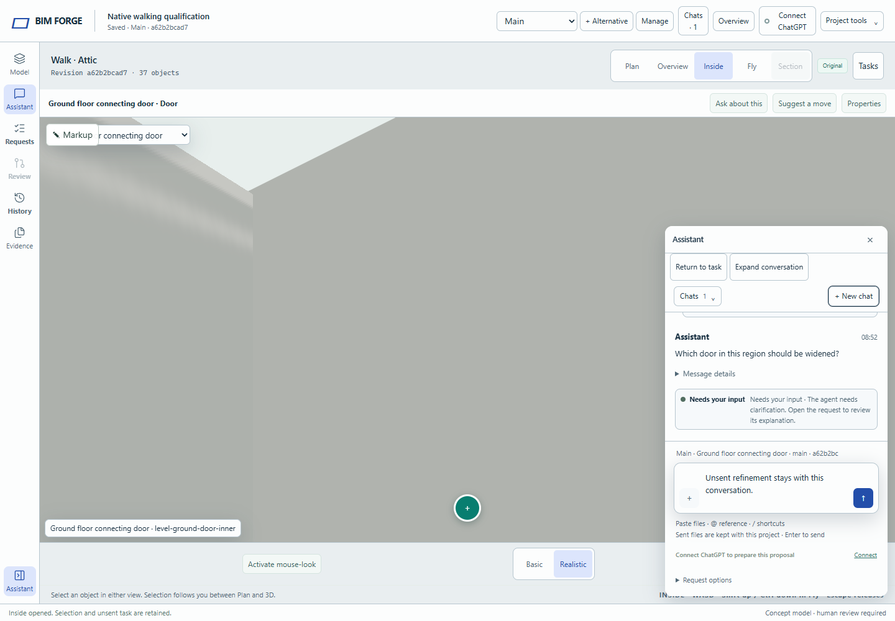

# Native Walk: doors and stairs (#284)

Walk now crosses sufficiently clear native Door openings and travels up and down supported straight native stairs. A landing changes the displayed floor without moving the camera, changing the selected construction object, submitting a chat, or moving a saved agent. Before this change, the whole host wall and every stair footprint blocked Walk.

## Design decision

The source uses X/Y horizontal and Z vertical metres. Door voids belong to their directed host wall; decorative door leaves have no authored open/closed state. Slab tops are level elevations. Stair treads are discrete boxes, owned by the lower level even when supporting arrival at the upper level. Viewer visibility therefore cannot establish physical support or headroom.

Two independent designs were compared: an immutable semantic world with opaque traversal states, and a compiled world with a stateful movement controller. The immutable world was chosen: the caller holds a session state and receives a validated next state, while source geometry and transitions remain private. The alternative contributed collision against all levels and a synchronous floor-arrival transaction. Render-mesh collision was rejected because hidden geometry still affects clearance and decorative leaves would incorrectly close authored door voids. No cross-family model judgment was available or claimed.

```text
source change -> compileNativeWalk(snapshot, sourcePin)
entry         -> enter({levelId, point}) -> {state, pose}
frame         -> advance(state, displacement, seconds) -> {state, pose, kind}
view return   -> bookmark(state) / restore(bookmark)
landing       -> viewer visibility + cached level -> browsing title
```

The traversal owner compiles support and solids, retains the particular active flight, sweeps a radius-0.22 m body, and permits only endpoint entry and full-body supported exits. Feet follow actual treads; the eye settles continuously. The navigation controller owns keyboard/focus and camera application. The viewer owns level visibility without framing. The app receives a browsing-level notification; authoring scope and task placement retain their existing owners. Returned state is consumed even when a blocked movement made safe partial progress. Explicit task return may revisit a supported floor, but still rejects a different project or source.

## Acceptance evidence

- `npm run validate`: strict TypeScript (388 source files), typecheck, policy pass.
- Source integration baseline: 51/51 native traversal, navigation, scene, plan and task-component checks pass.
- Final focused run: 16/16 pass, including 13 geometry tests, two camera/session tests and the real browser journey.
- Existing browser regressions: 6/6 pass across navigation, markup, Plan integration, saved agents and workspace lifecycle.
- The new browser journey crosses the actual 900 mm hosted doorway both ways, climbs Ground to Attic, returns through Plan halfway up a flight, then descends. It checks the retained ground-floor door in both pickers, the same unsent text and saved task origin, one canvas, one submission, no page errors, and identical accepted-project JSON before/after.
- Geometry fixtures cover 800/900 mm doorways, reversed hosts, low doors and windows, all four stair axes, 200/250 mm risers, side-entry rejection, gaps, missing landings, overlapping flights, roof/slab headroom, elevated obstacles, swept grazing collisions and frame caps. Snapshot bytes remain unchanged.



## Verification iterations

1. First full-app run exposed an idle navigation callback cancelling polyline markup; idle focus handling was corrected. The traversal journey also stopped early.
2. Markup passed. The new journey still stopped after one frame: an asynchronous browser wait predicate was being treated as truthy before its result. The test now reads a synchronous capture bridge.
3. The complete doorway/ascent/descent journey passed. A final focused repeat also passed after adding cross-floor return/source guards and improving the arrival capture. No validator or assertion was weakened.
4. The later two-CPU Linux qualification passed 72 existing checks, but the new journey timed out on its first doorway target. After the user reported the Linux VM back online, the unchanged test reproduced that failure. A temporary trace showed stable source, facing and canvas focus: the walker crossed the doorway and advanced from X=3 to X=4.3, but only 13 animation frames arrived before the 15-second deadline for X=4.6. The existing 50 ms frame cap correctly prevented large movement jumps. Changing only this navigation test to Basic rendering passed the full journey under the same resource limits and deadlines. The committed setup makes that choice explicit; no application rendering default, collision policy, timeout, or acceptance assertion changes. Temporary instrumentation remains outside the repository.

## Scope and review

Model delta: **zero entities, relationships, dimensions or revisions changed**. Bookmarks are transient camera-session data; no database/schema/deployment change is included. Fly retains WASD and Shift-up/Control-down.

Supported stairs are axis-aligned straight flights between adjacent native levels, with real landings, adequate headroom, width at least 440 mm, and risers at most 250 mm. The body is 1.75 m tall and the eye is nominally 1.6 m high. These are navigation policies, not accessibility or building-code certification. Furniture and asset collision use conservative envelopes. Linked IFC walking, curved/multiflight stairs and true Sections remain separate work.

For manual testing, create the house template, choose Inside, focus the model, and use WASD plus mouse-look. Cross the central connecting doorway to the room containing the Ground-to-Attic stair, then ascend and descend. Keep a selected door and an unsent chat while switching to Plan and back mid-flight. Review movement feel, clearance and floor continuity before approving this draft.
