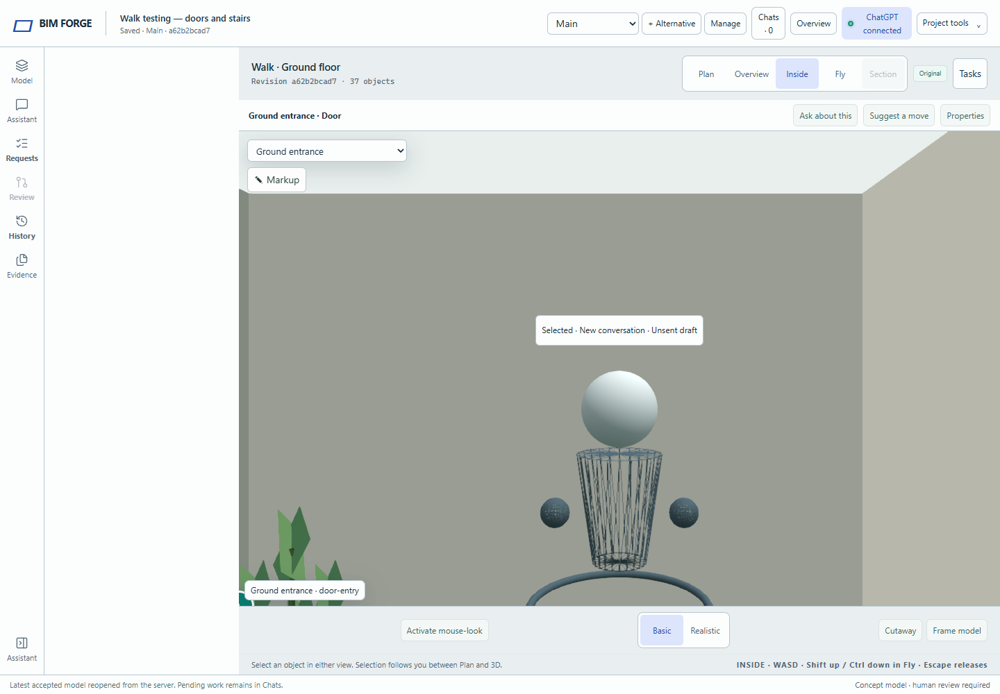
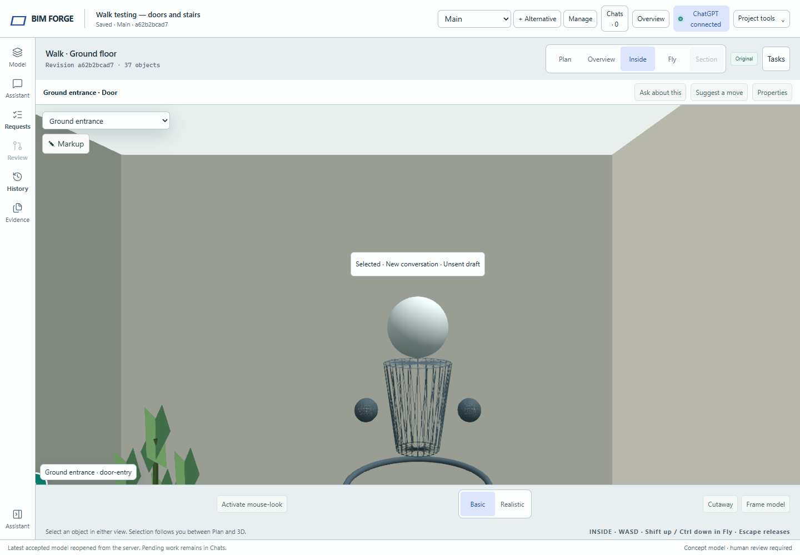

# Stable spatial workspace (#288)

The white strip was space reserved for the hidden navigation panel. When both navigation and conversation were closed, a combined CSS selector assigned the full navigation column at higher specificity than the navigation-closed rule. Opening an agent conversation removed that match, collapsing the column and resizing the model. The same selector also outranked the narrow layout.

The fix removes the redundant state variants from the base spatial-shell selector and makes the narrow override match either navigation state. Normal Model/Requests/History/Evidence navigation retains its intended behavior. No camera, task-opening, model, or persistence logic changes.

## Before and after

Both panels closed, before:

Both panels closed, after:

The live baseline reproduced the user's slide: selecting the spatial conversation changed model X/width from `344/1096` to `64/1376` at a 1440 px viewport. After the fix it stays at `64/1376` throughout the transition. At 800 and 390 px it stays full width before and after selection.

## Qualification

- `npm run validate` passed on Linux for the standalone issue branch (386 source files) and combined testing preview (389 files); typecheck and policy pass. The Linux build passed. Model delta: **zero** entities, relationships, accepted revisions, or stored conversations changed.
- `npm run test:spatial-shell-layout` fails on the original CSS with “No empty gutter at 1440px with navigation false,” then passes with the selector correction. It loads the shipped styles into a browser document without starting a web server. All nav/context combinations are checked at 1440, 800 and 390 px with normal and reduced motion; every sampled animation frame must retain model X/width when the conversation opens.
- The live Linux preview passed actual spatial-task selection from its task list at those three widths. The same canvas remains connected, camera eye/facing/up/level/motion remain equal, and there are no page errors or chat submissions. A disconnected-browser case also preserves the cached model bounds and camera.
- The layout detector reports no findings. Before/after desktop and narrow conversation captures were visually inspected. The browser regression is included in the Linux qualification file list.

A CSS-only reproduction establishes the failure without an agent, camera controller, server request, or page refresh, ruling those out as causes. Initial live exploration that opened Requests first exercised a different state; minimising to both panels closed reproduced the exact reported empty gutter.

The Linux preview uses integration revision `723a77a` (the existing Walk and toolbar preview plus this fix). Preview data and AI sign-in are preserved. The standalone PR targets main independently. No Windows application server was started; Windows carries only the browser and SSH client connection.
