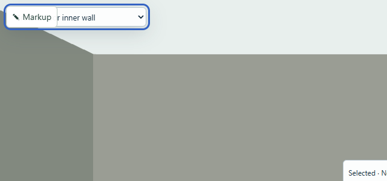
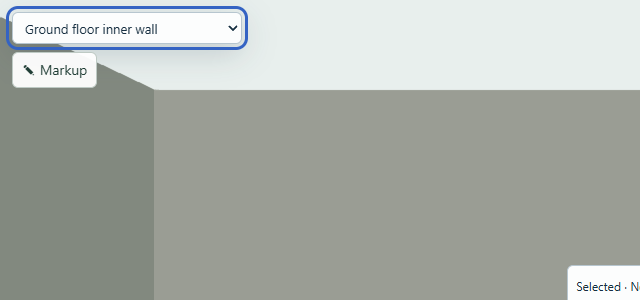
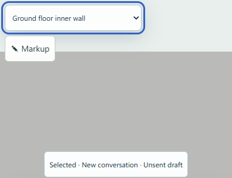

# Viewer control layout (#286)

The Markup toggle and object picker independently occupied the upper-left corner of the 3D viewer. Markup covered the selected object name and intercepted clicks. An older narrow-screen rule also hid the picker while the conversation was open.

The viewer now owns one positioned control group. The picker comes first, with Markup and its expanded tools below it in normal flow, separated by the existing 8 px spacing step. Available width constrains both controls and the tools. Empty overlay space passes pointer events through to the model. Existing control styling, focus rings, native selection and markup handlers remain unchanged. The grouped picker stays available in the narrow request workspace.

## Rendered evidence

Before, including keyboard focus:

After:

Phone width with coarse pointer targets:

## Qualification

- `npm run validate` passed on Linux for the standalone issue branch (385 source files) and the combined Walk testing preview (388 files). Typecheck and policy passed. The Linux demo build passed.
- Browser checks against the Linux-hosted preview passed at viewport widths 1440, 768, 390 and 320 px, including coarse pointer contexts at the two narrow sizes.
- Closed controls have zero intersecting area; the picker receives hit testing at its previously covered left edge. Selecting the inner wall works, and Tab moves from the picker to Markup.
- Expanded tools remain within the viewer at every checked width. Markup opens/closes; Inside and Overview retain the separated controls. No page errors or chat submissions occurred.
- The layout detector reports no findings. Rendered focus, spacing, and narrow reflow were inspected together.
- Baseline capture setup initially raced saved-project loading and assumed controls that the old narrow layout hid. The final capture waits for the visible, ready canvas and records the old hidden-picker state rather than treating an unloaded page as layout evidence. Acceptance assertions on the updated UI remain strict.

Model delta: **zero entities, relationships, revisions or stored conversations changed**. This changes viewer control layout only. It does not add turning controls or change navigation behavior.

The live Linux service uses integration revision `e2b96eb` (Walk preview `88b3347` plus this issue's two source commits). The source PR targets main independently of the Walk feature. The existing preview data directory and AI connection are retained; Windows hosts only the browser and SSH client connection.
