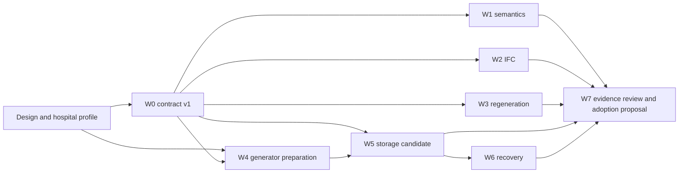

# Versioned model qualification program

Program: `QVM-01`. Parent tracker: [#122](https://github.com/Frederik91/bim-forge/issues/122). Status: execution in progress. The registry records current work state and reviewed outcomes separately from implementation-test success.

Start with the [current design candidate](../design/versioned-model-candidate.md). Read the [research](../research/versioned-bim-data-model.md) for its evidence and alternatives. The [registry](registry.json) assigns stable experiment IDs, definitions, dependencies, work streams, and current reviewed results. The [hospital benchmark](../../benchmarks/hospital/README.md) specifies the confirmed 200,000 m² database workload.

## Records and authority

| Record | Location | What it establishes |
| --- | --- | --- |
| Proposed design | `docs/design/versioned-model-candidate.md`, pinned by commit and hash | What a run is testing |
| Experiment definitions and reviewed summary | `docs/experiments/registry.json` | Assertions, owners, dependencies, status, and accepted result pointer |
| Work state and PR discussion | Parent and child GitHub issues | Who claimed a bounded task and what work remains |
| Per-run evidence | Unique directories under `docs/experiments/results/<experiment-id>/<run-id>/` | What actually executed and its result |
| Large raw artifacts | Durable private artifact storage, with hashes in the run record | Logs, datasets, traces, and backups needed to reproduce a result |
| Interpretation and adoption | `docs/experiments/decisions/` when evidence exists | Why evidence supports, rejects, or changes a design choice |

GitHub issues track work. They do not replace run evidence. Registry status changes only after a result review. A closed implementation issue, passing CI, agent narrative, or draft template cannot count as a passed experiment.

## Parallel work streams

| Stream | Execution issue | Exclusive implementation scope | Execution dependency |
| --- | --- | --- | --- |
| W0: shared contracts and tiny fixture | [#123](https://github.com/Frederik91/bim-forge/issues/123) | `experiments/contracts/**`, `experiments/fixtures/**`, result templates | Publish contract v1 first |
| W1: identity and proposal semantics | [#124](https://github.com/Frederik91/bim-forge/issues/124) | `experiments/semantic/**` | W0; paired-export part of EX-01 also uses W2 |
| W2: IFC and coordinates | [#125](https://github.com/Frederik91/bim-forge/issues/125) | `experiments/ifc/**` | W0 |
| W3: dependencies and regeneration | [#126](https://github.com/Frederik91/bim-forge/issues/126) | `experiments/regeneration/**` | W0 |
| W4: hospital dataset generation | [#127](https://github.com/Frederik91/bim-forge/issues/127) | `benchmarks/hospital/generator/**`, generated-fixture definitions | Profile v1; W0 before execution integration |
| W5: persistence and measured scale | [#128](https://github.com/Frederik91/bim-forge/issues/128) | `experiments/storage/**`, `benchmarks/hospital/workloads/**` | W0 and reduced W4 dataset |
| W6: upgrades, recovery, independent copies | [#129](https://github.com/Frederik91/bim-forge/issues/129) | `experiments/recovery/**` | W0 and first W5 candidate |
| W7: result review and adoption proposal | [#130](https://github.com/Frederik91/bim-forge/issues/130) | Shared design, registry, decision records | Incremental review; final decision needs W1-W3, W5, W6 evidence |

Prepare cases, collect IFC exports, define topology failures, and implement the deterministic hospital generator in parallel while W0 publishes the small shared contract. Publish that contract before completing every fixture. W5 can prototype after the contract and a reduced dataset exist. It does not wait for every correctness conclusion, but cannot claim qualification before those contracts pass. W6 can prepare failures and restore oracles immediately, then execute against the first storage candidate.

The registry expresses execution prerequisites as specific artifacts with case-level applicability. A paired export blocks only the cases using that export. The first usable storage candidate unlocks recovery tests while performance experiments continue. Producer streams and related experiments are references, not requirements that the entire stream or experiment has completed. W7's combined adoption gates are separate from execution readiness.

## Isolation and integration

One issue, agent, worktree, branch, and draft PR per bounded implementation attempt. Claim the issue before writing. Pin the W0 contract commit used by each stream. Contract changes go through W0 instead of local forks of shared definitions. Keep common package scripts and shared contracts under one owner. Integrate bounded results without a single giant implementation PR.

Workers write unique result directories and never concurrently edit the shared registry. W7 coordinates result pointers and design changes. A benchmark adapter or generator belongs to qualification code until an adoption decision explicitly promotes it. Delete rejected implementations rather than retaining production compatibility layers.

Each server run gets its own Compose project or equivalent container namespace, database, volumes, network ports, output path, and immutable run ID. Small correctness tests may share the host under recorded limits. Full performance runs reserve one exclusive measurement slot for the relevant host/storage resources. Concurrent coding is useful; competing database measurements on the same disks would invalidate comparison.

Do not flush shared host caches, change preview data, or weaken validators for a benchmark. Record implementation limits as limits. A larger experimental fixture uses its own contract instead of bypassing the current application's safeguards.

## Experiment catalog

| ID | Experiment | Stream | Initial result |
| --- | --- | --- | --- |
| EX-01 | Identity across snapshots, paired exports, and object lineage | W1 with W2 export fixtures | Baseline failed; candidate running |
| EX-02 | Narrow IFC-native versus native-authoring comparison | W2 | Running |
| EX-03 | Shared properties, definitions, and occurrence isolation | W1 | Baseline inconclusive; candidate running |
| EX-04 | Independent changes and cross-object semantic conflicts | W1 | Baseline failed; candidate running |
| EX-05 | Changed assumptions despite valid geometry | W1 | Baseline failed; candidate running |
| EX-06 | Same-object property independence and incompatible edits | W1 | Baseline failed; candidate running |
| EX-07 | Dependency evaluation and geometric references | W3 | Running |
| EX-08 | Coordinates, quantities, units, and exchange | W2 | Running |
| EX-09 | Interpretable immutable history across upgrades | W6 | Running |
| EX-10 | Revision storage growth and working-set queries | W5 | Running |
| EX-11 | Crash, retry, artifact completeness, and restore | W6 | Running |
| EX-12 | Disconnected branches, independent copies, and authority | W6 | Running |
| EX-13 | Detailed 200,000 m² hospital database workload | W5 with W4 generator | Running |

## A run and its result

1. Select an experiment definition and design commit. State the hypothesis, candidate variant, expected results, failure rules, and applicable budgets before execution.
2. Pin source, runner, generator, schema, indexes, validators, seed, dataset hashes, software, container images, and resource envelope. Record unavailable information explicitly.
3. Run against disposable server data. Separate deterministic operation tests from AI and UI follow-up tests. A script succeeding is not evidence of intended model behavior.
4. Capture actual operations, assertions, deltas, measurements, errors, and resource series. Preserve failed attempts. Finalize the run record atomically into a unique directory.
5. Review the evidence and link it from the execution issue. W7 updates the registry's reviewed result pointer and implications. Design changes identify which earlier results need repeating.

The [result template](templates/run-result.json) is deliberately marked as a template with `not-run` outcome. W0 implements machine validation before accepting executable results. Templates cannot be submitted as completed runs. Live progress is a journal; a terminal result is immutable. Corrections or reinterpretations create new records that reference the original.

Registry summaries use `not-run`, `running`, `blocked`, `passed`, `failed`, `inconclusive`, or `superseded`. A terminal run records `completed`, `failed`, `cancelled`, `timed-out`, or `resource-limit` independently of its experimental conclusion. Missing assertions or evidence prevent a `passed` conclusion. A timeout remains an observed limit, not an omitted sample.

Result reviews are separate immutable decision records that reference the original run. Reviewers do not edit a terminal run to add a sign-off. The coordinator records both the reviewed run and its review record in the registry.

Keep small results and decision records in Git. Put large logs and datasets in durable storage with checksum, byte size, media type, access scope, and retention. An ephemeral `/tmp` path or expiring signed URL alone is insufficient. Preserve access to failed-run evidence and the last accepted result when a new run fails.

## Adoption gates

W7 requires evidence for identity and edit scope, concurrent acceptance and approval equivalence, the declared IFC contract, dependency/regeneration failure behavior, interpretable history, complete recovery, and an agreed measured capacity envelope. Results qualify only the tested capability and workload. Missing real-kernel or API coverage stays explicit.

The program prepares evidence for [private project persistence #78](https://github.com/Frederik91/bim-forge/issues/78). It does not authorize production schema adoption, merging protected changes, or an unattended factory run.
