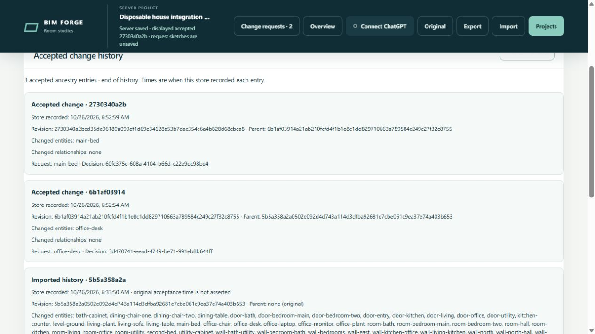

# Versioned house integration evidence

Issue [#161](https://github.com/Frederik91/bim-forge/issues/161) connects immutable model storage to the existing request, proposal, review and acceptance workflow. Baseline: `8a1f3a955ecea90bceef574ff8b9eab4249669ce`. The coordinator integrates separate persistence (#163), queue/HTTP (#164) and browser (#165) branches. The PostgreSQL publication investigation (#162) remains a separate experiment and PR.

## Observable behavior

The server owns the accepted project pointer. A request and its isolated result refer to immutable documents. Changing one furnishing adds its changed body and revision delta; other bodies retain their hashes. The accepted pointer, request decision and receipt commit together. A rejected, failed, invalid or conflicting proposal does not advance it.

Two requests prepared from one base can both be accepted when their changes reconcile. Existing semantic and engineering validators still run on the combined model. Comparing a historical proposal uses its bound base; reopening a project uses the server's accepted state. Browser recovery cannot roll that state back.

Migration validates the legacy projects, archived results, review and source bindings before committing. The old project body column is removed within that transaction. Failure preserves the original bytes and schema; the queue does not start processing partially migrated data. Existing IndexedDB bytes remain available for recovery/export.

## Server-container checks

All builds and tests use isolated containers on `frederik@192.168.1.17`. The tools image is `sha256:4b96c3cba2f461d2bb9b6a285e5514fcf58968c9614eddd3441bcdb2def38dff`; Node 24. Test containers have no network, except the disposable browser fixture's server-loopback HTTP listener. The normal preview at port 9443 is unchanged.

Artifacts live below `/ssd1/bim-forge-qualification/house-161`.

| Source | Method | Result | Raw artifact directory |
| --- | --- | --- | --- |
| `01b2c95` | Root validation and existing model tests | PASS; 44 model tests | `artifacts/contract-check` |
| `1a536e4` | Root validation, demo build, client and HTTP integration | PASS; 17 tests, 0 skipped | `artifacts/integrated-1a536e4` |
| `30bbcc5` | Root validation and complete `npm test` | PASS; 459 passed, 0 failed, 2 skipped; asset suite 21 passed | `artifacts/full-suite-30bbcc5` |
| `f2ed71b` | Root validation, demo build and browser client tests | PASS; 16 tests, 0 skipped | `artifacts/browser-fixed-f2ed71b` |
| `9f41b26` (queue worker) | Root validation, demo build and migration/queue/HTTP tests | PASS; 33 tests, 0 skipped | `worker164-9f41b26/artifacts` |
| `ace24fc` (browser worker) | Root validation, demo build and client tests | PASS; 16 tests, 0 skipped | `issue-165-20261026-overview-phone/artifacts` |
| `742b559` (combined code) | Root and changed-path validation, demo build, queue/HTTP/client/integration tests | PASS; 51 tests, 0 skipped | `artifacts/final-code-742b559` |
| `12892c6` (retained comparison follow-up) | Root and changed-path validation, demo build, client tests | PASS; 16 tests, 0 skipped | `artifacts/review-code-12892c6` |

The full run includes the single maintainer-approved rerun of the corrected persistence fixtures. Its core source/test blobs match `eb5cfba`; all 15 persistence tests passed. The two skipped cases are the existing administrator-dispatch/symlink tests. This is not a pass for those platform-specific cases.

The aggregate [draft PR #170](https://github.com/Frederik91/bim-forge/pull/170) also passed [GitHub CI at `a3bf2eb`](https://github.com/Frederik91/bim-forge/actions/runs/40278164119). That Ubuntu runner reported 465 main tests: 464 passed, zero failed, one skipped; the asset suite passed 21/21. The skipped case was the existing protected-file different-owner test. This differs from the server container's administrator skips because the environments exercise different privilege conditions. Root validation and all 30 changed-path checks passed.

The two HTTP integration cases use actual ScriptBox proposals and accept desk then bed, and bed then desk. Each proves asynchronous acknowledgment, unchanged accepted state before the worker finishes, a bound 3D delta, independent acceptance, stale browser import refusal, restart recovery, bounded accepted-history paging, retained execution evidence and idempotent decision replay. Their model delta is two modified furnishing IDs and zero relationship changes.

## Browser qualification

The disposable fixture uses `demo/fixtures/versioned-house-server.ts`, with explicit opt-in and a deterministic test worker. It exercises the application's real queue, ScriptBox, HTTP routes and Babylon viewer. It does not qualify ChatGPT sign-in or live model inference. Its data is separate from user projects.

The fixture runs on the server and is reached through an authenticated SSH loopback tunnel. No local app server/build is used. A self-signed test listener was abandoned without bypassing the browser warning.

At `f2ed71b`, the browser reopened the eight-room house from the server. Two proposals were ready against root `5b5a358a2a0502e092d4d743a114d3dfba92681e7cbe061c9ea37e74a403b653`. The coordinator:

1. Opened the desk proposal, orbited its 3D delta and inspected property details: width 1,600 to 1,800 mm, one modified entity, zero relationships.
2. Accepted the desk, producing `6b1af03914a21ab210fcfd4f1b1e8c1dd829710663a789584c249c27f32c8755`.
3. Opened the original bed proposal. Acceptance remained enabled; no revision was requested.
4. Accepted it, producing `2730340a2bcd35de96189a099ef1d69e34628a53b7dac354c6a4b828d68cbca8`.
5. Observed zero ready requests, two completed requests and three accepted ancestry entries with request/decision bindings.

Review caught browser corrections: native `fetch` needed its browser receiver preserved; Overview and retained comparison choices needed the accepted repository rather than the historical review repository. A phone check also found 14 px of root overflow requiring a structural layout correction.

At combined source `742b559`, a replacement container reopened the same database, including migration from the interim normalized sentinel column to `projects(id)`. A new browser tab reopened accepted head `2730340a2b`, two completed requests and the same three history entries. Opening the older desk request and then Overview still showed accepted revision `2730340a2b`. At a 390 × 844 viewport, document client/body/root widths were all 375 px (the scrollbar uses the remainder), with no horizontal root overflow. The temporary viewport override was reset.

Final browser verification at `12892c6` reopened the same state again. With the historical desk request selected, both retained alternatives remained available. Comparing bed and desk reported no divergent whole-object changes and did not advance accepted head `2730340a2b`. The phone width check again returned 375/375/375 px. The browser fixture and authenticated tunnel were then stopped; database and raw artifacts were retained. The normal preview was unchanged.

The [rotated 3D review](../evidence/house-161/rotated-review.jpg) was captured at `f2ed71b`. The [phone history](../evidence/house-161/phone-history.jpg) and recovered desktop history below were captured at `12892c6`. They show a disposable integration fixture, not a surveyed building or a signed-in ChatGPT inference session.

## Boundaries and next qualification

The separate publication investigation executed one instrumented reduced case against measured source `3a0b1ef3ec44c2e741fa5858d83d0ef8a7ce5098`, using controller/instrumentation `de4762f48d33365ea499e229dfb71c00031711fe`. Its original source/body/property/readback oracles passed for 270,205 records and all three actual plans were retained. FK trigger work and visibility insertion are material in this reduced case; the visibility join spilled. This does not identify the full-scale limiter or establish a speedup.

Its overall harness status is ISSUES: controller collection collided with root-owned client log names and failed to write its native terminal receipt. After the owned containers had stopped, the watchdog reported stale budget telemetry. Post hoc recovery is explicitly labeled; it does not fabricate the missing receipt. A future finalization correction was separately tested without another database case. The investigation report and exact raw identities remain in [draft PR #166](https://github.com/Frederik91/bim-forge/pull/166). All owned diagnostic containers are stopped, the historical cluster states are preserved, and no fourth full admission occurred.

This is a house-scale integration using SQLite, not adoption of the experimental hospital database. Portable runtime projections still hydrate the bounded house document. Existing 256 KiB, revision and array limits remain. Changed-only persistence does not imply a level-streaming API or constant-time hydration.

No fourth full hospital admission, Rust rewrite/speedup, general geometry qualification, disconnected synchronization, production model mutation, main merge or live-preview deployment is claimed. The measured PostgreSQL path, its constraints and the next diagnostic are reviewed in [PR #166](https://github.com/Frederik91/bim-forge/pull/166).
