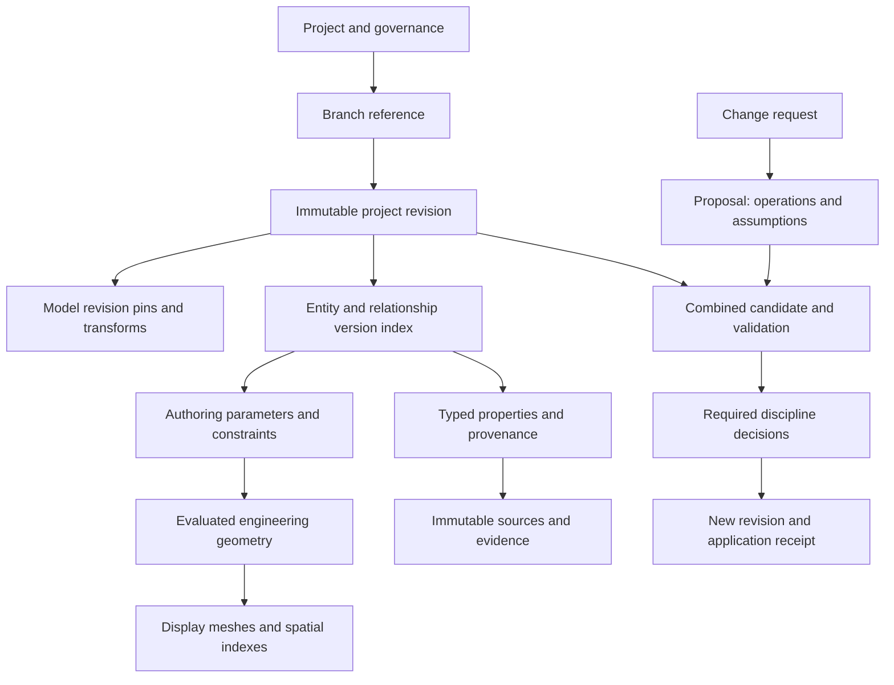

# Lessons for a versioned BIM data model

Research date: 25 October 2026. Tracking: [Issue 120](https://github.com/Frederik91/bim-forge/issues/120).

Status: research and proposed design. This report does not adopt a storage schema or change application behavior.

## The proposed direction survives, with several corrections

Keep stable identities for meaningful building objects, immutable versions, and atomic project revisions. Existing systems offer useful precedents, but none of the sources establishes that independently versioned objects alone provide safe BIM collaboration.

The main corrections to the earlier proposal are:

- An entity's identity, immutable content identifier, source-system identifier, and project revision are different identifiers.
- Storage units, conflict units, and approval units need different boundaries. A wall can be one stored entity while a safe change involves its openings, adjacent spaces, and connected systems.
- The model is a graph with several kinds of relationship. The project browser, room hierarchy, placement hierarchy, ownership, and dependency graph are different projections.
- Shared values do not imply shared authority. Deduplicating two property values must not couple future edits to two objects.
- Native authoring state, evaluated engineering geometry, display meshes, and query indexes need explicit roles and version bindings.
- IFC compatibility needs a declared exchange contract and loss report. An IFC-shaped schema does not establish lossless interchange or preserve every author's constraints.
- An immutable history must remain interpretable after schema, property dictionary, validator, and geometry-engine upgrades.

For BIM Forge, I recommend retaining the planned PostgreSQL and object-storage direction while qualifying these rules with small experiments. Neither this research nor the external vendors' performance claims proves a particular database layout will meet our workloads.

## Scope and evidence

The investigation uses buildingSMART specifications and repositories, official platform documentation, implementation documentation, and a database research paper. Source facts appear under **Evidence**. Statements under **Recommendation** are inferences for BIM Forge, not guarantees supplied by a standard or vendor.

The application baseline is commit `8a1f3a955ecea90bceef574ff8b9eab4249669ce`. Its repository already has stable entity identities, immutable full snapshots, proposal branches, and three-way reconciliation followed by model validation. Independently persisted entity versions and project manifests remain a proposed evolution. See [architecture](../architecture.md), [storage](../storage.md), [project mirrors](../project-mirrors.md), and [the baseline model implementation](https://github.com/Frederik91/bim-forge/blob/8a1f3a955ecea90bceef574ff8b9eab4249669ce/src/room-model.ts).

The source boundaries matter:

| Source | Scope used here | Limitation |
| --- | --- | --- |
| IFC | Released IFC 4.3.2.0, with explicitly identified IFC4 examples | IFC4.4 previews and development pages are not the released interchange contract. |
| buildingSMART certification | Stated exchange purposes and round-trip exclusions | Certification of an exchange view does not certify our authoring behavior. |
| Bonsai and IfcOpenShell | Native IFC authoring, diffing, shared properties, geometry settings | A documented feature is not a benchmark or a complete interoperability test. |
| BIMserver | Published database versioning design and terminology | Its own wiki warns that some material is historical. Use it as a precedent, not proof of current implementation details. |
| Speckle | Current 2026.9 documentation and explicitly labeled older object graphs | Current bundle support differs between cloud, enterprise, open-source server, and SDKs. |
| Revit, iTwin, FreeCAD, and OpenCascade | Authoring and concurrency lessons detailed below | API contracts and examples do not prove our proposed merge behavior. |
| IFC5 and OpenUSD | Experimental IFC5 composition and released USD scene composition | Composition order does not establish engineering authority or safe conflict resolution. |
| PostgreSQL and database research | Transaction isolation and invariant preservation | Database guarantees apply to the transactions and invariants we actually implement. |

No external software was benchmarked or installed for this report. The qualification experiments below remain unexecuted.

## 1. Identity needs more than an object ID

**Evidence.** IFC's `IfcRoot` supplies `GlobalId` to objects, property definitions, and objectified relationships. Resource-schema entities are outside that inheritance tree. `OwnerHistory` is optional in IFC4 and records the last modification rather than a complete revision history. IFC therefore distinguishes globally identified concepts from their supporting representation records, and it does not supply our project history. [IFC 4.3.2.0 IfcRoot](https://standards.buildingsmart.org/IFC/RELEASE/IFC4_3/HTML/lexical/IfcRoot.htm)

IfcDiff explicitly assumes that the same element retains its `GlobalId` across the two files being compared. Its added, deleted, and changed categories depend on that continuity. GUID preservation is therefore an integration requirement, not a detail we can repair after diffing. [IfcDiff](https://docs.ifcopenshell.org/ifcdiff.html)

BIMserver's published design separates server-local object identity from revision identity, and stores records keyed by project, object, and revision. Its documented GUID queries are distinct from its internal OID queries. This is a close historical precedent for separating entity identity from entity state. [BIMserver database versioning](https://github.com/opensourcebim/bimserver/wiki/database---versioning), [terminology](https://github.com/opensourceBIM/BIMserver/wiki/Terminology), [JSON queries](https://github.com/opensourceBIM/BIMserver/wiki/JSON-Queries)

Revit's `UniqueId` is stable within a document across upgrades and worksharing operations, while `ElementId` may change. This is a document-lineage contract, not a claim about arbitrary copied files. Bentley's BIS similarly distinguishes federated identity from local element identity, and expects different identities for physical, functional, and analytical perspectives. [Revit 2026 Element.UniqueId](https://help.autodesk.com/cloudhelp/2026/ENU/Revit-API-MainReference/files/html/f9a9cb77-6913-6d41-ecf5-4398a24e8ff8.htm), [BIS FederationGuids](https://www.itwinjs.org/bis/guide/fundamentals/federationguids/)

**Recommendation.** Give these concepts separate types and persistence fields:

| Identifier | Meaning | Example |
| --- | --- | --- |
| `EntityId` | This particular semantic object across its history | A specific installed pump or designed wall |
| `EntityVersionId` | One immutable state of that object | The pump's placement and properties in one accepted state |
| `ContentHash` | Canonical bytes or artifact content | A reused geometry definition or document |
| `ProjectRevisionId` | A consistent accepted or proposed project state | The exact model reviewed by an engineer |
| `SourceIdentity` | A source model's identifier mapped to our object | Source installation, model lineage, and IFC GlobalId |
| `OccurrenceId` | A placement where a shared definition is used | The second chair using the same family |

`EntityVersionId` may be content-addressed, but the version envelope must include semantic identity and schema version. Two distinct chairs must remain distinct even when their geometry and properties match. Their immutable geometry bytes can still be shared.

A native placement can use its `EntityId` as its occurrence identity. An element in a repeatedly linked source model also needs its model-occurrence context, so two links of the same source remain selectable as different placements. Physical and analytical representations can have separate entity identities connected by explicit correspondence. A common real-world asset reference does not require every discipline to edit one universal object record.

Map external identity using source namespace and model lineage. Preserve the source identifier without assuming it is trustworthy or unique in every incoming file. Duplicate GUIDs, copied source files, linked occurrences, deletion followed by recreation, and changed exporter IDs need explicit handling. A geometry match may suggest reconciliation, but it must not silently replace identity.

Do not expose STEP instance numbers such as `#123`, JSON array positions, display names, scene paths, or mesh indices as durable application identity. Splits and merges need explicit lineage, because one old wall becoming two new walls cannot be expressed by changing a version number alone.

## 2. Shared data and relationships need explicit edit semantics

**Evidence.** IFC defines types separately from occurrences. Type properties apply to occurrences, with occurrence properties overriding corresponding type properties under the defined property-set rules. This is shared meaning, not merely a storage optimization. [IFC4 IfcRelDefinesByType](https://standards.buildingsmart.org/IFC/RELEASE/IFC4/ADD2/HTML/schema/ifckernel/lexical/ifcreldefinesbytype.htm)

IfcOpenShell documents a concrete editing hazard: several elements can share one property set, so editing that set changes every associated element. Its `UnsharePsets` operation makes independent copies when that coupling is unwanted. [IfcOpenShell UnsharePsets](https://docs.ifcopenshell.org/autoapi/ifcpatch/recipes/UnsharePsets/index.html)

Space boundaries are themselves relationships with physical or virtual meaning and potentially their own connection geometry. A space and a wall are not interchangeable representations of the same boundary. [IFC4 IfcRelSpaceBoundary](https://standards.buildingsmart.org/IFC/RELEASE/IFC4/FINAL/HTML/schema/ifcproductextension/lexical/ifcrelspaceboundary.htm)

Speckle's current relation model distinguishes hosting, ownership, room occupancy, level membership, system membership, and connectivity. Its documentation also separates resolved object relationships from a solid-modeling feature history or assembly constraint solver. [Speckle relations](https://docs.speckle.systems/developers/object-model/relations)

**Recommendation.** Use typed relationships with defined cardinality, direction, lifecycle, and ownership. Version a relationship independently when it has business meaning or changes independently. A simple foreign-key attribute can remain part of its owning entity version when it has no separate lifecycle. Avoid making every scalar and geometric vertex a separately managed business entity.

The relationship contract should answer these questions:

- Does moving a host move this dependent object, invalidate it, or require a new proposal?
- Does deletion cascade, detach, fail, or leave an explicitly unresolved reference?
- Can a relationship have several participants, ordered participants, parameters, or evidence?
- Which source owns the assertion, and who may approve its change?
- Is the inverse a derived index, or an independently authored fact?

Keep one authoritative direction for each relationship. Build inverse indexes from it. Do not store two editable copies of the same association.

Separate containment, placement, support, ownership, and engineering dependency. A monitor supported by a desk may move with the desk. A chair nearby is a contextual association unless the model or request supplies stronger evidence. The AI can infer an appropriate proposal, record its assumption, and submit the resulting multi-object delta for review. This does not require a hard-coded `Workstation` entity.

Family definitions, type definitions, and property bundles need explicit edit scope. Changing a shared definition must identify affected occurrences. Editing one occurrence should create or update its override without rewriting every occurrence sharing the original value. Immutable storage can deduplicate identical values while maintaining those independent edit semantics.

Resolve ordinary relationship targets by `EntityId` within the pinned project revision. Store explicit version pins for imported libraries and other intentionally frozen dependencies. Recursively embedding target hashes into every semantic edge would turn graph cycles into a hashing problem and cause unrelated versions to change transitively.

## 3. IFC can be authored directly, but exchange is not our complete authoring model

**Evidence.** buildingSMART's certification page distinguishes reference coordination from design transfer and explicitly excludes data round-trip from those view definitions. The published IFC introduction describes a reference view as principally one-directional, without full design intent. [Use case certification](https://www.buildingsmart.org/compliance/use-case-certification/), [IFC introduction](https://standards.buildingsmart.org/IFC/DEV/IFC4_3/HTML/content/introduction.html)

Bonsai provides the counterexample to calling IFC merely an export format. It authors IFC directly in memory, using IFC as the model's source of truth. Its geometry processing and higher-level operations still need implementation in IfcOpenShell and the application. [Bonsai authoring architecture](https://docs.bonsaibim.org/studio/guides/development/hello_world.html)

**Recommendation.** Keep two architecture options explicit until an experiment compares them:

1. An IFC-native model with application extensions for intent, dependencies, provenance, and proposals.
2. A native authoring model with a maintained IFC semantic mapping and preservation of imported source data.

The existing prototype follows the second direction. It offers flexibility for our AI workflow, but it also creates an ongoing mapping obligation. A custom `Wall` containing a box and a name is insufficient evidence of IFC compatibility. The alternative can reuse IFC semantics more directly, but IFC alone still does not define our solver, durable history, approval policy, or asynchronous request lifecycle.

My provisional preference is the existing native authoring direction, provided IFC qualification happens before the persistent schema hardens. Preserve source artifacts and unfamiliar imported properties, classifications, relationships, and representations. Mark unsupported data and capabilities explicitly. An imported reference object may remain reference-only until a conversion produces editable native intent. Silent approximation would conceal information loss.

Declare the supported schema, exchange view, property requirements, geometry capabilities, units, and identity behavior. Test those promises with actual files and downstream readers. An import-export pass should produce an explicit loss report. Parsing successfully or displaying a plausible mesh is weaker evidence.

Use BCF for portable issue context, viewpoints, component references, and supporting documents. Its component references include IFC GUIDs and authoring-tool identifiers. Keep BIM Forge's executable proposal, exact revision, assumptions, validation evidence, and discipline decisions as its own richer contract. [BCF API 3.0](https://github.com/buildingSMART/BCF-API/tree/release_3_0)

## 4. A logical graph needs several physical representations

**Evidence.** Speckle's 2026.9 migration explains that its older object graph became slow and memory intensive for large models. The new representation separates columnar properties and typed relations. Earlier versions remain in their older format, so consumers must detect which format a version uses. These are the vendor's documented reasons and compatibility rules, not independent performance measurements. [Speckle data model migration](https://docs.speckle.systems/developers/migration/data-model-migration)

Current versions use bundles rather than a root object. Geometry is encoded separately, while project, model, and version addressing persists. [Speckle object model](https://docs.speckle.systems/developers/object-model/overview), [2026.9 developer changes](https://docs.speckle.systems/whats-new/developers)

The same migration notice says the open-source server does not yet support 2026.9, while enterprise deployments have a separate upgrade path. Adopting a format or SDK therefore requires checking the actual self-hosted combination, not assuming cloud documentation describes available open-source server behavior. [Speckle self-hosting boundary](https://docs.speckle.systems/developers/migration/data-model-migration#self-hosted-servers)

**Recommendation.** Keep these representations distinct:

- Immutable semantic versions and a project revision that resolves the complete model state.
- Transactional metadata and indexed properties for selection, search, validation, and authorization.
- Exact or analytic geometry needed for engineering operations, with its generating inputs and engine version.
- Display meshes, spatial indexes, thumbnails, and levels of detail that can be rebuilt from pinned inputs.
- Portable revision packages containing all required model, schema, evidence, and artifact dependencies.

The browser should load the geometry and properties needed for the current view. It should not reconstruct the entire history or fetch every property to answer a room query. Large analytical scans may justify a later columnar projection without changing which project revision is authoritative.

Do not persist a complete copy of every unchanged entity for every revision. Also avoid replacing that with an ever-growing chain of patches that requires replaying all history to open a project. Compare structural sharing, indexed version records, and periodic checkpoints against representative workloads.

A consistent revision can be a logical manifest without physically rewriting one enormous entity-to-version JSON map on every edit. Partitioned manifests or database indexes can resolve the same logical state. The choice needs measurements of revision publication, opening, neighborhood queries, history, backup, and restore.

Store artifacts before publishing a revision that references them. Verify their hashes and required dependencies, then publish the revision and branch update in a short database transaction. Treat abandoned uploads as collectable only after checking reachability, retention, and active proposals. PostgreSQL cannot make a separate object-store write atomic by itself.

## 5. Safe merging depends on what the change assumed

**Evidence.** PostgreSQL distinguishes snapshot isolation from serializability. Its documentation shows that transactions can update different rows and still produce a serialization anomaly. Serializable transactions can reject an unsafe execution and require a retry. [PostgreSQL transaction isolation](https://www.postgresql.org/docs/current/transaction-iso.html)

Bailis and colleagues formalize when operations can merge without coordination while preserving declared application invariants. Their result concerns the operations and invariants together. It does not establish that a convergent replicated data structure automatically preserves arbitrary engineering constraints. [Coordination avoidance in database systems](https://www.vldb.org/pvldb/vol8/p185-bailis.pdf)

iTwin's normal concurrency policy uses element locks and currency checks. Its current documentation marks `noLocks` experimental and unsuitable for production. Its rebase documentation is also experimental and describes database changeset conflicts. It must not be read as a demonstrated solution to arbitrary engineering merges. [iTwin concurrency control](https://www.itwinjs.org/learning/backend/concurrencycontrol/), [pull merge and conflict resolution](https://www.itwinjs.org/learning/backend/pullmerge/)

**Recommendation.** Separate three questions:

| Question | Unit | Example |
| --- | --- | --- |
| What is stored once? | Entity or component version | A wall's parameters |
| What can conflict? | Writes, reads, constraints, and query results | Door clearance around that wall |
| What must succeed and receive approval together? | Change set | Move a pump, reroute its pipe, reconnect power |

An entity version is a useful conservative conflict boundary initially. It should not permanently force every property edit on the same entity to conflict. A fire-rating edit and a display-label edit may be independent. Different fields can also interact, so field-level diffing alone is insufficient.

A proposal needs its base revision, explicit operations, affected entities, dependency assumptions, validator evidence, and authority requirements. Track required read dependencies as well as writes. A read dependency may be a predicate rather than a list of IDs: "no obstruction in this volume" or "every desk currently in this level." An object inserted after the agent ran can invalidate such an assumption without modifying any object it read.

For example, two agents can place different chairs into the same initially empty space. Neither overwrites the other's entity, but the combined result clashes. A wall can also move after an agent selected it as the destination behind a desk. The desk proposal can remain geometrically valid while losing the user's intended relationship.

Record meaningful preconditions and postconditions alongside the delta. Re-evaluate them against the candidate combined model. Instrumented ScriptBox queries can record reads, but recorded reads do not prove that every intent assumption was captured. Validator coverage and explicit semantic constraints remain necessary.

Avoid holding a database transaction or element lock while an AI works for minutes. Let the agent work on an immutable base in an isolated draft. At acceptance, construct a combined candidate, regenerate affected results, validate dependencies and constraints, and check authority. Publish using compare-and-swap on the expected accepted head. If it moved during validation, recompute or repeat the relevant checks. A serializable database transaction does not cover assumptions the AI read long before that transaction started.

Retain the originally reviewed proposal. Record an application or reconciliation receipt containing the actual predecessor, resulting revision, retained delta, revalidation evidence, policy version, and required approval scopes. Reuse approval after an unrelated accepted change only when the declared equivalence rules pass. If geometry, affected scope, required authority, or review-relevant assumptions change, present the revised candidate for approval.

Collaboration tools can use CRDTs or other convergent structures for comments, presence, and suitable drafts. The accepted engineering model should continue to require its declared constraints and approval rules. Offline continuation can produce divergent branches without claiming those branches are already jointly accepted.

Local undo, proposal rebase, and accepted history have different roles. Reversing an accepted change should produce a new revision and retain the original decision. A named milestone is a reference to state, not an approval. Retry IDs must identify the command or proposal as well as its payload. Reusing an identity with different content must fail or enter explicit reconciliation rather than discard one contribution.

## 6. Coordinates, units, and property meaning belong in the contract

**Evidence.** IFC local placements can be relative to other placements, and the specification puts prevention of placement cycles at the application level. `IfcMapConversion` separately transforms local engineering coordinates into a projected map reference system through scale, rotation, and translation. [IFC4 IfcLocalPlacement](https://standards.buildingsmart.org/IFC/RELEASE/IFC4/FINAL/HTML/schema/ifcgeometricconstraintresource/lexical/ifclocalplacement.htm), [IFC 4.3.2.0 IfcMapConversion](https://standards.buildingsmart.org/IFC/RELEASE/IFC4_3/HTML/lexical/IfcMapConversion.htm)

bSDD distinguishes property identity from labels and includes dictionary versions in identifiers. Its documentation warns that `latest` is mutable and recommends specific versions for contractual references. [bSDD references](https://technical.buildingsmart.org/services/bsdd/referencing-bsdd-in-ids-and-ifc/), [bSDD data structure](https://github.com/buildingSMART/bSDD/blob/master/Documentation/bSDD%20JSON%20import%20model.md)

JSON canonicalization gives repeatable serialization for hashing. RFC 8785 defines ordering and number rules, including finite IEEE 754 values. It does not define geometric equivalence or engineering tolerances. [RFC 8785](https://www.rfc-editor.org/rfc/rfc8785)

**Recommendation.** Define canonical internal quantities, explicit dimensions and units at boundaries, placement frames, model-to-project transforms, and map reference metadata. Keep the survey transform separate from each element's local geometry. A renderer's shifted origin must not rewrite model coordinates.

Specify numerical precision, rounding at input boundaries, and tolerances by operation. Use exact canonical bytes for integrity and a separate tolerance-aware comparison for geometric similarity. A tolerance must not silently alter the bytes of an approved historical model. Preserve ordered lists where order matters and canonicalize sets according to their schema rather than arbitrarily sorting every array.

Property definitions need stable identifiers, data types, quantities, dictionary versions, and allowed values. Display labels and translations are presentation. Distinguish absent, unknown, not applicable, conflicting, and explicitly cleared values. Distinguish an authored input from a derived result and a source-owned observation.

Scope schema upgrades to explicit new representations or migrations. Preserve the original immutable bytes and their hashes. A new adapter can interpret an old revision without silently declaring it equivalent to a rewritten revision. Pin schema, canonicalization, mapping, validator, and geometry-engine versions in the relevant manifests and evidence.

## 7. Operations data and design history have different lifecycles

**Evidence.** Brick models describe points and their references to external systems such as BACnet and time-series databases. A point can have several external references, and its time-series metadata identifies where observations are stored. The semantic model and the measurement stream are related but distinct. [Brick external representations](https://docs.brickschema.org/metadata/external-representations.html), [Brick time-series storage](https://docs.brickschema.org/metadata/timeseries-storage.html)

IDS specifies applicability and information requirements for IFC models using facets such as entities, properties, classification, materials, and part relationships. It is useful for declared information-delivery checks. That scope does not replace geometry regeneration, engineering calculation, source authority, or human approval. [IDS user manual](https://github.com/buildingSMART/IDS/blob/870f9c4e6e8f414e737b4d84ca1aa9b46fc6c8f3/Documentation/UserManual/README.md)

**Recommendation.** Version the mapping from our pump to the source-owned asset or sensor. Store incoming readings separately, with source time, receipt time, units, quality, and freshness. Capture a reading into immutable evidence only when a calculation or decision relies on it. Do not create a new design revision for every sensor sample.

Keep building lifecycle state separate from revision history. "Recorded today" and "installed last year" are different facts. A future renovation scenario can coexist with today's accepted building. A demolished asset may remain historically meaningful and linked to maintenance records.

Provenance should identify a particular document artifact, page or region, observation, measurement, or external record version. An AI confidence score describes the agent's uncertainty. It does not replace source evidence, authorization, or a deterministic check.

Use IDS where its information requirements fit, then add geometry, coordination, provenance, and application-specific validators. Record which checks ran against which candidate, and their coverage limits.

## 8. Composition is useful, but layer precedence is not approval

**Evidence.** The IFC5 repository labels its examples as alpha work. Its example FAQ shows separately authored layers that compose properties and preserve earlier source data. It also warns that the examples are incomplete. [IFC5 development](https://github.com/buildingSMART/IFC5-development/tree/1a63082ada967c683cfacee2005f8f749c8e1b79), [IFC5 example FAQ](https://github.com/buildingSMART/IFC5-development/blob/1a63082ada967c683cfacee2005f8f749c8e1b79/Examples_FAQ.md)

OpenUSD supports references, nondestructive overrides, variants, and payloads that defer loading scene data. Composition has an explicit strength order that resolves opinions into a scene. [OpenUSD 26.08 introduction](https://openusd.org/release/intro.html), [composition FAQ](https://openusd.org/release/usdfaq.html)

**Recommendation.** Borrow the separation of authored contributions from their composed result. A project can pin several source-model revisions, transforms, and native contributions rather than flattening everything into one mutable file. This supports discipline federation, design variants, and independently retained copies.

A stronger layer winning a property value must not stand in for an engineer accepting it. Show provenance and competing assertions. Apply discipline authority and approvals before publishing accepted state. Source ownership, entity ownership, storage location, and authority to accept a cross-discipline change are separate concerns.

Track IFC5 as a source of design experiments and future mappings. Keep released IFC qualification as the interoperability target. The alpha examples are not a stable persistence contract for BIM Forge.

## 9. Regeneration and subshape identity need their own contract

**Evidence.** Revit regenerates during transaction commit, and geometry queried before regeneration can be stale. Regeneration failure requires aborting the active transaction. Its commit API can return committed, rolled back, or pending, so a successful mutation call is not the final outcome. [Revit 2026 Document.Regenerate](https://help.autodesk.com/cloudhelp/2026/ENU/Revit-API-MainReference/files/html/22468e2c-9772-8478-0816-c9759aa43428.htm), [Transaction.Commit](https://help.autodesk.com/cloudhelp/2026/ENU/Revit-API-MainReference/files/html/9e9983d1-bd0d-b476-2dc4-021c56eb2bd7.htm)

iTwin's beta `ElementDrivesElement` mechanism persists directed dependencies and processes them in dependency order when saving. Cycles are fatal in that mechanism, and applications must inspect evaluation errors. This is a one-way dependency mechanism, not a general constraint solver. [ElementDrivesElement](https://www.itwinjs.org/reference/core-backend/relationships/elementdriveselement/)

FreeCAD's project documentation describes the topological naming problem: a feature edit can change face or edge names and break dependent features. The mitigation introduced in stable FreeCAD 1.0 detects, suggests repairs for, and sometimes repairs references. It does not promise to resolve every ambiguous case. This documentation repository is archived, so it describes that approach rather than verifying every current workbench. [FreeCAD topological naming documentation](https://github.com/FreeCAD/FreeCAD-documentation/blob/main/wiki/Topological_naming_problem.md?plain=1)

OpenCascade's naming model records generated, modified, and deleted topology. Splits and merges can map one old shape to several new shapes or several old shapes to one new shape. Capturing that evolution requires application participation. [OCCT TNaming_Evolution](https://occt3d.com/dev/doc/refman/html/_t_naming___evolution_8hxx.html)

**Recommendation.** Distinguish a relationship that describes finished objects from a dependency that regenerates them. Topologically sort one-way dependencies. Treat cyclic constraints as an explicitly bounded solver problem with defined failure outcomes. Do not reject every cycle in the full semantic graph, where bidirectional connectivity and loops can be legitimate.

Evaluate an AI proposal in isolation, regenerate the affected model, and inspect the final evaluation outcome before producing reviewable evidence. A failed or pending evaluation must not publish partial accepted state. Record both intended operations and the actual dependent delta. A level-height change can affect far more entities than the directly edited level.

Give selections on faces and edges an owning entity, source version, semantic intent, and available feature-history mapping. Prefer a named datum or authored feature anchor over `Face7`. If a new opening splits the selected wall face, an old face index must not silently attach the window or annotation to an arbitrary successor. Keep unresolved or repaired attachments visible in the review.

Persist authored parameters and constraints alongside evaluated engineering representations. Retain the artifact used for review when exact reproduction after a kernel upgrade is uncertain. Display meshes can vary with rendering quality while the accepted engineering representation stays pinned. This supports basic and realistic rendering without giving the viewer authority over design geometry.

## Proposed structure to qualify

This is a conceptual model, not a required table layout:

An accepted revision resolves a complete logical state. Each model occurrence has an identity and a pinned source revision and transform. Native entity and relationship versions resolve inside that state. Shared definitions reuse immutable content, while instances keep distinct identities.

A dependency graph determines what must regenerate and which assumptions need rechecking. The graph can include constraints, parameters, and geometric references that do not appear in the project browser. Derived caches include the input versions and engine versions that produced them. Preserve the evaluated representation used for an engineering approval when exact later regeneration cannot be guaranteed.

A request's progress journal and failed attempts remain durable workflow records without becoming accepted model revisions. Commit resulting state and semantic operations together. Replaying AI code alone cannot restore history reliably, because models, external sources, and engines can change.

Independent project copies need all required artifacts, revision ancestry, schema contracts, and review evidence in their agreed scope. A synchronized database without complete artifacts is not a usable revision. Authorization still applies when an old revision or artifact is retrieved. Retained history and future access policy need explicit project governance, as already described in [project mirrors](../project-mirrors.md).

## Experiments that should precede the persistent schema

These are proposed qualification work, not completed tests. Use disposable fixtures and the server container. Agree scale and latency budgets before measuring.

| Experiment | Required evidence | Decision it informs |
| --- | --- | --- |
| Identity across two real exports | Preserve unchanged GUIDs, detect duplicate or churned IDs, distinguish two identical chairs, record split and merge lineage | Source identity mapping and import reconciliation |
| IFC-native versus native-authoring slice | The same wall, opening, room boundary, typed product, units, and properties through both designs, with loss reports and downstream checks | Which semantics to reuse directly and what native state to retain |
| Shared-property isolation | Two objects share stored content. Editing one occurrence leaves the other unchanged. An explicit type edit lists all affected occurrences | Value reuse, shared definitions, and edit scope |
| Independent changes and semantic conflicts | Desk and remote bed both accepted without regeneration of the request. Two new objects competing for one clearance region cannot both pass | Read dependencies, spatial predicates, and combined validation |
| Changed assumptions with valid geometry | Move a destination wall after a desk proposal. Detect whether the declared wall relation still holds | Intent preconditions and approval reuse |
| Same-object property edits | Merge independent metadata where policy permits. Reject incompatible units, derived/input edits, and differing changes to the same meaning | Whether finer conflict components are needed |
| Regeneration and geometric references | Resize a shared wall with openings and adjacent rooms. Exercise feature insertion and face reordering. Fail atomically if a dependent reference becomes ambiguous | Dependency graph, semantic anchors, and solver transaction boundary |
| Coordinates and units | Combine local metres, millimetres, a rotated model, and a survey transform. Check dimensional and positional accuracy after export | Canonical quantities, placement model, and tolerances |
| History under upgrades | Open and verify old revisions after a property dictionary, schema, canonicalization, and geometry-engine upgrade | Version pinning, adapters, and migration boundaries |
| Growth and working-set queries | Measure publish, open, neighborhood query, diff, history, memory, and transferred bytes on a house fixture and larger public or synthetic models | Entity storage, manifests, indexes, checkpoint frequency, and later columnar projections |
| Crash and incomplete artifact transfer | Interrupt publication, retry acceptance, omit one artifact during restore, and interrupt mirror synchronization | Idempotency, branch publication, completeness, and garbage collection |
| Offline divergence and authority | Retain an independently usable copy, diverge two branches, reconcile, preserve evidence, and require both affected disciplines | Portable packages and governance across installations |

The first implementation can keep conservative entity-level conflicts. It should already preserve semantic identity, typed relationships, explicit source mapping, and atomic change sets. Those decisions are expensive to reconstruct later. More elaborate manifests, columnar storage, and fine-grained merge rules can follow measured need.

## Research limits and unresolved decisions

- The sources do not establish a universal optimal entity size. Start with meaningful independently referenced domain objects and measure actual edit and query patterns.
- No proof here establishes complete semantic dependency tracking for AI-generated changes. Unknown dependencies require conservative validation or renewed review.
- No evaluated fixture establishes IFC round-trip fidelity for BIM Forge. Retaining raw IFC does not by itself establish an editable lossless mapping.
- We have not selected a parametric geometry kernel or proven stable face references across regeneration. That decision needs its own bounded experiment.
- The reported Speckle migration is current vendor documentation as of the research date. Its performance claims have not been reproduced here.
- Some buildingSMART pages refused direct automated retrieval. Their relevant specification text was available through indexed first-party pages. Source repositories were used where available, including the bSDD model documentation.
- BIMserver documentation is a historical design source. Its current storage, concurrency, and maintenance behavior were not audited.
- IFC5 remains experimental. OpenUSD composition offers useful mechanisms but does not define BIM Forge's engineering acceptance process.
- The PostgreSQL and object-store recommendation remains provisional until representative tests establish a practical revision layout and completeness protocol.

## Source ledger

All linked sources were consulted on 25 October 2026. Prefer the released IFC documentation over similarly named `DEV` and preview pages. Older IFC4 pages above support specific longstanding concepts and are labeled accordingly.

- [Released IFC 4.3.2.0 documentation](https://standards.buildingsmart.org/IFC/RELEASE/IFC4_3/)
- [IFC 4.3.2.0 IfcRoot](https://standards.buildingsmart.org/IFC/RELEASE/IFC4_3/HTML/lexical/IfcRoot.htm)
- [IFC4 IfcRelDefinesByType](https://standards.buildingsmart.org/IFC/RELEASE/IFC4/ADD2/HTML/schema/ifckernel/lexical/ifcreldefinesbytype.htm)
- [IFC4 IfcRelSpaceBoundary](https://standards.buildingsmart.org/IFC/RELEASE/IFC4/FINAL/HTML/schema/ifcproductextension/lexical/ifcrelspaceboundary.htm)
- [IFC4 IfcLocalPlacement](https://standards.buildingsmart.org/IFC/RELEASE/IFC4/FINAL/HTML/schema/ifcgeometricconstraintresource/lexical/ifclocalplacement.htm)
- [IFC 4.3.2.0 IfcMapConversion](https://standards.buildingsmart.org/IFC/RELEASE/IFC4_3/HTML/lexical/IfcMapConversion.htm)
- [buildingSMART use case certification](https://www.buildingsmart.org/compliance/use-case-certification/)
- [IFC clarified introduction and exchange-view scope](https://standards.buildingsmart.org/IFC/DEV/IFC4_3/HTML/content/introduction.html)
- [Bonsai authoring architecture](https://docs.bonsaibim.org/studio/guides/development/hello_world.html)
- [IfcDiff](https://docs.ifcopenshell.org/ifcdiff.html)
- [IfcOpenShell UnsharePsets](https://docs.ifcopenshell.org/autoapi/ifcpatch/recipes/UnsharePsets/index.html)
- [BIMserver database versioning](https://github.com/opensourcebim/bimserver/wiki/database---versioning)
- [BIMserver terminology](https://github.com/opensourceBIM/BIMserver/wiki/Terminology)
- [BIMserver query documentation](https://github.com/opensourceBIM/BIMserver/wiki/JSON-Queries)
- [BIMserver wiki age caveat](https://github.com/opensourceBIM/BIMserver/wiki)
- [Speckle object model, 2026.9](https://docs.speckle.systems/developers/object-model/overview)
- [Speckle relations, 2026.9](https://docs.speckle.systems/developers/object-model/relations)
- [Speckle migration and self-hosted support boundary](https://docs.speckle.systems/developers/migration/data-model-migration)
- [Speckle 2026.9 developer changes](https://docs.speckle.systems/whats-new/developers)
- [PostgreSQL transaction isolation](https://www.postgresql.org/docs/current/transaction-iso.html)
- [Bailis et al., Coordination avoidance in database systems, PVLDB 8(3), 2014](https://www.vldb.org/pvldb/vol8/p185-bailis.pdf)
- [bSDD identifiers in IFC and IDS](https://technical.buildingsmart.org/services/bsdd/referencing-bsdd-in-ids-and-ifc/)
- [bSDD data structure and mutable latest references](https://github.com/buildingSMART/bSDD/blob/master/Documentation/bSDD%20JSON%20import%20model.md)
- [RFC 8785, JSON canonicalization](https://www.rfc-editor.org/rfc/rfc8785)
- [Brick external references](https://docs.brickschema.org/metadata/external-representations.html)
- [Brick time-series references](https://docs.brickschema.org/metadata/timeseries-storage.html)
- [IDS manual, commit 870f9c4](https://github.com/buildingSMART/IDS/blob/870f9c4e6e8f414e737b4d84ca1aa9b46fc6c8f3/Documentation/UserManual/README.md)
- [BCF API 3.0, commit 701e5ce](https://github.com/buildingSMART/BCF-API/tree/701e5ceb3548b2feec73f4ec56f5a1d6112bd16f)
- [IFC5 alpha examples, commit 1a63082](https://github.com/buildingSMART/IFC5-development/tree/1a63082ada967c683cfacee2005f8f749c8e1b79)
- [IFC5 example FAQ, same commit](https://github.com/buildingSMART/IFC5-development/blob/1a63082ada967c683cfacee2005f8f749c8e1b79/Examples_FAQ.md)
- [OpenUSD 26.08 introduction](https://openusd.org/release/intro.html)
- [OpenUSD 26.08 composition FAQ](https://openusd.org/release/usdfaq.html)
- [Revit 2026 UniqueId, API 26.4.0.0](https://help.autodesk.com/cloudhelp/2026/ENU/Revit-API-MainReference/files/html/f9a9cb77-6913-6d41-ecf5-4398a24e8ff8.htm)
- [BIS FederationGuids, iTwin.js v5 documentation](https://www.itwinjs.org/bis/guide/fundamentals/federationguids/)
- [iTwin.js v5 concurrency policy](https://www.itwinjs.org/learning/backend/concurrencycontrol/)
- [iTwin.js experimental rebase documentation](https://www.itwinjs.org/learning/backend/pullmerge/)
- [Revit 2026 regeneration, API 26.4.0.0](https://help.autodesk.com/cloudhelp/2026/ENU/Revit-API-MainReference/files/html/22468e2c-9772-8478-0816-c9759aa43428.htm)
- [Revit 2026 transaction outcome](https://help.autodesk.com/cloudhelp/2026/ENU/Revit-API-MainReference/files/html/9e9983d1-bd0d-b476-2dc4-021c56eb2bd7.htm)
- [iTwin.js ElementDrivesElement, beta](https://www.itwinjs.org/reference/core-backend/relationships/elementdriveselement/)
- [FreeCAD project documentation, archived April 2026, describing the 1.0 naming approach](https://github.com/FreeCAD/FreeCAD-documentation/blob/main/wiki/Topological_naming_problem.md?plain=1)
- [OpenCascade TNaming_Evolution, documentation displaying OCCT 8.0.1](https://occt3d.com/dev/doc/refman/html/_t_naming___evolution_8hxx.html)
