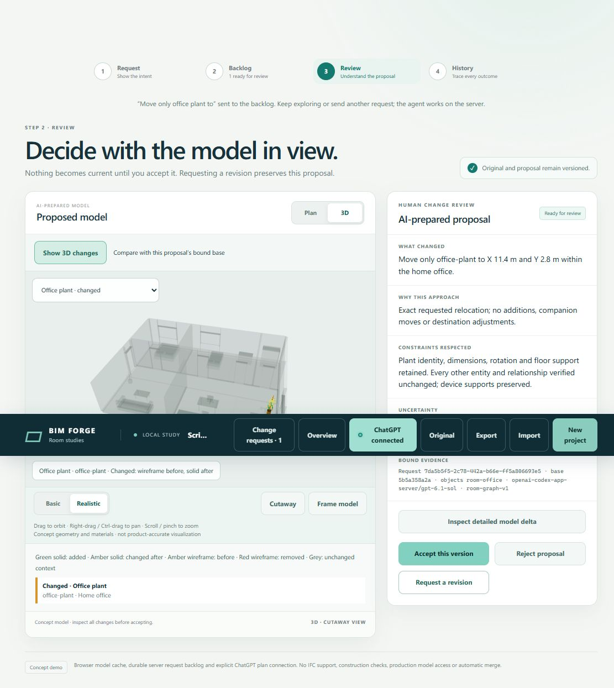
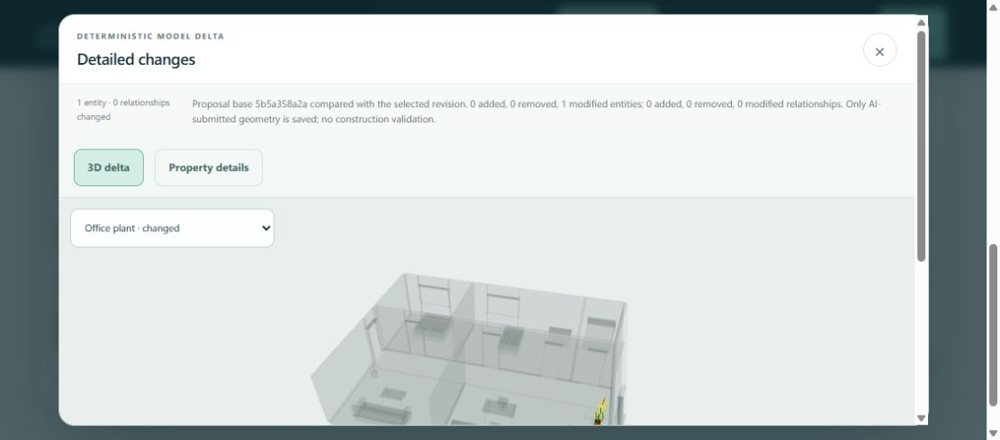

# ScriptBox integration validation

## Scope and result

Issue [103](https://github.com/Frederik91/bim-forge/issues/103) replaces the AI model-authoring tools with ScriptBox and retains the supported product behavior. The baseline is residential-floor commit `10982ab9c97d3bde9c95a7b8515bba39d7c591a7`, not the older `main` branch.

The reviewed runtime commit is `4a9b9af998d7603d315c106ae56f5f76550891e9`. Documentation and screenshots may be committed after that code revision. No validator, review requirement or repository protection was disabled.

## Server-container checks

All application builds and tests ran on the server. The Windows workstation was used for source edits, Git and browser interaction only. The browser reached the candidate through an SSH port forward; the application, ScriptBox and Codex app-server ran in the server container.

The build/test Node image is pinned to `node@sha256:55fb5f5a527ea2c5c4a95f963e48ef90aa38c7b346054fdc8ee9957a2b55d205`.

| Check | Observed result |
| --- | --- |
| `npm run validate` | Passed strict TypeScript source checks, typecheck and policy configuration validation. |
| `npm test` | 330 tests: 328 passed, 0 failed, 2 existing skips. Includes the Babylon browser build and scene tests. |
| Preview Dockerfile build | Passed using the tracked local tarball and production dependencies. No .NET dependency or runtime artifact download. |
| Integration tests inside the production-style image | All 12 passed with networking disabled, non-root user, read-only root, dropped capabilities, 1 GiB memory and the bounded temporary filesystem. |
| Upstream Node package build/check/test | Build, typecheck, lint, Node tests and artifact check passed before packing the pinned upstream commit. |
| Tarball integrity | SHA-256 `f931970b8ba056d457f8b36e1c4c443370bd3e67fd8e8ff975cd11377a82336d`, also protected by the npm lockfile integrity. |

The runtime image is `bim-forge-preview-app:4a9b9af998d7603d315c106ae56f5f76550891e9`, image ID `sha256:3dbc6307177c51a9e1b9c833a0f3034faa0315cd1f632988a18bdd24ffa794d7`.

Reproduce the principal commands in a server build container with the source and installed dependencies mounted at `/app`:

```sh
npm ci --ignore-scripts
npm run validate
npm test
docker build -t bim-forge-preview-app:scriptbox-check -f deploy/preview/Dockerfile .
docker run --rm --network none --cpus=1.5 --memory=1g --pids-limit=128 \
	--user=65032:33 --read-only --cap-drop=ALL \
	--security-opt=no-new-privileges:true \
	--tmpfs /tmp:rw,noexec,nosuid,nodev,size=32m,mode=1777 \
	bim-forge-preview-app:scriptbox-check node --test src/model-script.test.ts
```

`npm run validate` checks policy configuration without inferring a Git diff. The explicit changed-file policy check passed for all 25 changed paths before publication, and `git -c core.whitespace=cr-at-eol diff --check` passed. [Draft PR 104](https://github.com/Frederik91/bim-forge/pull/104) targets the residential-floor branch and awaits maintainer review.

## Feature parity evidence

| Existing behavior | Evidence |
| --- | --- |
| Bound inspection, selection and exact model data | Script tests exercise generated declarations, typed mixed-entity arrays, room membership, clear bounds, doorway connections, units and docs. |
| Rectangular shell and entry changes | Existing room-model tests now use real scripts. Wall/opening identities, hashes, exact fit, invalid geometry and correction assertions remain. |
| Whole-model furnishings and supported devices | Office and visual-request tests preserve six-object creation, freestanding desk creation, desk/monitor/laptop/chair relocation, supports and unrelated items. |
| Room-local changes and explicit transfers | Residential-floor tests retain shared walls, connected rooms, one-room preservation, containment, door clearance and whole-floor transfer assertions. |
| Decline and provider failure | Scripts can return a clarification without history changes. A provider failure after a successful proposal computation publishes nothing. |
| Backlog, retries, revisions and progress | Queue tests cover durable acknowledgement, idempotency, two workers, bounded attempts, revision history, recovery, activity and evidence retention. |
| Cancellation and shutdown | Queue, HTTP, provider startup-race and runtime tests verify attempt-scoped cancellation, late-result rejection, terminal evidence and cleanup. |
| Plan, Babylon rendering and 3D review | Existing scene tests cover basic/realistic modes, selection, camera, openings, derived placement and before/after delta rendering. Live UI checks are described below. |
| Human acceptance and stale bases | Existing acceptance/decision transaction and stale-base assertions remain. No approval or accepted-model write API is registered in the guest. |
| Optional names, account connection and old saved data | Name generation, existing sign-in endpoint tests, historical review names, legacy byte roundtrips and new-evidence acceptance/restoration pass. |

Atomic scripts deliberately replace cross-tool partial drafts. Observation and decline discard staged changes. A final proposal script must perform the complete change from its bound base. The previous executable inspection/preview/submit/decline dispatcher is removed. Historical tool names remain data-only reader support.

## Negative regressions and review findings

The review used two independent agents, one for standards/security and one for the issue requirements. They used the inherited session model; this was not a cross-model-family review.

### Standards

Review found that DEL/C1 text in guest diagnostics could prevent evidence projection, and that saved execution evidence could contradict a successful proposal. The fixes normalize diagnostic text, reject impossible outcome combinations and require matching actual tool evidence with a final completed, validated proposal. Historical records without script evidence retain their previous exact representation.

### Spec

Review found that an ordinary guest exception could hide a preceding host-integrity failure and allow a later script, and that hostile method names could erase failure evidence. Integrity checks now run for every terminal status, fatal authority remains sticky, and rejected names are escaped to bounded ASCII. Terminal execution records are persisted before the aggregate evidence-budget check.

The two runtime regressions failed before the fix, then both passed. The semantic-outcome and invalid-review-trace regressions also failed before their fix. The final full suite passes all of them. The follow-up standards and spec reviews reported no remaining correctness blocker in the changed code.

Additional real-package checks cover write-then-throw rollback, expected validation-error repair, observation/decline isolation, resource-limit rollback, concurrent request cancellation, source hashes, runtime identity and provider-failure rollback. Tests use the real bundled guest, not a mocked sandbox.

## Live UI checks

The candidate uses its own test backlog. The existing shared preview container, its accepted model database and its public address were not replaced.

1. Created an empty room named `ScriptBox server acceptance` through the UI. Submitted an unnamed request for a desk, monitor, laptop, chair, corner table and plant using the existing connected ChatGPT plan. No API key or local application process was used.
2. Observed immediate acknowledgement, a working backlog ticket and the live inspection/validation timeline. The agent recovered from a rejected review-text result by rerunning a complete script. The persisted trace contained inspection, documentation discovery, a discarded execution and a successful proposal.
3. Opened the 3D proposal. The actual delta contained six added furniture entities and no shell change. Explicitly accepted this disposable proposal, reopened the accepted 11-object model, changed rendering mode, opened Plan and selected the desk. The UI remained responsive after acceptance.
4. Created `ScriptBox floor acceptance`, opened the home office in the eight-room floor and requested that only `office-plant` move to `[11.4, 2.8]` metres. The actual detailed delta showed one modified entity and zero relationship changes. Its property table showed `[11.5, 3.3]` before and `[11.4, 2.8]` after. Shell dimensions and hosted openings remained unchanged.
5. Repeated the room-scoped request on the hardened image after the review fixes. Request `7da5b5f5-2c78-442a-b66e-ff5a806693e5` reached ready, produced the same one-entity delta and was explicitly accepted through the UI. The server returned `completed`; its final execution was `completed`, `proposal`, `passed`. Screenshots below are from this hardened-image run.





The initial in-app browser later stopped responding during a project-switch check. The server remained healthy, and the independent Chrome run completed the residential workflow. This is recorded as a browser-observation limitation, not proof of an application defect or proof that every browser configuration is qualified.

The first disposable candidate stored its test backlog in a temporary filesystem. Restarting that container cleared those test records. The hardened candidate uses a separate persistent test directory. No shared-preview project data was removed.

## Boundaries and remaining work

This integration does not add arbitrary graph editing, adjacent-room topology, construction/code validation, discipline-agent auto-approval or external system writes. Those remain separate product capabilities. Heavy geometry and database work belongs behind trusted host APIs, not in guest JavaScript loops.

Sandbox execution is bounded, not a guarantee against defects in QuickJS, WASM or Node. Upstream guest-worker crash injection and additional transport fault tests remain upstream qualification work. This application currently registers synchronous, deterministic model operations and static documentation, and checks cancellation and revocation before draft writes.

The change requires human review for its security boundary, review-evidence representation and new queue table. It must not auto-merge. Replacing the shared preview is a separate maintainer decision.

Older readers reject new script-review fields. Deploy the app and browser bundle together, retain compatible readers when rolling back, and preserve the accepted-model database. This task does not perform a data downgrade or shared-preview deployment.
