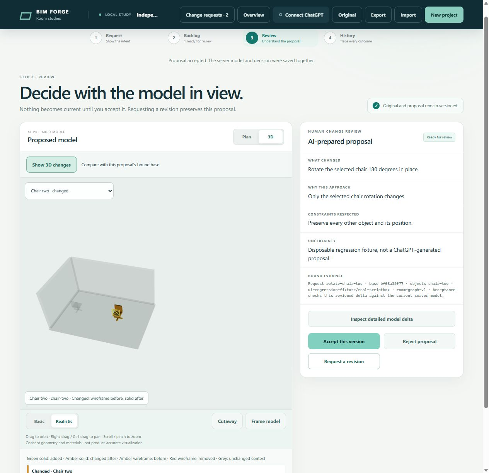
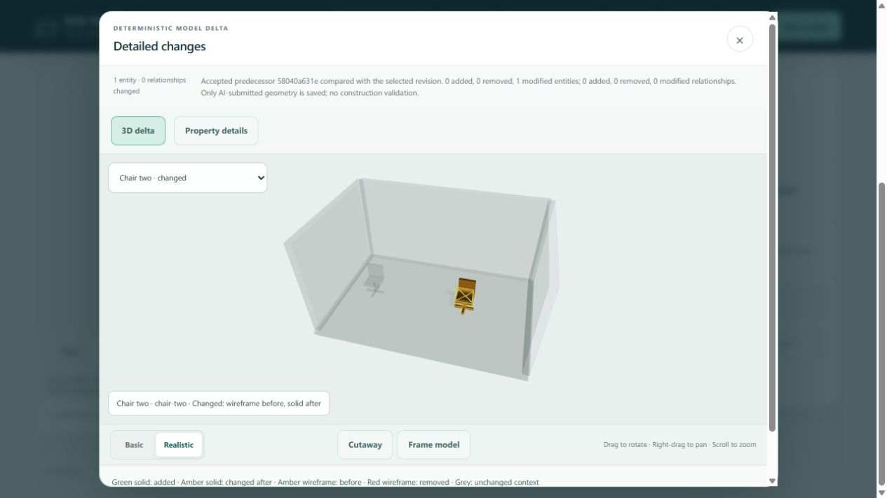

# Independent proposal acceptance

Issue [105](https://github.com/Frederik91/bim-forge/issues/105) fixes a ready proposal becoming unavailable after an unrelated proposal is accepted. The baseline is merged ScriptBox revision `2cab7da1caf5c2ab86d303d57ce03befb4be654e`.

## Cause and change

The backlog marked every other ready request as `needs-input` after acceptance. The decision endpoint also required an exact base match. Different chair identities did not matter.

`RoomRepository.previewAcceptance()` now compares each changed entity and relationship with the bound base and current accepted model. Divergent edits to the same record fail. The complete combined snapshot passes the existing geometry, hosting, room and support validators before acceptance.

`acceptProposal()` retains the original proposal revision, branch, request binding and AI evidence. A rebased human decision records `application.ontoRevisionId` and `application.appliedRevisionId`. The new applied revision descends from the preceding accepted revision. Restore recomputes the combined snapshot and checks its accepted predecessor. No agent receives acceptance authority.

The backlog reassesses compatible results, including requests marked stale by the older release and proposals that finish after another acceptance. The decision transaction still checks the full ticket and current project before committing. Conflicts remain readable and require a resolution. No agent rerun is needed for an independent change.

`reviewAt()` resolves both original proposals and applied revisions. The original proposal compares with its original bound base. The combined accepted revision compares with its accepted predecessor, so the second chair review does not show the first chair as another change.

## Before and after evidence

The focused regression command runs in a server container:

```sh
node --test --test-name-pattern='two independent chair proposals.*both finished' demo/change-requests.test.ts
```

Against the baseline with the new test, the second request fails with `actual: needs-input`, `expected: ready` after acceptance of the first chair. The same regression passes with the fix. A second variant covers the later-finishing proposal. Both variants recover a legacy stale ticket without changing its original review or invoking another agent attempt.

Model tests verify these outcomes:

- Both independent rotations survive acceptance and exact save restoration.
- The second original proposal and review evidence remain unchanged.
- Applied-revision comparison contains only `office-chair`, not the preceding accepted chair edit.
- Divergent rotations of the same chair fail without changing accepted history.
- Individually valid desk and laptop edits fail when their combined support becomes invalid.
- A forged application revision fails restoration.
- Existing request-version, decision replay, concurrent delivery and atomic acceptance assertions still pass.

The full server run contains 334 tests: 332 passed, 2 existing skips, no failures. `npm run validate` passes strict TypeScript, typecheck and policy checks. Captured [validation output](issue-105-validate.log) and [test output](issue-105-tests.log) accompany this report.

## Server-hosted UI evidence

The disposable candidate uses its own database and a loopback-only published port on the server. The browser reaches it through an SSH forward. Its deterministic fixture provider creates both proposals through the real ScriptBox package and production backlog. This is not a fresh ChatGPT-generation test.

1. Import the two-chair fixture and open the backlog with both proposals ready.
2. Review and accept the first proposal.
3. Open the second proposal. Its **Accept this version** button remains enabled.
4. Accept the second proposal without revising or rerunning its request. Both tickets become completed.
5. Restart the candidate, reload the browser, and open the current accepted model. Its review remains associated, and the detailed 3D delta shows one changed entity and zero changed relationships against the accepted predecessor.





The reported real pending request was also checked read-only on the server. Its reviewed rotation is compatible with the current accepted model and changes one chair without relationship changes. No decision, ticket state or model data was written during that check.

## Review and rollout boundary

The Standards review found no blocking violation. It noted possible duplicated acceptance-state mapping as a non-blocking maintenance concern. The Spec review found the applied revision lost its UI review association. That finding is fixed and verified after reload. Both reviewers used the inherited session model.

This change is not merged or installed over the shared preview. PR 104 and npm ScriptBox 0.1.1 are already deployed there. Approval of PR 104 does not approve this separate model-acceptance change.

Deploy the app and browser bundle together after maintainer review. Older readers reject the optional application fields once a rebased proposal is accepted. Preserve the database and compatible readers during rollback. Do not overwrite accepted user work with a pre-release database snapshot.
