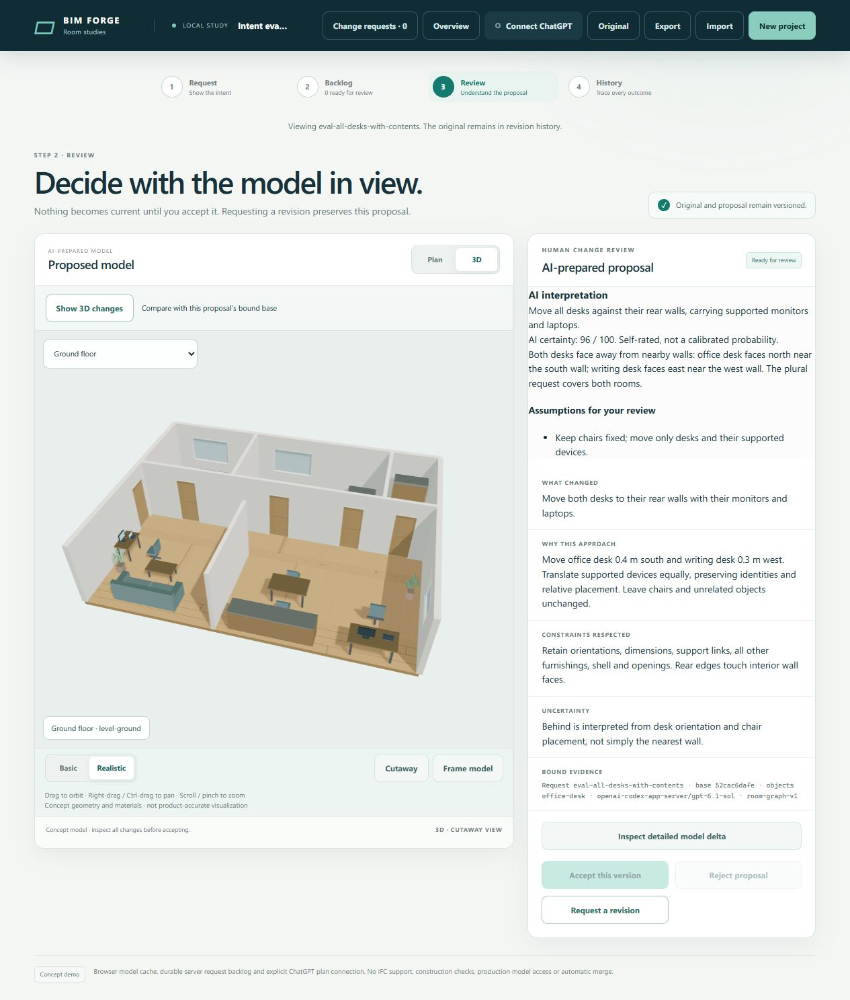

# Intent interpretation and certainty validation

Issue [107](https://github.com/Frederik91/bim-forge/issues/107) changes proposal interpretation and exposes bounded self-rated certainty. The baseline is the deployed ScriptBox 0.1.1 revision `2cab7da1caf5c2ab86d303d57ce03befb4be654e`. This branch does not include or approve PR 106.

## Regression and deterministic checks

The original provider instructions explicitly requested a clarification when a desk move left supported device destinations unclear. A live baseline sample on the residential fixture identified the south wall but declined to ask whether the monitor and laptop should accompany the desk. No geometry proposal was prepared.

The new metadata regression failed before implementation with `Unexpected script decision fields`. It now passes through the real ScriptBox package, explicit acceptance and exact save restoration. A 35/100 assessment does not prevent a valid proposal, and a 100/100 assessment cannot bypass invalid geometry. Missing metadata on a fresh proposal is rejected without inventing a score. Historical saved-review absence remains valid.

The assessment parser also rejects out-of-range or fractional scores, nonnumeric values, unknown fields, excessive text, excessive assumptions, sparse arrays and accessors. Returned data is copied and frozen. A tampered saved score fails restoration.

Server validation and the full application suite pass. The suite contains 333 tests: 331 passed, 2 existing skips, no failures. All 15 sandbox tests also pass in the production-style image with networking disabled, a non-root user, read-only root, dropped capabilities, 1 GiB memory and bounded temporary storage. All builds and tests run in server containers, not the Windows workstation.

Captured [validation output](issue-107-validate.log), [application tests](issue-107-tests.log) and [restricted image tests](issue-107-image-tests.log) accompany this report.

## Live evaluation cases

`scripts/evaluate-model-intent.ts` uses the existing connected account through the production Codex worker and real ScriptBox runtime. The cases use synthetic repository fixtures, not the user's pending requests. No sample is automatically accepted or persisted into the shared preview backlog.

The evaluation covers these outcomes:

| Case | Required evidence |
| --- | --- |
| All desks with contents | Two desks in different rooms and orientations touch their respective rear walls. Four supported devices translate equally, with all other fields and relative offsets preserved. |
| Selected desk against its wall | A proposal instead of a dependency clarification; supported contents follow. |
| Rotated scene | Geometry, not a fixed compass direction or wall name, determines the destination. |
| Plant against a wall | The general interpretation policy works beyond desks. |
| Explicit freestanding point | The marked destination and chair exclusion override defaults. |
| Another desk only | One new desk, no copied devices or chair, and no changed existing furnishings. |
| Choose a reasonable wall | A valid wall-contact proposal with disclosed assumptions instead of unnecessary clarification. |
| Unsupported adjacent-room topology | A decline with the original model preserved. |

These are single stochastic samples per case, not a benchmark or reliability estimate. Preliminary checks exposed contradictory fixture destinations near a fixed chair. Those fixtures were corrected to clear marked points rather than changing production validation. An early replay also found an older artifact left by a failed sample. Qualification now requires a fresh evidence directory, saves each completed output before assertions, and refuses to overwrite files. Stale passing samples cannot mask a later failed output.

The final [live qualification run](issue-107-live-qualified.log) passed all eight cases using `gpt-6.1-sol`. Seven prepared proposals; unsupported topology declined. The [baseline sample](issue-107-live-baseline.log) declined the selected-desk request to ask about its supported devices.

The eight [saved project outputs](issue-107-intent-samples/) pass the shared live and [offline replay assertions](issue-107-replay.log), including 1 mm wall contact and relative translation within `1e-6` metres. Replay does not open an account connection or call a model. Run it in a server build container with dependencies installed:

```sh
node scripts/evaluate-model-intent.ts --replay docs/validation/issue-107-intent-samples
```

Fresh live runs use `node scripts/evaluate-model-intent.ts` with the normal server account connection. Set `BIM_FORGE_INTENT_EVIDENCE_DIRECTORY` to a fresh empty directory to capture outputs. `--case <id>` selects one scenario. Live outputs can vary; a passing captured run does not prove that every future interpretation will be correct.

## Review UI

The server-hosted isolated candidate imports a real successful multi-desk proposal, opens its branch from history, and displays the interpretation, assumptions, evidence basis and self-rated score. The screenshot is from a successful earlier sample with a 96/100 self-rating. The qualification rerun is separate and can yield a different self-rating.



This UI check does not create a shared-preview ticket or accept a user proposal. The candidate is loopback-only on the server and reached through an SSH forward. The public preview remains on the previously approved release.

## Review and rollout boundary

Independent Standards and Spec reviews identified contract and evidence gaps: fresh metadata was optional, the arbitrary-wall check did not prove contact, and supported-device checks omitted rotation. Those are corrected. Live and replay modes now share the same preservation, pending-decision, interpretation and scenario assertions. Reviewers used the inherited session model.

No merge or shared-preview replacement is authorized by this task. After maintainer review, deploy the app and browser bundle together. Older readers reject new `intent` fields. Preserve compatible readers and accepted project data during rollback; do not silently strip review evidence.
